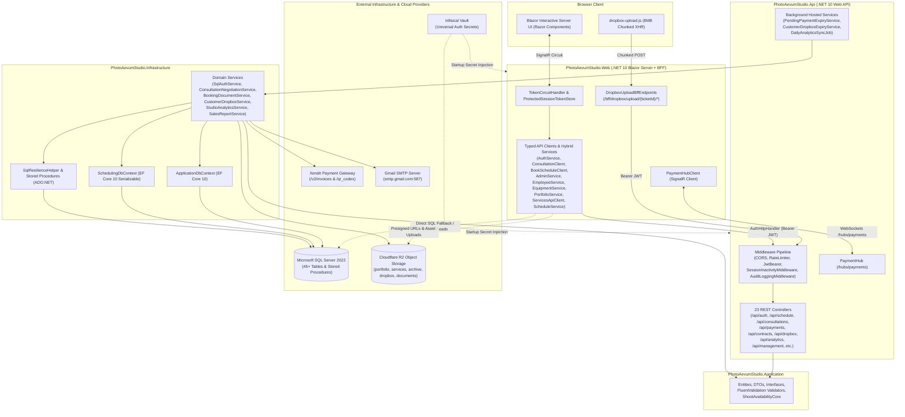

# Photo Aevum Studio — System & Code Documentation

## 1. Major Features

### 1.1 Identity, Role-Based Access Control (RBAC), and Account Lifecycle
- **Multi-Role Authentication & Authorization (`AppRoles`)**: Supports five hierarchical roles: `SystemAdmin` (`SADM-###`), `Admin` (`ADM-###`), `Office Clerk` (`CLK-###` or `EMP-###` with Office Clerk specialization), `Employee` (`EMP-###`), and `Customer` (`CUST-####`).
- **Dual-Store Authentication (`SqlAuthService`, `AuthController`)**: Evaluates credentials against SQL Server tables (`dbo.SystemAdmin`, `dbo.Admin`, `dbo.Employees`, `dbo.Customer`) and ASP.NET Core Identity (`dbo.AspNetUsers`) using BCrypt work-factor 11 (`BCryptPasswordHasher`). Issues HMAC-SHA256 JWT tokens containing `sub`, `email`, `name`, `role`, `studio_id`, `department`, `position`, `specialization`, and `is_first_login` claims.
- **Root Account Protection (`SADM-001`)**: Hard-locks the seeded root system administrator `SADM-001` from modification, password reset via admin management, or deletion across both backend (`AdminManagementService`, `AdminsController`) and frontend (`AdminService`, `UserService`).
- **Cross-Role Email Uniqueness**: Validates that any email address is unique across `dbo.SystemAdmin`, `dbo.Admin`, `dbo.Employees`, `dbo.Customer`, and `dbo.AspNetUsers` before registration or profile update.
- **Customer Registration & OTP Verification**: Two-step customer sign-up (`api/auth/send-verification`, `api/auth/verify-code`, `api/auth/register-customer`) and password reset (`api/auth/forgot-password`, `api/auth/verify-reset-code`, `api/auth/reset-password`) backed by 6-digit random OTP codes cached in `IMemoryCache` for 15 minutes and rate-limited (`AuthVerificationPolicy`, `AuthLoginPolicy`).
- **First-Login Mandatory Password Change & Onboarding Handbook**: Newly created staff and administrators receive deterministic or random temporary passwords (`AdminCredentialGenerator`, `EmployeeCredentialGenerator`) with `isFirstLogin = 1`, plus a welcome email with the dynamic PDF Employee Handbook (`OnboardingDocumentService` via QuestPDF) attached. Login blocks JWT issuance until `api/auth/initial-password-change` is completed.

### 1.2 Service Catalog, Combo Packages, Add-Ons, and Public Portfolio
- **Three-Tier Service Catalog (`ServicesController`, `PackagesController`, `AdditionalServicesController`, `CategoriesController`)**:
  - **Main Services (`dbo.Services`, `SRV-####`)**: Supports `Per Hour`, `Per Session`, `Per Single Shot`, `Per Multi-Shot`, and `Per Picture` rate types, linked to `dbo.ServiceCategory` (`CAT-####`) via `dbo.ServiceCategoryJoins`.
  - **Combo Packages (`dbo.ComboPackage`, `PKG-####`)**: Bundles multiple main services via `dbo.PackageServiceJoins` (`PSJ-########`).
  - **Additional Services / Add-Ons (`dbo.AdditionalServices`, `ADD-####`)**: Standalone add-on services categorized by `CategoryName` and `RateType`.
- **Portfolio & Home Highlights (`PortfolioController`, `PortfolioService`, `dbo.Portfolios`, `dbo.PortfolioCategory`, `dbo.PortfolioImages`, `dbo.HomeHighlights`)**: Manages public portfolio albums (`PRF-####`), categories (`PCAT-####`), featured toggles, and homepage highlight carousels (`HHL-####`) with hybrid storage in Cloudflare R2 (`portfolio` bucket) and SQL Server `varbinary(max)` fallbacks.

### 1.3 Conflict-Aware Consultation Scheduling & Booking Negotiation
- **Serializable Consultation Booking (`ScheduleBookingService`, `ScheduleController`)**: Books 30-minute consultation slots across 9 daily time slots (08:00–16:30) with automatic load-balanced Office Clerk assignment (`OfficeClerkAssignmentResolver`) or explicit clerk selection, operating under `IsolationLevel.Serializable` with `UPDLOCK, HOLDLOCK` range locks and `rowversion` optimistic concurrency.
- **Shoot & Crew Availability Engine (`ShootAvailabilityCore`, `BookingWizardEngine`)**: Pure functional scheduling engine enforcing studio operating hours (08:00 AM–08:00 PM), a 2-hour preparation buffer (`PrepBufferMinutes = 120`), and a 1-hour post-event buffer (`PostBufferMinutes = 60`). Evaluates minute-granularity intervals, crew days off, approved leaves, and same-day full-calendar-day equipment locks.
- **Consultation Negotiation Workflow (`ConsultationNegotiationService`, `ConsultationsController`)**: Tracks negotiations (`NEG-####` in `dbo.BookingNegotiation`), generates deterministic Google Meet / Zoom links (`GoogleMeetAdapter`), records negotiation outcomes (`Pending_Call`, `Deal_Won`, `Deal_Lost`, `Rescheduled`, `Pending Payment`, `Appointment Booked`, `Cancelled`), and converts won negotiations into `dbo.EventAppointment` (`EVT-####`) records with assigned crew (`dbo.EventEmployee`, including `IsTeamLeader`), equipment (`dbo.EventEquipment`), and line items (`dbo.EventLineItem`).

### 1.4 Clickwrap Contracts, Two-Stage Xendit Payments, and Real-Time Notifications
- **Clickwrap Contracts & PDF Receipts (`BookingDocumentService`, `DocumentPdfService`, `ContractsController`)**: Seeds and versions studio legal terms (`dbo.TermsVersions`), configures per-booking contracts (`dbo.BookingContracts`, `CTR-YYYY-######`), records customer clickwrap acceptance (`AcceptedTermsCheckbox`, `AcceptedPrivacyCheckbox`, IP address, User-Agent, SHA-256 contract snapshot hash), and generates QuestPDF documents stored in Cloudflare R2 (`documents` bucket) for contracts and Official Receipts (`OR-DP-YYYY-######`, `OR-FP-YYYY-######`).
- **Two-Stage Payment Lifecycle & Xendit Integration (`XenditPaymentService`, `PaymentsController`)**:
  - **Stage 1 (15% Reservation Fee / Downpayment)**: Calculates 15% deposit (`Math.Round(total * 0.15m, 2, MidpointRounding.AwayFromZero)`), creates Xendit invoices (`/v2/invoices`) and dynamic QR Ph codes (`/qr_codes`), enforces a 12-hour payment deadline (`PendingPaymentExpiryService`) with a one-time 6-hour extension (`RequestExtensionAsync`), and requires clickwrap contract acceptance prior to payment verification.
  - **Stage 2 (85% Final Settlement & On-Site Overtime)**: Computes final balance (`TotalAmount - DownpaymentAmount + ExtraCharges`) including overtime hours (`OvertimeHours * OvertimeHourlyRate`, default `₱2,500/hr`), supports Xendit QR/Invoice or On-Site Cash collection by Team Leaders (`LogEmployeeCashAsync`), and requires Admin remittance verification (`ApproveRemittanceAsync`, `VerifyCashSettlementAsync`).
- **Real-Time SignalR Event Bus (`PaymentHub`, `SignalRPaymentNotifier`, `PaymentHubClient`)**: Broadcasts `PaymentCompleted`, `BookingExpired`, and `EventStatusChanged` events across `booking:{id}`, `customer:{id}`, `staff:{id}`, and `live-monitor` groups.

### 1.5 Live On-Site Event Execution, Team Leader Controls, and Equipment Maintenance
- **Team Leader Execution Pipeline (`ConsultationNegotiationService`, `PaymentsController`)**: Enforces strict state machine transitions (`Confirmed` → `Preparation` → `Dispatch` → `Ongoing` → `Event Done` → `Payment Verification (Cash)` / `Payment Verification (QR:Pending Payment)` → `Complete` → `Delivered`).
- **Crew Verification & Replacement Requests**: Team Leaders verify crew attendance on-site (`VerifyCrewDutyAsync`) or submit replacement requests (`RequestCrewReplacementAsync`) that Admins fulfill (`FulfillCrewReplacementAsync`) or reject (`RejectCrewReplacementAsync`).
- **Equipment Dispatch & Maintenance Sync (`EquipmentService`, `EquipmentsController`, `EquipmentTypesController`)**: Tracks physical gear (`EQP-####`) and types (`EQT-####`), records physical gear pickup (`MarkEquipmentTakenAsync`), handles extra equipment requests (`SubmitEquipmentRequestAsync`, `ReviewEquipmentRequestAsync`), and synchronizes maintenance schedules (`dbo.MaintenanceSchedule`) with equipment status (`Available`, `Maintenance`, `Archived`).

### 1.6 Workforce Management: DOLE-Compliant Timesheets & Statutory Leave Ledger
- **DOLE Labor Code Article 88 Timesheets (`TimesheetController`, `EmployeeTimesheet`)**: Tracks daily punches (`ClockIn`, `ClockOut`, `TotalHours`) in Philippine Standard Time (`UTC+8`). Enforces strict non-offsetting between undertime and overtime (`ApplyDoleShiftMinutes`, 480-minute standard shift) for rank-and-file Office Clerks (`IsTitleIExempt = false`), while marking field production crew as Title I exempt (`IsTitleIExempt = true`). Supports admin punch adjustments (`AdjustTimesheetPunch`) and overtime approval (`ApproveOvertime`).
- **Philippine Statutory Leave Management (`LeavesController`, `EmployeeLeave`, `LeaveType`, `LeaveBalance`)**: Seeds 9 leave types (`VL`, `SL`, `LWOP`, `UNAVAIL`, `MAT`, `PAT`, `SPL`, `VAWC`, `EMERG`), excludes employee rest days (`DaysOff`) and 2026 Philippine Regular/Special Non-Working Holidays (`PhilippineHolidays.Holidays2026`) when computing `DaysDeducted`, and enforces an 80% maximum concurrent workforce absence cap per date.

### 1.7 Chunked Customer Dropbox Deliverables & Cold Data Archiving
- **Deliverables Unlock Gating & 500 MB Chunked ZIP Upload (`CustomerDropboxService`, `CustomerDropboxController`, `DropboxChunkUploadCoordinator`, `DropboxUploadBffEndpoints`)**: Unlocks digital deliverables only when Stage 1 + Stage 2 payments are cleared (`RemainingBalance == 0`). Supports multi-part chunked ZIP uploads (up to 500 MB per file, 8 MB chunks) through a ticket-authenticated BFF proxy (`/bff/dropbox/upload/{ticketId}/*`) into Cloudflare R2 (`dropbox` bucket), generates 15-minute presigned download URLs, emails customers upon upload, and auto-purges expired archives after 60 days (`CustomerDropboxExpiryService`).
- **Cold Data Archiving (`DataArchiveService`, `dbo.ArchiveIndex`)**: Serializes historical records older than the retention window into GZip-compressed JSON blobs in Cloudflare R2 (`archive` bucket).

### 1.8 Four-Tier Studio Analytics & Sales Reporting
- **Descriptive, Diagnostic, Predictive, and Prescriptive Analytics (`StudioAnalyticsService`, `StudioAnalyticsCalculator`, `BookingPredictionService`, `WorkflowActionEngine`, `DailyAnalyticsSyncJob`, `AnalyticsController`)**: Computes revenue, payment recovery, utilization, cancellation rate, equipment/workforce ratios, linear-regression 6-month booking/revenue forecasts with seasonal multipliers, and idempotent prescriptive workflow actions persisted in `dbo.StudioAnalyticsActions`.
- **Sales Ledger & Monthly Executive Reports (`SalesReportService`, `SalesReportsController`)**: Aggregates cleared and pending payment transactions (`TXN-####` / `INV-YYYY-####`), supports manual sale recording and CSV export, and computes weekday/time-slot booking heatmaps and equipment utilization metrics.

---

## 2. Technologies Used

### 2.1 Languages, Frameworks, and Runtime Versions
| Category | Technology | Version / Target | Usage in Codebase |
| :--- | :--- | :--- | :--- |
| Runtime & SDK | .NET / C# | `net10.0` (C# 13, Nullable enabled, ImplicitUsings enabled) | Target framework across all backend and frontend projects (`Directory.Build.props`) |
| Backend Web Framework | ASP.NET Core Web API | `Microsoft.NET.Sdk.Web` (`net10.0`) | REST API controllers, SignalR hubs, middleware, background hosted services (`PhotoAevumStudio.Api`) |
| Frontend Web Framework | ASP.NET Core Blazor Interactive Server | `Microsoft.NET.Sdk.Web` (`net10.0`) | Server-rendered interactive Razor components, SignalR circuit management, BFF endpoints (`PhotoAevumStudio.Web`) |
| Database Query Language | Transact-SQL (T-SQL) | SQL Server 2022 | Schema DDL, stored procedures (`PhotoAevumStudioStoredProcedures.sql`), and parameterized ADO.NET queries |
| Scripting & E2E Tooling | Python / PowerShell / JavaScript | Python 3, PowerShell 5.1+, ES6 JS | E2E verification suite (`tests/*.py`), test runner (`tests/run_tests.ps1`), browser chunked XHR uploader (`wwwroot/js/dropbox-upload.js`) |

### 2.2 Databases, ORMs, and Storage Layers
| Layer | Technology / Package | Version | Usage in Codebase |
| :--- | :--- | :--- | :--- |
| Primary Relational DBMS | Microsoft SQL Server | SQL Server 2022 (`mssql/server:2022-latest` in CI, MonsterASP SQL Server in prod) | Stores all 45+ operational, scheduling, identity, contract, and analytics tables |
| ORM (Primary & Scheduling) | Entity Framework Core (`Microsoft.EntityFrameworkCore.SqlServer`) | `10.0.5` | `ApplicationDbContext` (Identity + 25 DbSets) and `SchedulingDbContext` (Serializable consultation booking) |
| Identity Store | ASP.NET Core Identity (`Microsoft.AspNetCore.Identity.EntityFrameworkCore`) | `10.0.5` | `ApplicationUser` and `IdentityRole` persistence |
| Low-Level Data Access | ADO.NET (`Microsoft.Data.SqlClient`) | `6.1.1` (Infrastructure) / `6.1.4` (Web) | Stored procedure execution and schema-resilient SQL queries via `SqlResilienceHelper` |
| Cloud Object Storage | Cloudflare R2 (`AWSSDK.S3`) | `4.0.104.6` | S3-compatible object storage across 5 buckets: `portfolio`, `services`, `archive`, `dropbox`, `documents` |
| In-Memory Caching | `Microsoft.Extensions.Caching.Memory` & `ConcurrentDictionary` | Built-in (`net10.0`) | OTP verification codes, chunk upload sessions, upload tickets, and 30s/60s catalog/schedule caches |
| Browser Session Storage | `ProtectedSessionStorage` & `ProtectedLocalStorage` | Built-in (`net10.0`) | Encrypted client-side JWT persistence (`ProtectedSessionTokenStore`) with persisted DataProtection keys (`App_Data/DataProtectionKeys`) |

### 2.3 Libraries, SDKs, APIs, and External Services
| Library / External Service | Package / Endpoint | Version | Purpose |
| :--- | :--- | :--- | :--- |
| Secrets Management | `Infisical.IConfigurationProvider` | `0.0.2` | Fetches runtime secrets from Infisical (`https://app.infisical.com`) via Universal Auth |
| Authentication / JWT | `Microsoft.AspNetCore.Authentication.JwtBearer` & `System.IdentityModel.Tokens.Jwt` | `10.0.5` / `8.16.0` | JWT Bearer token generation, validation, and SignalR query-string token extraction |
| Password Hashing | `BouncyCastle.Cryptography` (`OpenBsdBCrypt`) | `2.6.2` | BCrypt (`2a`, cost factor 11) password hashing and verification |
| Validation | `FluentValidation`, `FluentValidation.DependencyInjectionExtensions` | `12.1.1` / `11.11.0` | Request DTO validation and password policy enforcement |
| PDF Generation | `QuestPDF` | `2026.9.2` | Generates Employee/Admin Handbooks, Terms & Conditions, Booking Contracts, and Official Receipts |
| Email Delivery | `MailKit` / `MimeKit` & Gmail SMTP | `4.15.1` | Sends OTP emails, welcome emails with PDF attachments, booking confirmations, and Dropbox alerts (`smtp.gmail.com:587`) |
| Payment Gateway | Xendit REST API (`HttpClient`) | API v2 / `2022-07-31` | Creates Invoices (`https://api.xendit.co/v2/invoices`), QR Ph codes (`/qr_codes`), and processes webhooks |
| Real-Time Messaging | ASP.NET Core SignalR (`Microsoft.AspNetCore.SignalR.Client`) | `10.0.5` | Real-time payment and event status push notifications (`/hubs/payments`) |
| API Documentation | `Swashbuckle.AspNetCore` | `10.1.5` | OpenAPI / Swagger UI generation in Development |
| UI Styling | Bootstrap 5 & Scoped Blazor CSS | Bootstrap 5.3 | Responsive layout, modals, drawers, and custom studio styling |

### 2.4 Build Tools, Testing Frameworks, and Deployment/Hosting Configs
| Tool / Config | Technology | Details Observed in Codebase |
| :--- | :--- | :--- |
| Build & Package Management | MSBuild / .NET CLI (`Directory.Build.props`) | Enforces deterministic builds (`Deterministic=true`), `AnalysisLevel=latest-recommended`, and `NuGetAuditMode=direct` |
| Unit & Component Testing | xUnit (`2.9.3`), bUnit (`2.6.2`), Moq (`4.20.72`), EF Core InMemory (`10.0.5`), coverlet (`6.0.4`) | `PhotoAevumStudio.Infrastructure.Tests` (15 test files) and `PhotoAevumStudio.Web.Tests` (42 test files) |
| Live E2E Test Suite | Python `unittest` / `requests` / `pyodbc` | `tests/run_antigravity_tests.py` and 5 E2E verification modules |
| CI/CD & Hosting | GitHub Actions (`.github/workflows/deploy.yml`) & MonsterASP.NET | Builds, tests against a SQL Server 2022 container, injects Infisical secrets into `appsettings.Production.json`, and deploys via FTPS (`SamKirkland/FTP-Deploy-Action@v4.3.5`) to `api-photoaevum.tryasp.net` and `photoaevum.tryasp.net` |

---

## 3. System Architecture

### 3.1 Architectural Style & Pattern
Photo Aevum Studio implements a **Clean / Layered Architecture** on the backend paired with an **Interactive Blazor Server Frontend (with Backend-for-Frontend / BFF extensions)**:
1. **Presentation & BFF Layer (`PhotoAevumStudio.Web`)**: Interactive Server Razor components, circuit-scoped state services, SignalR client (`PaymentHubClient`), and BFF minimal API endpoints (`/bff/dropbox/upload/{ticketId}/*`) that stream large file chunks without exposing raw JWTs to browser JavaScript.
2. **API Gateway & Real-Time Layer (`PhotoAevumStudio.Api`)**: 23 REST controllers, SignalR hub (`PaymentHub`), custom middleware (`SessionInactivityMiddleware`, `AuditLoggingMiddleware`), background hosted workers (`PendingPaymentExpiryService`, `CustomerDropboxExpiryService`, `DailyAnalyticsSyncJob`), and analytics engines.
3. **Application Core Layer (`PhotoAevumStudio.Application`)**: Domain entities, DTOs, service interfaces, FluentValidation validators, pure scheduling math (`ShootAvailabilityCore`), and credential generators. Contains zero dependencies on database drivers or cloud SDKs.
4. **Infrastructure & Persistence Layer (`PhotoAevumStudio.Infrastructure`)**: Concrete implementations of all application interfaces, hybrid data access (`ApplicationDbContext`, `SchedulingDbContext`, and `SqlResilienceHelper` ADO.NET stored procedure/query execution), Cloudflare R2 S3 client (`R2StorageService`), Xendit HTTP integration (`XenditPaymentService`), SMTP client (`EmailService`), and QuestPDF rendering (`DocumentPdfService`, `OnboardingDocumentService`).

### 3.2 Data Flow and Control Flow Across Modules/Layers
1. **Authentication & Circuit Token Flow**:
   - User submits credentials in `Login.razor` → `AuthService.LoginAsync` → `POST api/auth/login` → `AuthController` → `SqlAuthService.LoginAsync`.
   - Upon validation, `AuthController` signs a JWT and returns `LoginResponse`.
   - `AevumAuthenticationStateProvider.NotifyUserLoginAsync` stores the JWT in `ProtectedSessionTokenStore` (backed by `ProtectedSessionStorage`, `ProtectedLocalStorage`, and an `AsyncLocal<string?>` ambient token bound per circuit inbound activity by `TokenCircuitHandler`).
   - Subsequent outbound HTTP calls from Blazor services pass through `AuthHttpHandler`, which reads the circuit's ambient token and attaches `Authorization: Bearer <token>`.
2. **Consultation to Event Booking & Payment Flow**:
   - Customer selects services and requests a consultation slot → `BookScheduleClient.BookAsync` → `POST api/schedule/bookings` → `ScheduleBookingService.CreateBookingAsync` executes a `SERIALIZABLE` transaction on `SchedulingDbContext` and mirrors the inquiry into `dbo.BookingNegotiation` (`NEG-####`).
   - Office Clerk conducts consultation and converts a won deal → `ConsultationClient.CreateEventAppointmentAsync` → `POST api/consultations/{id}/create-event` → `ConsultationNegotiationService.CreateEventAppointmentAsync` validates buffer-aware crew/equipment conflicts (`ShootAvailabilityCore`), inserts `dbo.EventAppointment` (`EVT-####`), `dbo.EventEmployee`, `dbo.EventEquipment`, `dbo.EventLineItem`, generates a Xendit 15% reservation invoice/QR, and creates a draft `dbo.BookingContracts` record.
   - Customer accepts the clickwrap contract (`POST api/contracts/{appointmentId}/accept`) and completes payment via Xendit QR/Invoice (`POST api/payments/webhook` or `verify-downpayment`).
   - `ConsultationNegotiationService` marks `DownpaymentStatus = 'Paid'`, transitions `EventStatus = 'Confirmed'`, generates the Stage 1 Official Receipt PDF (`BookingDocumentService.RecordVerifiedPaymentAndIssueReceiptAsync`), and triggers `SignalRPaymentNotifier` → `PaymentHub` → `PaymentHubClient` in Blazor.
3. **On-Site Execution & Deliverables Delivery Flow**:
   - Team Leader advances the event through `Preparation` → `Dispatch` (marking equipment taken) → `Ongoing` (verifying crew attendance) → `Event Done`.
   - Stage 2 (85% final settlement + overtime) is settled via Xendit QR or Cash Remittance approved by Admin, issuing the Stage 2 Official Receipt PDF and setting `EventStatus = 'Complete'`.
   - Staff uploads event ZIP archives in `UploadEventCustomer.razor` → browser JS (`dropbox-upload.js`) slices the file into 8 MB chunks → `DropboxUploadBffEndpoints` (`/bff/dropbox/upload/{ticketId}/*`) forwards chunks to `CustomerDropboxController` → `DropboxChunkUploadCoordinator` reassembles the file in background, uploads to Cloudflare R2 (`dropbox` bucket), records `dbo.CustomerDropbox` & `dbo.CustomerDropboxFiles`, and transitions `EventStatus = 'Delivered'`.

### 3.3 Key Integrations, Configuration/Secrets Handling, and Cross-Cutting Concerns
- **Infisical Secret Injection**: Both `PhotoAevumStudio.Api/Program.cs` and `PhotoAevumStudio.Web/Program.cs` load `.env` files (walking up to 5 parent directories), connect to Infisical (`AddInfisical`) when `INFISICAL_CLIENT_ID`, `INFISICAL_CLIENT_SECRET`, and `INFISICAL_PROJECT_ID` are present, and normalize double-underscore (`__`) keys into colon-delimited (`:`) ASP.NET Core configuration keys.
- **Database Schema Self-Healing & Resilience (`SqlResilienceHelper`, `EnsureSchemaAsync`)**: Connects with `ConnectRetryCount=3`, `ConnectRetryInterval=5`, and `CommandTimeout=45`. Transient SQL error numbers (`-2, 20, 64, 233, 10053, 10054, 10060, 40197, 40501, 40613, 49918, 49919, 49920`) are automatically retried with exponential backoff. Services also run idempotent `IF OBJECT_ID(...) IS NULL` / `IF COL_LENGTH(...) IS NULL` guards so schema additions never fail against older databases.
- **Cross-Cutting Middleware & Security**:
  - `SessionInactivityMiddleware`: Enforces a 30-minute sliding inactivity timeout per authenticated user in `IMemoryCache`, returning HTTP `401` with `X-Session-Expired: Inactivity` if idle.
  - `AuditLoggingMiddleware`: Intercepts mutating requests (`POST`, `PUT`, `PATCH`, `DELETE`), scrubs sensitive fields (`password`, `token`, `secret`), and writes audit records to `dbo.AuditLogs` and `dbo.HistoryLog`.
  - **Rate Limiting**: Partitioned IP rate limiters protect `/api/auth/send-verification` (`AuthVerificationPolicy`, 5 req / 5 min) and `/api/auth/login` (`AuthLoginPolicy`, 10 req / 1 min).

### 3.4 System Architecture & Data-Flow Diagram

---

## 4. File-by-File Code Documentation

### File: `Directory.Build.props`
- **Summary:** Root MSBuild properties file applied to all `.csproj` projects in the repository.
- **Purpose / Use:** Centralizes compiler determinism, code analysis level, and NuGet security auditing settings across backend, frontend, and test projects.
- **Why It Is Used (Design Rationale):** Eliminates configuration drift across multiple `.csproj` files by enforcing uniform build standards at the solution root.
- **Technologies & Dependencies:** MSBuild XML schema.
- **Functions / Classes / Methods:** Declarative MSBuild `<PropertyGroup>`: `Deterministic` (`true`), `AnalysisLevel` (`latest-recommended`), `EnforceCodeStyleInBuild` (`false`), `NuGetAudit` (`true`), `NuGetAuditMode` (`direct`), `NuGetAuditLevel` (`high`).
- **Programming Logic:** Automatically imported by MSBuild before each project file is evaluated.
- **How It Is Implemented:** Standard MSBuild `Directory.Build.props` XML file at the repository root.
- **Validation:** Enables `NuGetAudit` at level `high` for direct package dependencies.
- **Error Handling:** Not observed in provided code (declarative build file).

---

### File: `.github/workflows/deploy.yml`
- **Summary:** GitHub Actions CI/CD workflow for building, testing, and deploying both the Backend API and Blazor Frontend to MonsterASP.NET via FTPS.
- **Purpose / Use:** Automates continuous integration (with a live SQL Server 2022 service container) and zero-downtime FTPS deployment (`app_offline.htm` lifecycle) on pushes to `main` or manual `workflow_dispatch`.
- **Why It Is Used (Design Rationale):** Ensures every deployment passes schema initialization, stored procedure creation, unit tests, and Infisical secret injection before publishing artifacts to production servers.
- **Technologies & Dependencies:** GitHub Actions (`ubuntu-latest`), `mcr.microsoft.com/mssql/server:2022-latest`, `actions/checkout@v4`, `actions/setup-dotnet@v4` (`.NET 10.0.x`), `mssql-tools18` (`sqlcmd`), `jq`, `curl`, `lftp`, `SamKirkland/FTP-Deploy-Action@v4.3.5`.
- **Functions / Classes / Methods:**
  - Job `build-and-test`: Provisions SQL Server 2022 on port `1433`, executes `database/PhotoAevumStudioDatabase.sql` and `database/PhotoAevumStudioStoredProcedures.sql`, runs `dotnet test` for `PhotoAevumStudio.Infrastructure.Tests` and `PhotoAevumStudio.Web.Tests`, publishes both apps in `Release` mode, authenticates against Infisical Universal Auth API (`/api/v1/auth/universal-auth/login`) to generate `appsettings.Production.json`, and uploads artifacts.
  - Job `deploy-api`: Downloads `api-publish`, uploads `app_offline.htm` via `lftp`, deploys files via FTPS to `FTP_SERVER_API`, removes `app_offline.htm`, and warms up `https://api-photoaevum.tryasp.net/health`.
  - Job `deploy-frontend`: Downloads `frontend-publish`, deploys via FTPS to `FTP_SERVER_FRONTEND`, and verifies HTTP status (`200`/`302`) on `https://photoaevum.tryasp.net`.
- **Programming Logic:** Executes `build-and-test` first; `deploy-api` and `deploy-frontend` run conditionally (`if: github.ref == 'refs/heads/main' || github.event_name == 'workflow_dispatch'`) with `needs: build-and-test`.
- **How It Is Implemented:** Multi-job YAML workflow using bash steps, `sqlcmd` retry loops, and `jq` JSON generation.
- **Validation:** Verifies that critical secrets (`DB_CONNECTION_STRING`, `JWT_KEY`, `R2_ACCESS_KEY`, `R2_SECRET_KEY`) are non-empty before writing `appsettings.Production.json`, and polls `/health` for up to 10 attempts after deploy.
- **Error Handling:** Exits with status code `1` if SQL Server fails to start within 30 attempts, if critical secrets are missing, or if post-deploy health checks do not return HTTP 200/302/404.

---

### File: `PhotoAevumStudioBackend/PhotoAevumStudio.Api/PhotoAevumStudio.Api.csproj`
- **Summary:** Project file for the ASP.NET Core Web API (`PhotoAevumStudio.Api`).
- **Purpose / Use:** Declares target framework (`net10.0`), user secrets ID, NuGet packages, and project references to `PhotoAevumStudio.Application` and `PhotoAevumStudio.Infrastructure`.
- **Why It Is Used (Design Rationale):** Encapsulates HTTP presentation, middleware, SignalR hubs, and background hosted services separately from domain and persistence libraries.
- **Technologies & Dependencies:** `net10.0`, `Infisical.IConfigurationProvider` (`0.0.2`), `Microsoft.AspNetCore.Authentication.JwtBearer` (`10.0.5`), `Microsoft.AspNetCore.OpenApi` (`10.0.2`), `Microsoft.EntityFrameworkCore.Design` (`10.0.5`), `Microsoft.EntityFrameworkCore.SqlServer` (`10.0.5`), `Swashbuckle.AspNetCore` (`10.1.5`), `FluentValidation.DependencyInjectionExtensions` (`11.11.0`).
- **Functions / Classes / Methods:** MSBuild `<Project Sdk="Microsoft.NET.Sdk.Web">` definition.
- **Programming Logic:** Configures `<InvariantGlobalization>false</InvariantGlobalization>` to support full culture and timezone formatting.
- **How It Is Implemented:** Standard SDK-style `.csproj`.
- **Validation:** Not observed in provided code.
- **Error Handling:** Not observed in provided code.

---

### File: `PhotoAevumStudioBackend/PhotoAevumStudio.Api/appsettings.json`
- **Summary:** Base JSON configuration file for `PhotoAevumStudio.Api`.
- **Purpose / Use:** Defines default structure and placeholder keys for logging, SQL connection strings, JWT settings, storage, SMTP, Xendit, Cloudflare R2 buckets, onboarding documents, and CORS origins.
- **Why It Is Used (Design Rationale):** Provides safe non-secret defaults in source control while allowing environment variables, user secrets, or Infisical to override sensitive values at runtime.
- **Technologies & Dependencies:** ASP.NET Core `IConfiguration` JSON provider.
- **Functions / Classes / Methods:** Configuration sections: `Logging`, `ConnectionStrings:DefaultConnection`, `Jwt` (`Key`, `Issuer`, `Audience`), `Storage` (`Provider`, `LocalBasePath`, `BaseUrl`), `EmailSettings`, `EmailConfig`, `OnboardingDocuments`, `Xendit`, `CloudflareR2` (`AccountId`, `AccessKey`, `SecretKey`, `ServiceUrl`, `PublicUrl`, `Buckets` for `Portfolio`, `Services`, `Archive`, `Dropbox`, `Documents`), `Cors:AllowedOrigins`.
- **Programming Logic:** Loaded automatically by `WebApplication.CreateBuilder(args)` and overridden by higher-priority configuration sources.
- **How It Is Implemented:** Hierarchical JSON file.
- **Validation:** Validated at startup in `Program.cs` (e.g., rejects `"PLACEHOLDER"` for `DefaultConnection` and `Jwt:Key`).
- **Error Handling:** Not observed in provided code.

---

### File: `PhotoAevumStudioBackend/PhotoAevumStudio.Api/Program.cs`
- **Summary:** Composition root, dependency injection configuration, middleware pipeline, and startup initializer for the Backend Web API.
- **Purpose / Use:** Bootstraps Infisical secrets, configures EF Core DbContexts, Identity, JWT authentication, CORS, rate limiters, application/infrastructure services, hosted background workers, SignalR hubs, and database seeding.
- **Why It Is Used (Design Rationale):** Centralizes application startup wiring and ensures consistent cross-cutting policies (authentication, rate limiting, audit logging, and database initialization).
- **Technologies & Dependencies:** `Infisical.IConfigurationProvider`, `Microsoft.EntityFrameworkCore`, `Microsoft.AspNetCore.Identity`, `Microsoft.AspNetCore.Authentication.JwtBearer`, `FluentValidation`, `PhotoAevumStudio.Application`, `PhotoAevumStudio.Infrastructure`, `PhotoAevumStudio.Api.*`.
- **Functions / Classes / Methods:**
  - Top-level startup script and `public partial class Program` (exposed for `WebApplicationFactory` integration tests).
  - Anonymous `/health` endpoint (`GET /health`) verifying database connectivity (`CanConnectAsync()`).
- **Programming Logic:**
  1. Walks up parent directories to load `.env` variables if not already set.
  2. Connects to Infisical (`builder.Configuration.AddInfisical(...)`) if credentials are present, then normalizes `__` keys into `:` keys.
  3. Configures Kestrel and IIS `MaxRequestBodySize` (`536_870_912` bytes / 512 MB) and `MultipartBodyLengthLimit` for large ZIP uploads.
  4. Resolves `DefaultConnection` from 5 fallback keys and registers `ApplicationDbContext` and `SchedulingDbContext` with `EnableRetryOnFailure(maxRetryCount: 5, maxRetryDelay: 10s)`.
  5. Registers ASP.NET Core Identity with `BCryptPasswordHasher<ApplicationUser>` and `CustomIdentityErrorDescriber`.
  6. Configures JWT Bearer authentication (extracting `access_token` from query string for `/hubs/payments` SignalR requests) and Role claim mapping.
  7. Registers `FrontendPolicy` CORS and partitioned IP rate limiters (`AuthVerificationPolicy`, `AuthLoginPolicy`).
  8. Registers all scoped, singleton, and hosted services (`PendingPaymentExpiryService`, `CustomerDropboxExpiryService`, `DailyAnalyticsSyncJob`).
  9. Applies middleware in order: ExceptionHandler (`/error`), Swagger (Development), HTTPS Redirection (Production), StaticFiles, Routing, CORS, RateLimiter, Authentication, `SessionInactivityMiddleware`, Authorization, `AuditLoggingMiddleware`, Controllers, `/health`, and `PaymentHub` (`/hubs/payments`).
  10. Executes `DatabaseSeeder.SeedAsync` and `SchedulingSchema.EnsureCreatedAsync` on startup.
- **How It Is Implemented:** Top-level C# statements using `WebApplication.CreateBuilder(args)`.
- **Validation:** Throws `InvalidOperationException` at startup if `DefaultConnection` is missing/placeholder or if `Jwt:Key` is missing, `"PLACEHOLDER"`, or shorter than 32 bytes.
- **Error Handling:** Catches Infisical initialization exceptions in non-production environments and logs warnings; catches startup seeding exceptions via `ILogger<Program>` so transient DB warm-up delays do not crash the host process.

---

### File: `PhotoAevumStudioBackend/PhotoAevumStudio.Api/Analytics/ETL/DailyAnalyticsSyncJob.cs`
- **Summary:** Background hosted service (`BackgroundService`) that periodically refreshes studio analytics snapshots and logs ETL health metrics.
- **Purpose / Use:** Runs an automated analytics ETL cycle 20 seconds after startup and every 6 hours thereafter across the trailing 6-month window.
- **Why It Is Used (Design Rationale):** Decouples periodic analytics aggregation and anomaly checking from interactive HTTP requests.
- **Technologies & Dependencies:** `Microsoft.Extensions.Hosting.BackgroundService`, `IServiceScopeFactory`, `IStudioAnalyticsService`, `ILogger<DailyAnalyticsSyncJob>`.
- **Functions / Classes / Methods:**
  - `ExecuteAsync(CancellationToken stoppingToken)`: Delays 20s, runs `RunSyncCycleAsync`, then loops on a 6-hour `PeriodicTimer`.
  - `RunSyncCycleAsync(CancellationToken ct)`: Creates a DI scope, resolves `IStudioAnalyticsService`, computes the trailing 6-month `StudioAnalyticsQuery`, calls `GetOverviewAsync`, and logs revenue, booking count, and predicted next-month bookings.
- **Programming Logic:** Calculates Philippine Standard Time (`UTC+8`) current date, defines a 6-month lookback window (`granularity: "month"`, `scenario: "expected"`), and executes the analytics overview pipeline.
- **How It Is Implemented:** Inherits from `BackgroundService` using `PeriodicTimer(TimeSpan.FromHours(6))`.
- **Validation:** Checks `stoppingToken.IsCancellationRequested` before and during each cycle.
- **Error Handling:** Catches `OperationCanceledException` when stopping cleanly; catches and logs any general `Exception` via `_logger.LogWarning` so the background loop survives transient database outages.

---

### File: `PhotoAevumStudioBackend/PhotoAevumStudio.Api/Analytics/Predictive/BookingPredictionService.cs`
- **Summary:** Static predictive analytics engine that forecasts 6-month booking volumes, revenue, category demand, and cancellation risks.
- **Purpose / Use:** Implements ordinary least-squares (OLS) linear regression combined with Philippine studio seasonal multipliers, recent momentum blending, and scenario multipliers (`conservative`, `expected`, `optimistic`).
- **Why It Is Used (Design Rationale):** Encapsulates pure mathematical forecasting logic in a stateless, deterministic class that can be unit-tested independently of database I/O.
- **Technologies & Dependencies:** `System`, `System.Linq`, `PhotoAevumStudio.Application.DTOs`, `PhotoAevumStudio.Infrastructure.Services`.
- **Functions / Classes / Methods:**
  - `BuildPredictive(StudioAnalyticsSnapshot snapshot, DateOnly anchorEndDate, string scenario)`: Main entry point returning `PredictiveAnalyticsDto`.
  - `ComputeLinearRegression(IReadOnlyList<double> yValues)`: Computes `(double Slope, double Intercept)` using OLS regression over index `0..n-1`.
  - `GetSeasonalFactor(int month)`: Returns monthly seasonality weights (peak `1.18` in Dec, `1.12` in Jun, trough `0.90` in Aug).
  - `GetScenarioMultiplier(string? scenario)`: Returns `0.85` for `"conservative"`, `1.15` for `"optimistic"`, and `1.00` for `"expected"`.
- **Programming Logic:**
  1. Aggregates historical active bookings into a 12-month time series ending at `anchorEndDate`.
  2. Fits linear regression lines for monthly booking counts and monthly revenue, blending `65%` regression trend with `35%` trailing 3-month average (`recentAvgBookings`), scaled by `GetSeasonalFactor(month)` and `scenarioMultiplier`.
  3. Projects the next 6 months with `±18%` confidence bands (`LowerBoundBookings`, `UpperBoundBookings`, `LowerBoundRevenue`, `UpperBoundRevenue`).
  4. Forecasts top 6 service categories by comparing recent 90-day volume against prior 90-day volume (`Rising`, `Stable`, `Cooling`).
  5. Evaluates upcoming bookings within 30 days for cancellation/expiry risk based on unpaid downpayments, overdue payment deadlines, unaccepted contracts, or unassigned crew.
- **How It Is Implemented:** Pure static methods operating on `StudioAnalyticsSnapshot`.
- **Validation:** Guards against zero-count collections (`Math.Max(1, ...)`), clamps predicted values to non-negative numbers, and normalizes scenario strings.
- **Error Handling:** Returns zero-initialized regression parameters `(0, 0)` when input series are empty.

---

### File: `PhotoAevumStudioBackend/PhotoAevumStudio.Api/Analytics/Prescriptive/WorkflowActionEngine.cs`
- **Summary:** Static prescriptive analytics rule engine that diagnoses operational bottlenecks and generates prioritized, executable workflow recommendations.
- **Purpose / Use:** Evaluates 6 studio operational domains (unassigned upcoming events, overdue downpayments, low consultation conversion, equipment maintenance bottlenecks, high-demand category capacity, and unremitted cash collections) and produces `PrescriptiveRecommendationDto` items.
- **Why It Is Used (Design Rationale):** Separates decision-support rule evaluation from data retrieval and persistence.
- **Technologies & Dependencies:** `System`, `System.Linq`, `PhotoAevumStudio.Application.DTOs`, `PhotoAevumStudio.Infrastructure.Services`.
- **Functions / Classes / Methods:**
  - `GenerateRecommendations(StudioAnalyticsSnapshot snapshot, DescriptiveAnalyticsDto descriptive, PredictiveAnalyticsDto predictive, DateOnly today, IReadOnlyDictionary<string, string>? appliedLookup = null)`: Evaluates rules and returns a ranked `List<PrescriptiveRecommendationDto>`.
- **Programming Logic:**
  1. **Rule 1 (`ACT-CREW-ASSIGN`)**: Flags confirmed events within the next 14 days lacking assigned crew (`High` priority).
  2. **Rule 2 (`ACT-PAYMENT-FOLLOWUP`)**: Flags pending-payment bookings or consultations awaiting downpayment, estimating 65% recovery (`High` priority).
  3. **Rule 3 (`ACT-EQUIP-MAINT`)**: Flags when `>15%` of total equipment is in `Maintenance` or open maintenance schedules exist (`Medium`/`High` priority).
  4. **Rule 4 (`ACT-CONSULT-SLA`)**: Triggers when consultation conversion rate is `<50%` with at least 3 consultations (`Medium` priority).
  5. **Rule 5 (`ACT-CASH-REMIT`)**: Flags unverified employee cash collections or pending cash verification bookings (`High` priority).
  6. **Rule 6 (`ACT-CAPACITY-SCALE`)**: Recommends crew/package capacity expansion based on top predicted rising category (`Low`/`Medium` priority).
  7. Cross-references each recommendation's `ActionCode` against `appliedLookup` (`dbo.StudioAnalyticsActions`) to mark previously executed actions as `IsApplied = true`.
- **How It Is Implemented:** Deterministic rule evaluation returning immutable DTO records ordered by priority (`High` → `Medium` → `Low`) and `EstimatedRevenueImpact`.
- **Validation:** Safely handles null `appliedLookup` and empty snapshot lists.
- **Error Handling:** Not observed in provided code (pure in-memory evaluation).

---

### File: `PhotoAevumStudioBackend/PhotoAevumStudio.Api/BackgroundServices/CustomerDropboxExpiryService.cs`
- **Summary:** Background hosted service (`BackgroundService`) that automatically purges expired Customer Dropbox ZIP archives after their 60-day retention period.
- **Purpose / Use:** Runs `ICustomerDropboxService.ProcessExpiredDropboxesAsync` every 6 hours to delete expired ZIP objects from Cloudflare R2 (`dropbox` bucket) and mark database rows as `Expired`.
- **Why It Is Used (Design Rationale):** Enforces the studio's 60-day digital deliverables storage policy automatically without manual admin intervention.
- **Technologies & Dependencies:** `Microsoft.Extensions.Hosting.BackgroundService`, `IServiceScopeFactory`, `ICustomerDropboxService`, `ILogger<CustomerDropboxExpiryService>`.
- **Functions / Classes / Methods:**
  - `ExecuteAsync(CancellationToken stoppingToken)`: Waits 30 seconds after host startup, then loops every 6 hours (`CheckInterval = TimeSpan.FromHours(6)`), creating a DI scope and invoking `dropboxService.ProcessExpiredDropboxesAsync(stoppingToken)`.
- **Programming Logic:** Executes in a `while (!stoppingToken.IsCancellationRequested)` loop, logging whenever `purged > 0` containers are cleaned up.
- **How It Is Implemented:** Inherits from `BackgroundService` and uses `Task.Delay(CheckInterval, stoppingToken)`.
- **Validation:** Checks `stoppingToken.IsCancellationRequested`.
- **Error Handling:** Catches `OperationCanceledException` when stopping; catches and logs any `Exception` via `_logger.LogError` so the service continues running on subsequent intervals.

---

### File: `PhotoAevumStudioBackend/PhotoAevumStudio.Api/BackgroundServices/PendingPaymentExpiryService.cs`
- **Summary:** Background hosted service (`BackgroundService`) that expires unpaid bookings whose 12-hour Stage 1 reservation fee deadline has passed.
- **Purpose / Use:** Polls `IConsultationNegotiationService.ProcessExpiredDownpaymentsAsync` every 5 minutes to release held crew and equipment slots and notify connected clients via SignalR.
- **Why It Is Used (Design Rationale):** Prevents unpaid reservations from indefinitely blocking studio dates, crew, and equipment.
- **Technologies & Dependencies:** `Microsoft.Extensions.Hosting.BackgroundService`, `IServiceScopeFactory`, `IConsultationNegotiationService`, `ILogger<PendingPaymentExpiryService>`.
- **Functions / Classes / Methods:**
  - `ExecuteAsync(CancellationToken stoppingToken)`: Loops every 5 minutes (`_checkInterval = TimeSpan.FromMinutes(5)`), creating a scope and calling `negotiationService.ProcessExpiredDownpaymentsAsync(stoppingToken)`.
- **Programming Logic:** Evaluates `dbo.EventAppointment` rows with `DownpaymentStatus = 'Pending'` and `PaymentDeadline < SYSUTCDATETIME()`, transitioning them to `Expired`.
- **How It Is Implemented:** Scoped service invocation inside a `BackgroundService` timer loop.
- **Validation:** Checks `stoppingToken.IsCancellationRequested`.
- **Error Handling:** Catches `OperationCanceledException` to exit cleanly on shutdown; catches and logs general exceptions via `_logger.LogError`.

---

### File: `PhotoAevumStudioBackend/PhotoAevumStudio.Api/Hubs/PaymentHub.cs`
- **Summary:** JWT-authenticated ASP.NET Core SignalR Hub (`/hubs/payments`) for real-time payment and live event status broadcasting.
- **Purpose / Use:** Manages SignalR connection groups for individual bookings (`booking:{id}`), customers (`customer:{id}`), staff members (`staff:{id}`), and the studio-wide live operations monitor (`live-monitor`).
- **Why It Is Used (Design Rationale):** Enables instant UI updates across Customer, Team Leader, Office Clerk, and Admin screens when a Xendit webhook arrives or an event transitions states, eliminating client-side polling.
- **Technologies & Dependencies:** `Microsoft.AspNetCore.SignalR.Hub`, `Microsoft.AspNetCore.Authorization.AuthorizeAttribute`, `System.Security.Claims`, `PhotoAevumStudio.Application.Auth.AppRoles`.
- **Functions / Classes / Methods:**
  - `JoinBooking(string appointmentId)` / `LeaveBooking(string appointmentId)`: Adds/removes caller from `booking:{appointmentId}`.
  - `JoinLiveMonitor()` / `LeaveLiveMonitor()`: Adds/removes caller from `live-monitor` (restricted to `SystemAdmin`, `Admin`, `OfficeClerk`, `Employee`).
  - `JoinCustomer(string customerId)`: Adds caller to `customer:{customerId}` if caller is staff or owns `customerId`.
  - `JoinStaff(string employeeId)`: Adds caller to `staff:{employeeId}` if caller is staff.
  - `GroupName(string appointmentId)`, `CustomerGroupName(string customerId)`, `StaffGroupName(string employeeId)`: Static group name formatters.
- **Programming Logic:** Inspects `Context.User` role claims and `studio_id` / `NameIdentifier` claims before permitting group subscriptions.
- **How It Is Implemented:** Decorated with `[Authorize]` and mapped to `/hubs/payments` in `Program.cs`.
- **Validation:** Rejects null/empty IDs and enforces role/ownership checks in `JoinLiveMonitor`, `JoinCustomer`, and `JoinStaff` to prevent cross-customer information disclosure.
- **Error Handling:** Silently ignores unauthorized or empty group join requests.

---

### File: `PhotoAevumStudioBackend/PhotoAevumStudio.Api/Hubs/SignalRPaymentNotifier.cs`
- **Summary:** SignalR implementation of `IPaymentRealtimeNotifier` that dispatches real-time messages through `IHubContext<PaymentHub>`.
- **Purpose / Use:** Bridges domain services (`ConsultationNegotiationService`, `PaymentsController`) to connected SignalR clients without coupling the Application or Infrastructure layers to `Microsoft.AspNetCore.SignalR`.
- **Why It Is Used (Design Rationale):** Follows the Dependency Inversion Principle by implementing the `IPaymentRealtimeNotifier` interface defined in `PhotoAevumStudio.Application`.
- **Technologies & Dependencies:** `Microsoft.AspNetCore.SignalR.IHubContext<PaymentHub>`, `PhotoAevumStudio.Application.Interfaces.IPaymentRealtimeNotifier`.
- **Functions / Classes / Methods:**
  - `NotifyPaymentCompletedAsync(string appointmentId, CancellationToken ct)`: Sends `"PaymentCompleted"` to `booking:{appointmentId}` and `"EventStatusChanged"` (`EventStatus = "Confirmed"`, `FinalPaymentStatus = "Paid"`) to `live-monitor`.
  - `NotifyBookingExpiredAsync(string appointmentId, CancellationToken ct)`: Sends `"BookingExpired"` to `booking:{appointmentId}` and `"EventStatusChanged"` (`EventStatus = "Expired"`) to `live-monitor`.
  - `NotifyEventStatusChangedAsync(string appointmentId, string eventStatus, string? finalPaymentStatus, string? customerId, IEnumerable<string>? assignedEmployeeIds, CancellationToken ct)`: Broadcasts `"EventStatusChanged"` to a deduplicated list of groups (`live-monitor`, `booking:{appointmentId}`, `customer:{customerId}`, and each `staff:{empId}`).
- **Programming Logic:** Collects all target group names into a case-insensitive `HashSet<string>` and calls `hub.Clients.Groups(targetGroups).SendAsync(...)` in a single batch.
- **How It Is Implemented:** Singleton service injected with `IHubContext<PaymentHub>`.
- **Validation:** Filters out null or whitespace `customerId` and `assignedEmployeeIds` before building group names.
- **Error Handling:** Propagates `CancellationToken` to `SendAsync`.

---

### File: `PhotoAevumStudioBackend/PhotoAevumStudio.Api/Middleware/AuditLoggingMiddleware.cs`
- **Summary:** HTTP request middleware that logs mutating API requests (`POST`, `PUT`, `PATCH`, `DELETE`) to the database audit trail via `IAuditLogService`.
- **Purpose / Use:** Captures actor identity (`studio_id`, `NameIdentifier`, `Email`), HTTP method, request path, status code, client IP, and scrubbed JSON request bodies for compliance and security auditing.
- **Why It Is Used (Design Rationale):** Centralizes audit trail capture at the HTTP pipeline boundary so controller actions do not need repetitive boilerplate logging.
- **Technologies & Dependencies:** `Microsoft.AspNetCore.Http`, `System.Text.Json`, `PhotoAevumStudio.Application.Interfaces.IAuditLogService`, `ILogger<AuditLoggingMiddleware>`.
- **Functions / Classes / Methods:**
  - `InvokeAsync(HttpContext context, IAuditLogService auditLogService)`: Buffers JSON request bodies (`context.Request.EnableBuffering()`), awaits `_next(context)`, and records audit logs for mutating methods.
  - `IsMutatingRequest(string method)`: Returns `true` for `POST`, `PUT`, `PATCH`, `DELETE`.
  - `ScrubSensitiveData(string jsonPayload)`: Parses JSON and replaces any property containing `"password"`, `"token"`, or `"secret"` with `"***REDACTED***"`.
- **Programming Logic:**
  1. Checks if the HTTP method is mutating; if not, passes directly to `_next(context)`.
  2. If `ContentType` is `application/json`, reads the request stream and rewinds `Position = 0`.
  3. After `_next(context)` completes, extracts user claims, determines `action = $"{method} {path} (Status: {statusCode})"`, scrubs sensitive JSON keys, and calls `auditLogService.LogActionAsync(...)`.
- **How It Is Implemented:** Custom ASP.NET Core middleware class.
- **Validation:** Checks `context.Request.ContentLength > 0` and `ContentType.Contains("application/json")` before reading the body stream.
- **Error Handling:** Wraps `ScrubSensitiveData` in a `try/catch` returning `"[Unparseable or Binary Payload]"` on malformed JSON; wraps `auditLogService.LogActionAsync` in a `try/catch` logging errors via `_logger.LogError` so audit failures never crash the user's HTTP response.

---

### File: `PhotoAevumStudioBackend/PhotoAevumStudio.Api/Middleware/SessionInactivityMiddleware.cs`
- **Summary:** Middleware enforcing a 30-minute sliding session inactivity timeout for authenticated API requests.
- **Purpose / Use:** Tracks the last active UTC timestamp per authenticated user ID in `IMemoryCache` and rejects requests with HTTP `401 Unauthorized` if the user has been idle for more than 30 minutes.
- **Why It Is Used (Design Rationale):** Mitigates unattended workstation risks by enforcing server-side inactivity expiration even when a stateless JWT has not yet reached its absolute expiry time.
- **Technologies & Dependencies:** `Microsoft.AspNetCore.Http`, `Microsoft.Extensions.Caching.Memory.IMemoryCache`, `System.Security.Claims`.
- **Functions / Classes / Methods:**
  - `InvokeAsync(HttpContext context)`: Evaluates `context.User.Identity?.IsAuthenticated`. Checks `IMemoryCache` key `"SessionActivity_{userId}"`. If `now - lastActive > TimeSpan.FromMinutes(30)`, removes the cache entry, sets header `X-Session-Expired: Inactivity`, and returns a 401 JSON response. Otherwise updates the timestamp with a 1-hour sliding expiration.
- **Programming Logic:** Resets the activity timestamp whenever the user hits `/api/auth/login`; for all other authenticated requests, compares elapsed idle time against `_inactivityLimit` (30 minutes).
- **How It Is Implemented:** Custom ASP.NET Core middleware registered between `UseAuthentication()` and `UseAuthorization()`.
- **Validation:** Resolves user identity from `ClaimTypes.NameIdentifier` or `"sub"`.
- **Error Handling:** Returns structured JSON `{"message": "Session expired due to 30 minutes of inactivity. Please log in again."}` with status `401`.

---

### File: `PhotoAevumStudioBackend/PhotoAevumStudio.Api/Services/DropboxChunkUploadCoordinator.cs`
- **Summary:** Singleton coordinator managing chunked ZIP file staging on local disk and asynchronous finalization/upload to Cloudflare R2 (`dropbox` bucket).
- **Purpose / Use:** Handles multi-part chunk uploads (`InitializeSession`, `AppendChunkAsync`, `StartFinalizeInBackground`, `GetStatus`, `CancelSession`) for up to 500 MB ZIP deliverables.
- **Why It Is Used (Design Rationale):** Prevents HTTP request timeouts and excessive memory allocation when uploading large event photo archives over slow connections or reverse proxies.
- **Technologies & Dependencies:** `System.Collections.Concurrent`, `Microsoft.Extensions.DependencyInjection.IServiceScopeFactory`, `ICustomerDropboxService`, `PhotoAevumStudio.Application`.
- **Functions / Classes / Methods:**
  - `DropboxChunkUploadSession`: Holds `SessionId`, `EventAppointmentId`, `FileName`, `TotalBytes`, `ContentType`, `UploadedBy`, `TempFilePath`, `BytesReceived`, `LastChunkIndex`, `Status` (`Uploading`, `Finalizing`, `Completed`, `Failed`), and `SemaphoreSlim WriteLock`.
  - `InitializeSession(...)`: Validates `.zip` extension and `1..500 MB` size, creates a temp file in `Path.GetTempPath()/aevum-dropbox-chunks`, and registers a session.
  - `AppendChunkAsync(string sessionId, int chunkIndex, Stream chunkStream, CancellationToken ct)`: Acquires `session.WriteLock`, enforces sequential `chunkIndex` (with idempotent retry acceptance for already-written chunks), and appends bytes to the temp file.
  - `StartFinalizeInBackground(string sessionId)`: Launches `FinalizeCoreAsync` on a background task to stream the assembled temp file into `ICustomerDropboxService.UploadEventZipAsync`.
  - `GetStatus(string sessionId)` & `CancelSession(string sessionId)`: Queries or aborts an upload session and deletes its temporary file.
- **Programming Logic:**
  1. Purges stale sessions older than 2 hours (`SessionTtl = TimeSpan.FromHours(2)`).
  2. Writes sequential chunks directly to a `FileStream` on disk using an 80 KB buffer.
  3. Once all chunks arrive, transitions status to `Finalizing` and streams the file from disk to Cloudflare R2 in a scoped background task so the client can poll `/status/{sessionId}` without holding an open HTTP connection.
- **How It Is Implemented:** Thread-safe `ConcurrentDictionary<string, DropboxChunkUploadSession>` with per-session `SemaphoreSlim(1, 1)` locks.
- **Validation:** Validates `.zip` file extension, size bounds (`1` byte to `500 MB`), sequential chunk indices, and post-upload file length (`fileInfo.Length <= 0`).
- **Error Handling:** Catches exceptions in `FinalizeCoreAsync`, records `session.ErrorMessage` and `Status = "Failed"`, logs via `_logger.LogError`, and guarantees temp file deletion in a `finally` block.

---

### File: `PhotoAevumStudioBackend/PhotoAevumStudio.Api/Controllers/AdditionalServicesController.cs`
- **Summary:** REST API controller (`api/additionalservices`) for managing Studio Additional Services (Add-Ons) in `dbo.AdditionalServices`.
- **Purpose / Use:** Provides CRUD endpoints, next-ID preview (`ADD-####`), category listing, and binary image retrieval for add-on services.
- **Why It Is Used (Design Rationale):** Exposes add-on catalog management over HTTP with Cloudflare R2 image storage (`services` bucket) and atomic SQL sequence generation.
- **Technologies & Dependencies:** `Microsoft.AspNetCore.Mvc`, `Microsoft.Data.SqlClient`, `PhotoAevumStudio.Application.Interfaces.IR2StorageService`, `PhotoAevumStudio.Infrastructure.Data.SqlResilienceHelper`.
- **Functions / Classes / Methods:**
  - `GetNextId(CancellationToken ct)` (`GET api/additionalservices/next-id`): Calls `dbo.sp_GetNextAdditionalServiceID` or queries `MAX(AdditionalServicesID)` to preview the next `ADD-####` ID.
  - `GetCategories(CancellationToken ct)` (`GET api/additionalservices/categories`): Lists `ServiceCategoryName` from `dbo.ServiceCategory`.
  - `GetAll(CancellationToken ct)` (`GET api/additionalservices`): Returns all add-ons with resolved Cloudflare R2 presigned URLs or `/api/additionalservices/{id}/image` fallbacks.
  - `GetImage(string id, CancellationToken ct)` (`GET api/additionalservices/{id}/image`): Redirects to R2 presigned URL or serves `AdditionalServiceImage` bytes from SQL.
  - `Create([FromForm] CreateAdditionalServiceFormRequest request, CancellationToken ct)` (`POST api/additionalservices`): Validates input, uploads image to R2 (`services/addons/...`), and executes `dbo.sp_CreateAdditionalService` or an atomic `UPDLOCK, HOLDLOCK` insert.
  - `Update(string id, [FromForm] CreateAdditionalServiceFormRequest request, CancellationToken ct)` (`PUT api/additionalservices/{id}`): Updates an add-on and logs to `dbo.HistoryLog`.
- **Programming Logic:** Normalizes rate types via `NormalizeRateType` (`Per Hour`, `Per Session`, `Per Single Shot`, `Per Multi-Shot`, `Per Picture`), ensures `RateType`, `ImageFileName`, and `ImageUrl` columns exist (`EnsureSchemaColumnsAsync`), and stores both R2 object keys and binary fallback bytes.
- **How It Is Implemented:** ASP.NET Core `ControllerBase` using parameterized `SqlCommand` over `SqlResilienceHelper`.
- **Validation:** Validates non-empty `ServiceName` (max 150 chars), `ServiceCategoryDescription` (max 300 chars), `ServiceCategory`, and `ServicePrice > 0`.
- **Error Handling:** Catches `SqlException` (`Number == 2627 || Number == 2601`) to return HTTP `409 Conflict` on duplicate names; returns `ProblemDetails` on validation or server errors.

---

### File: `PhotoAevumStudioBackend/PhotoAevumStudio.Api/Controllers/AdminsController.cs`
- **Summary:** REST API controller (`api/management/admins`) for managing `Admin` (`ADM-###`) and `SystemAdmin` (`SADM-###`) accounts.
- **Purpose / Use:** Handles listing, next-ID calculation, creation, updating, credential resending (with Employee Handbook PDF), and deletion of administrator accounts.
- **Why It Is Used (Design Rationale):** Enforces strict role hierarchy (`SystemAdmin` vs `Admin`) and root account (`SADM-001`) immutability at the API boundary.
- **Technologies & Dependencies:** `Microsoft.AspNetCore.Mvc`, `Microsoft.AspNetCore.Authorization`, `IAdminManagementService`, `IAuditLogService`.
- **Functions / Classes / Methods:**
  - `GetAdmins()` (`GET api/management/admins`): Returns administrators filtered by caller role (`Admin` cannot see `SystemAdmin`; `SADM-001` is hidden from all non-`SADM-001` users).
  - `GetNextId([FromQuery] string role)` (`GET api/management/admins/next-id`): Returns next available `SADM-###` or `ADM-###` ID.
  - `GetAdmin(string id)` (`GET api/management/admins/{id}`): Retrieves a single admin record with visibility enforcement.
  - `CreateAdmin([FromBody] CreateAdminRequest request)` (`POST api/management/admins`): Restricted to `SystemAdmin`; creates account and sends welcome email + PDF handbook.
  - `UpdateAdmin(string id, [FromBody] UpdateAdminRequest request)` (`PUT api/management/admins/{id}`): Restricted to `SystemAdmin`; blocks edits to `SADM-001`.
  - `ResendCredentials(string id)` (`POST api/management/admins/{id}/resend-credentials`): Restricted to `SystemAdmin`; resets temporary password and re-sends onboarding email.
  - `DeleteAdmin(string id)` (`DELETE api/management/admins/{id}`): Restricted to `SystemAdmin`; blocks self-deletion and deletion of `SADM-001`.
- **Programming Logic:** Uses `IsCallerSystemAdmin()` to inspect both JWT role claims and `SADM-` studio ID prefix before delegating to `IAdminManagementService`.
- **How It Is Implemented:** `[Authorize(Roles = AppRoles.AdminOrAbove)]` controller with per-action `IsCallerSystemAdmin()` guards.
- **Validation:** Validates non-empty `FirstName`, `LastName`, `Email`, and checks `id.Equals("SADM-001")` before any mutation.
- **Error Handling:** Returns `403 Forbidden` (`Problem(...)`) on privilege violations, `404 NotFound` when records are missing or hidden, and `400 BadRequest` on duplicate emails or invalid operations.

---

### File: `PhotoAevumStudioBackend/PhotoAevumStudio.Api/Controllers/AnalyticsController.cs`
- **Summary:** REST API controller (`api/analytics`) serving the 4-tier Studio Analytics dashboard, prescriptive action execution, and CSV report export.
- **Purpose / Use:** Exposes `GET api/analytics/overview`, `POST api/analytics/prescriptive/apply`, and `GET api/analytics/export` for `SystemAdmin`, `Admin`, and `OfficeClerk` roles.
- **Why It Is Used (Design Rationale):** Coordinates descriptive/diagnostic calculations (`StudioAnalyticsService`), predictive regressions (`BookingPredictionService`), and prescriptive recommendations (`WorkflowActionEngine`) in a single endpoint.
- **Technologies & Dependencies:** `Microsoft.AspNetCore.Mvc`, `Microsoft.AspNetCore.Authorization`, `IStudioAnalyticsService`, `BookingPredictionService`, `WorkflowActionEngine`.
- **Functions / Classes / Methods:**
  - `GetOverview(...)` (`GET api/analytics/overview`): Normalizes date range, loads snapshot via `_analyticsService.LoadSnapshotAsync`, builds `Descriptive`, `Diagnostic`, `Predictive`, and `Prescriptive` payloads, and returns `StudioAnalyticsOverviewDto`.
  - `ApplyPrescriptiveActions([FromBody] ApplyPrescriptiveActionsRequest request, CancellationToken ct)` (`POST api/analytics/prescriptive/apply`): Executes selected recommendation codes via `_analyticsService.ApplyPrescriptiveActionsAsync`.
  - `ExportCsv(...)` (`GET api/analytics/export`): Builds a multi-section UTF-8 CSV file (`studio-analytics-{start}-to-{end}.csv`) covering KPIs, time series, category revenue, status distribution, diagnostics, forecasts, and prescriptive actions.
- **Programming Logic:** Defaults `endDate` to today (`UTC+8`) and `startDate` to 5 months prior if omitted; swaps `start` and `end` if inverted; normalizes `granularity` (`day`, `week`, `month`) and `scenario` (`conservative`, `expected`, `optimistic`).
- **How It Is Implemented:** Decorated with `[Authorize(Roles = AppRoles.OfficeClerkOrAbove)]`.
- **Validation:** Rejects `ApplyPrescriptiveActions` with `400 BadRequest` if `ActionCodes` is null or empty; escapes CSV fields via `EscapeCsv`.
- **Error Handling:** Relies on global exception handling and null-safe snapshot defaults.

---

### File: `PhotoAevumStudioBackend/PhotoAevumStudio.Api/Controllers/AuthController.cs`
- **Summary:** REST API controller (`api/auth`) managing authentication, JWT issuance, OTP email verification, customer self-registration, staff registration, and password lifecycle.
- **Purpose / Use:** Serves 12 authentication and credential endpoints supporting both SQL-table accounts (`dbo.SystemAdmin`, `dbo.Admin`, `dbo.Employees`, `dbo.Customer`) and ASP.NET Core Identity (`ApplicationUser`).
- **Why It Is Used (Design Rationale):** Centralizes identity verification, JWT token signing, rate-limited OTP workflows, and cross-role email uniqueness checks.
- **Technologies & Dependencies:** `Microsoft.AspNetCore.Mvc`, `Microsoft.AspNetCore.Identity`, `Microsoft.AspNetCore.RateLimiting`, `Microsoft.Extensions.Caching.Memory`, `System.IdentityModel.Tokens.Jwt`, `FluentValidation`, `ISqlAuthService`, `IStudioManagementService`, `IEmailService`, `IAuditLogService`, `IOnboardingDocumentService`.
- **Functions / Classes / Methods:**
  - `SendVerificationCode([FromBody] SendVerificationRequest request)` (`POST api/auth/send-verification`): Rate-limited (`AuthVerificationPolicy`); checks email uniqueness, generates a 6-digit OTP via `RandomNumberGenerator.GetInt32(100000, 999999)`, caches it for 15 minutes, and emails it.
  - `VerifyCode([FromBody] VerifyCodeRequest request)` (`POST api/auth/verify-code`): Validates OTP and sets `"Verified_{email}"` in `IMemoryCache` for 30 minutes.
  - `CheckEmail([FromQuery] string email, [FromQuery] string? excludeId)` (`GET api/auth/check-email`): Checks cross-role email uniqueness.
  - `ForgotPassword`, `VerifyResetCode`, `ResetPassword` (`POST api/auth/forgot-password`, `verify-reset-code`, `reset-password`): Customer OTP password recovery workflow.
  - `RegisterCustomer([FromBody] CustomerRegisterRequest request)` (`POST api/auth/register-customer`): Validates via `_customerRegisterValidator`, verifies OTP completion, calls `_sqlAuthService.RegisterCustomerAsync`, and creates a matching `ApplicationUser`.
  - `Register([FromBody] RegisterRequest request)` (`POST api/auth/register`): Admin-only endpoint to provision staff/admin accounts, sync SQL tables, generate the PDF Employee Handbook (`_onboardingDocumentService.GenerateHandbookPdf`), and send welcome credentials.
  - `ResendEmployeeWelcome(string employeeId)` (`POST api/auth/employees/{employeeId}/resend-welcome`): Regenerates temporary password for first-login staff and resends the welcome email + PDF handbook.
  - `Login([FromBody] LoginRequest request)` (`POST api/auth/login`): Rate-limited (`AuthLoginPolicy`); authenticates against `ISqlAuthService` first, then `UserManager<ApplicationUser>`. Returns `RequiresPasswordChange = true` (without JWT) if `IsFirstLogin` is true; otherwise signs and returns an 8-hour JWT.
  - `InitialPasswordChange([FromBody] InitialPasswordChangeRequest request)` (`POST api/auth/initial-password-change`): Validates and updates password on first login, clearing `isFirstLogin`.
  - `ChangePassword([FromBody] ChangePasswordRequest request)` (`POST api/auth/change-password`): Authenticated password change for active users.
  - `Logout()` (`POST api/auth/logout`): Clears `"SessionActivity_{userId}"` from `IMemoryCache` and logs the logout event.
- **Programming Logic:** Implements dual-write synchronization between SQL domain tables (`dbo.Employees`, `dbo.Admin`, `dbo.Customer`) and ASP.NET Core Identity (`dbo.AspNetUsers`) so legacy and Identity-based lookups remain consistent.
- **How It Is Implemented:** Controller using `JwtSecurityTokenHandler` with `SecurityAlgorithms.HmacSha256` and `ValidationExtensions.ToProblemDetails` for RFC 7807 validation responses.
- **Validation:** Uses FluentValidation (`IValidator<RegisterRequest>`, `IValidator<CustomerRegisterRequest>`, `IValidator<ChangePasswordRequest>`, `IValidator<InitialPasswordChangeRequest>`, `IValidator<ResetPasswordRequest>`) plus OTP cache verification.
- **Error Handling:** Returns `401 Unauthorized` on bad credentials, `403 Forbidden` on unauthorized role creation, `409 Conflict` on duplicate emails, and `503 ServiceUnavailable` when SMTP fails during OTP dispatch.

---

### File: `PhotoAevumStudioBackend/PhotoAevumStudio.Api/Controllers/BookingsController.cs`
- **Summary:** REST API controller (`api/bookings`) for EF Core `Booking` entity operations (`IBookingService`).
- **Purpose / Use:** Exposes endpoints to create a booking (`POST api/bookings`), get booking details (`GET api/bookings/{id}`), list bookings by customer/status (`GET api/bookings`), and transition booking status (`PATCH api/bookings/{id}/status`).
- **Why It Is Used (Design Rationale):** Provides an HTTP interface over `IBookingService` for `ApplicationDbContext.Bookings` management and resource assignment conflict validation.
- **Technologies & Dependencies:** `Microsoft.AspNetCore.Mvc`, `Microsoft.AspNetCore.Authorization`, `IBookingService`, `PhotoAevumStudio.Application`.
- **Functions / Classes / Methods:**
  - `CreateBooking([FromBody] CreateBookingRequest request)` (`POST api/bookings`)
  - `GetBooking(int id)` (`GET api/bookings/{id}`)
  - `GetBookings([FromQuery] string? customerId, [FromQuery] BookingStatus? status)` (`GET api/bookings`)
  - `TransitionStatus(int id, [FromBody] TransitionStatusRequest request)` (`PATCH api/bookings/{id}/status`)
- **Programming Logic:** Extracts `userId` and `userRole` from JWT claims (`ClaimTypes.NameIdentifier`, `ClaimTypes.Role`), restricts customers to their own `customerId`, and delegates business rules to `_bookingService`.
- **How It Is Implemented:** `[Authorize]` controller returning `CreatedAtAction`, `Ok`, `Conflict`, or `BadRequest`.
- **Validation:** Enforces ownership check (`booking.CustomerId != userId` returns `Forbid()` for customers).
- **Error Handling:** Catches `InvalidOperationException` and returns `409 Conflict` if the message contains `"Conflict"` or `"already assigned"`, otherwise `400 BadRequest`; catches `KeyNotFoundException` and returns `404 NotFound`.

---

### File: `PhotoAevumStudioBackend/PhotoAevumStudio.Api/Controllers/CategoriesController.cs`
- **Summary:** REST API controller (`api/categories`) managing `dbo.ServiceCategory` (`CAT-####`).
- **Purpose / Use:** Lists service categories, previews the next `CAT-####` ID, creates new categories, and deletes categories.
- **Why It Is Used (Design Rationale):** Provides atomic ID generation (`UPDLOCK, HOLDLOCK`) and schema self-healing (`RateTypeID`, `RateTypeName`) for service categories.
- **Technologies & Dependencies:** `Microsoft.AspNetCore.Mvc`, `Microsoft.Data.SqlClient`, `ApplicationDbContext`, `SqlResilienceHelper`.
- **Functions / Classes / Methods:**
  - `GetCategories(CancellationToken ct)` (`GET api/categories`)
  - `GetNextId(CancellationToken ct)` (`GET api/categories/next-id`)
  - `CreateCategory([FromBody] CreateServiceCategoryRequest request, CancellationToken ct)` (`POST api/categories`)
  - `DeleteCategory(string id, CancellationToken ct)` (`DELETE api/categories/{id}`)
- **Programming Logic:** Runs `EnsureServiceCategoryColumnsAsync` to guarantee `RateTypeID` and `RateTypeName` columns exist on `dbo.ServiceCategory`, and generates sequential `CAT-0001` IDs inside a transaction.
- **How It Is Implemented:** Hybrid EF Core / ADO.NET controller.
- **Validation:** Rejects empty category `Name` or `Description`, and checks for case-insensitive duplicate category names (`409 Conflict`).
- **Error Handling:** Rolls back SQL transaction on failure and returns `Problem(...)`.

---

### File: `PhotoAevumStudioBackend/PhotoAevumStudio.Api/Controllers/ConsultationsController.cs`
- **Summary:** REST API controller (`api/consultations`) for the consultation and negotiation lifecycle (`IConsultationNegotiationService`).
- **Purpose / Use:** Schedules consultations, queries negotiations, updates negotiation outcomes, converts won negotiations into `dbo.EventAppointment` records, updates event crew/equipment rosters, and fulfills crew replacement requests.
- **Why It Is Used (Design Rationale):** Exposes the consultation-to-booking state machine to customers, Office Clerks, and Admins with role-based access enforcement.
- **Technologies & Dependencies:** `Microsoft.AspNetCore.Mvc`, `Microsoft.AspNetCore.Authorization`, `IConsultationNegotiationService`, `PhotoAevumStudio.Application`.
- **Functions / Classes / Methods:**
  - `ScheduleConsultation([FromBody] CreateConsultationRequest request, CancellationToken ct)` (`POST api/consultations/schedule`)
  - `GetNegotiations([FromQuery] string? clerkEmployeeId, [FromQuery] string? status, CancellationToken ct)` (`GET api/consultations`)
  - `GetById(string id, CancellationToken ct)` (`GET api/consultations/{id}`)
  - `UpdateOutcome(string id, [FromBody] UpdateNegotiationOutcomeRequest request, CancellationToken ct)` (`POST api/consultations/{id}/outcome`)
  - `CreateEventAppointment(string id, [FromBody] CreateEventAppointmentFromNegotiationRequest request, CancellationToken ct)` (`POST api/consultations/{id}/create-event`)
  - `UpdateAppointmentRoster(string appointmentId, [FromBody] UpdateAppointmentRosterRequest request, CancellationToken ct)` (`PUT api/consultations/appointments/{appointmentId}/roster`)
  - `FulfillCrewReplacement(string appointmentId, int requestId, [FromBody] FulfillCrewReplacementRequest request, CancellationToken ct)` (`POST api/consultations/appointments/{appointmentId}/crew-replacements/{requestId}/fulfill`)
- **Programming Logic:** Extracts caller identity via `GetUserId()` (`studio_id`, `NameIdentifier`, `sub`) and delegates each operation to `_service`.
- **How It Is Implemented:** `[Authorize]` controller with `[Authorize(Roles = AppRoles.OfficeClerkOrAbove)]` on staff-only endpoints.
- **Validation:** Validates non-null request bodies and enforces role attributes.
- **Error Handling:** Catches `KeyNotFoundException` (`404 NotFound`), `InvalidOperationException` (`409 Conflict` if message contains `"Conflict"` or `"unavailable"`, else `400 BadRequest`), and `ArgumentException` (`400 BadRequest`).

---

### File: `PhotoAevumStudioBackend/PhotoAevumStudio.Api/Controllers/ContractsController.cs`
- **Summary:** REST API controller (`api/contracts`) managing studio Terms & Conditions, clickwrap Booking Contracts, and Official Receipt PDF downloads.
- **Purpose / Use:** Serves active terms (`GET api/contracts/terms/active`), terms PDF (`GET api/contracts/terms/pdf`), booking documents bundle (`GET api/contracts/{appointmentId}`), contract configuration (`POST api/contracts/{appointmentId}/configure`), clickwrap acceptance (`POST api/contracts/{appointmentId}/accept`), contract PDF download (`GET api/contracts/{appointmentId}/pdf`), and receipt PDF download (`GET api/contracts/{appointmentId}/receipts/{receiptType}/pdf`).
- **Why It Is Used (Design Rationale):** Decouples legal contract versioning, clickwrap audit capture (IP + User-Agent + SHA-256 hash), and PDF receipt generation from payment gateway controllers.
- **Technologies & Dependencies:** `Microsoft.AspNetCore.Mvc`, `Microsoft.AspNetCore.Authorization`, `IBookingDocumentService`, `PhotoAevumStudio.Application`.
- **Functions / Classes / Methods:**
  - `GetActiveTerms(CancellationToken ct)` (`[AllowAnonymous]`)
  - `DownloadActiveTermsPdf(CancellationToken ct)` (`[AllowAnonymous]`)
  - `GetBookingDocuments(string appointmentId, CancellationToken ct)`
  - `ConfigureContract(string appointmentId, [FromBody] ConfigureBookingContractRequest request, CancellationToken ct)` (`[Authorize(Roles = AppRoles.OfficeClerkOrAbove)]`)
  - `AcceptContract(string appointmentId, [FromBody] AcceptContractRequest request, CancellationToken ct)`
  - `DownloadContractPdf(string appointmentId, CancellationToken ct)`
  - `DownloadReceiptPdf(string appointmentId, string receiptType, CancellationToken ct)`
- **Programming Logic:** In `AcceptContract`, extracts client IP from `X-Forwarded-For` or `RemoteIpAddress` and `User-Agent` from request headers, passing them to `_documentService.AcceptContractAsync`.
- **How It Is Implemented:** `[Authorize]` controller returning JSON DTOs or `File(bytes, "application/pdf", fileName)`.
- **Validation:** Enforces customer ownership checks (`CustomerOwnsBooking` comparing `CustomerId` and `CustomerEmail` claims) on document bundle, acceptance, and PDF download endpoints.
- **Error Handling:** Catches `KeyNotFoundException` (`404 NotFound`) and `InvalidOperationException` (`400 BadRequest` with `{ detail = ex.Message }`).

---

### File: `PhotoAevumStudioBackend/PhotoAevumStudio.Api/Controllers/CustomerDropboxController.cs`
- **Summary:** REST API controller (`api/dropbox`) for Customer Dropbox deliverables management, presigned R2 download URL generation, and single-request or chunked ZIP archive uploads.
- **Purpose / Use:** Allows customers to list their unlocked event dropboxes and generate 15-minute presigned download URLs, while allowing staff (`OfficeClerkOrAbove`) to list all event containers, upload ZIP archives (direct or chunked), poll upload status, and delete individual ZIP files.
- **Why It Is Used (Design Rationale):** Enforces payment unlock gating (`IsDeliverablesUnlocked`) and supports reliable multi-chunk uploads up to 500 MB via `DropboxChunkUploadCoordinator`.
- **Technologies & Dependencies:** `Microsoft.AspNetCore.Mvc`, `Microsoft.AspNetCore.Authorization`, `ICustomerDropboxService`, `DropboxChunkUploadCoordinator`.
- **Functions / Classes / Methods:**
  - `GetMyDropboxes(CancellationToken ct)` (`GET api/dropbox/my`)
  - `GetMyDownloadUrl(string dropboxId, [FromQuery] string? fileId, CancellationToken ct)` (`GET api/dropbox/my/{dropboxId}/download-url`)
  - `GetAdminEventContainers(CancellationToken ct)` (`GET api/dropbox/admin/events`)
  - `InitChunkUpload(string eventAppointmentId, [FromBody] DropboxChunkInitRequest request)` (`POST api/dropbox/admin/{eventAppointmentId}/upload/init`)
  - `UploadChunk(string eventAppointmentId, [FromQuery] string sessionId, [FromQuery] int chunkIndex, IFormFile? chunk, CancellationToken ct)` (`POST api/dropbox/admin/{eventAppointmentId}/upload/chunk`)
  - `CompleteChunkUpload(string eventAppointmentId, [FromQuery] string sessionId)` (`POST api/dropbox/admin/{eventAppointmentId}/upload/complete`)
  - `GetChunkUploadStatus(string sessionId)` (`GET api/dropbox/admin/upload/status/{sessionId}`)
  - `CancelChunkUpload(string sessionId)` (`DELETE api/dropbox/admin/upload/{sessionId}`)
  - `UploadEventZip(string eventAppointmentId, IFormFile? file, CancellationToken ct)` (`POST api/dropbox/admin/{eventAppointmentId}/upload`, 500 MB request size limit)
  - `DeleteEventZipFile(string eventAppointmentId, string dropboxFileId, CancellationToken ct)` (`DELETE api/dropbox/admin/{eventAppointmentId}/files/{dropboxFileId}`)
- **Programming Logic:** Extracts customer identity (`ResolveCustomerId`, `ResolveEmail`) to verify ownership and full payment before issuing R2 presigned download URLs; coordinates chunked uploads through `_chunkCoordinator`.
- **How It Is Implemented:** `[Authorize]` controller with `[RequestSizeLimit(536_870_912)]` onupload actions.
- **Validation:** Validates non-empty `sessionId`, matching `eventAppointmentId` on chunk sessions, and non-empty `IFormFile`.
- **Error Handling:** Catches `UnauthorizedAccessException` (`403 Forbidden`), `KeyNotFoundException` (`404 NotFound`), and `InvalidOperationException` (`400 BadRequest`).

---

### File: `PhotoAevumStudioBackend/PhotoAevumStudio.Api/Controllers/EquipmentsController.cs`
- **Summary:** REST API controller (`api/equipments`) for studio equipment inventory and maintenance schedule synchronization.
- **Purpose / Use:** Provides endpoints to list equipment, get next `EQP-####` ID preview, create/update/archive equipment items, and create/update/delete maintenance schedules (`dbo.MaintenanceSchedule`).
- **Why It Is Used (Design Rationale):** Exposes equipment catalog and maintenance operations over HTTP, delegating to `IStudioManagementService` and `IR2StorageService`.
- **Technologies & Dependencies:** `Microsoft.AspNetCore.Mvc`, `Microsoft.AspNetCore.Authorization`, `IStudioManagementService`, `IR2StorageService`, `IAuditLogService`.
- **Functions / Classes / Methods:**
  - `GetAll()` (`GET api/equipments`)
  - `GetNextIdPreview()` (`GET api/equipments/next-id-preview`)
  - `GetById(string id)` (`GET api/equipments/{id}`)
  - `Create([FromBody] CreateEquipmentRequest request)` (`POST api/equipments`)
  - `Update(string id, [FromBody] UpdateEquipmentRequest request)` (`PUT api/equipments/{id}`)
  - `UpdateStatus(string id, [FromBody] UpdateEquipmentStatusRequest request)` (`PATCH api/equipments/{id}/status`)
  - `GetMaintenanceSchedules()` (`GET api/equipments/maintenance`)
  - `CreateMaintenanceSchedule([FromBody] CreateMaintenanceScheduleRequest request)` (`POST api/equipments/maintenance`)
  - `UpdateMaintenanceScheduleStatus(int id, [FromBody] UpdateMaintenanceStatusRequest request)` (`PATCH api/equipments/maintenance/{id}/status`)
  - `DeleteMaintenanceSchedule(int id)` (`DELETE api/equipments/maintenance/{id}`)
- **Programming Logic:** Uploads base64 or binary equipment images to Cloudflare R2 (`services` bucket under `equipment/`), and synchronizes `dbo.Equipment.EquipmentStatus` whenever a maintenance schedule is created, completed, or deleted.
- **How It Is Implemented:** Controller decorated with `[Authorize(Roles = AppRoles.OfficeClerkOrAbove)]` / `[Authorize(Roles = AppRoles.AdminOrAbove)]`.
- **Validation:** Validates required `EquipmentName` and `EquipmentTypeId`.
- **Error Handling:** Catches `KeyNotFoundException` (`404 NotFound`) and `InvalidOperationException` (`400 BadRequest` or `409 Conflict`).

---

### File: `PhotoAevumStudioBackend/PhotoAevumStudio.Api/Controllers/EquipmentTypesController.cs`
- **Summary:** REST API controller (`api/equipment-types`) for managing `dbo.EquipmentType` (`EQT-####`).
- **Purpose / Use:** Lists equipment categories with item counts, previews the next `EQT-####` ID, creates new equipment types, and updates or deletes existing types.
- **Why It Is Used (Design Rationale):** Encapsulates equipment category CRUD operations via `IEquipmentTypeService`.
- **Technologies & Dependencies:** `Microsoft.AspNetCore.Mvc`, `Microsoft.AspNetCore.Authorization`, `IEquipmentTypeService`, `IAuditLogService`.
- **Functions / Classes / Methods:**
  - `GetAll(CancellationToken ct)` (`GET api/equipment-types`)
  - `GetNextId(CancellationToken ct)` (`GET api/equipment-types/next-id`)
  - `GetById(string id, CancellationToken ct)` (`GET api/equipment-types/{id}`)
  - `Create([FromBody] CreateEquipmentTypeDto dto, CancellationToken ct)` (`POST api/equipment-types`)
  - `Update(string id, [FromBody] UpdateEquipmentTypeDto dto, CancellationToken ct)` (`PUT api/equipment-types/{id}`)
  - `Delete(string id, CancellationToken ct)` (`DELETE api/equipment-types/{id}`)
- **Programming Logic:** Delegates CRUD operations to `_equipmentTypeService` and records audit logs via `_auditLogService`.
- **How It Is Implemented:** `[Authorize]` controller with `[Authorize(Roles = AppRoles.AdminOrAbove)]` on write actions.
- **Validation:** Validates non-empty `EquipmentTypeName` via `ModelState` and service checks.
- **Error Handling:** Catches `KeyNotFoundException` (`404 NotFound`) and `InvalidOperationException` (`409 Conflict` / `400 BadRequest`).

---

### File: `PhotoAevumStudioBackend/PhotoAevumStudio.Api/Controllers/HistoryLogController.cs`
- **Summary:** REST API controller (`api/history-logs`) providing role-filtered access to the unified audit and history log (`dbo.HistoryLog` and `dbo.AuditLogs`).
- **Purpose / Use:** Queries historical system actions with strict role-visibility filtering (`SystemAdmin` sees all; `Admin` cannot see `SystemAdmin` logs; `Employee`/`OfficeClerk` only see their own logs).
- **Why It Is Used (Design Rationale):** Prevents privilege escalation or cross-role surveillance in the audit log viewer.
- **Technologies & Dependencies:** `Microsoft.AspNetCore.Mvc`, `Microsoft.AspNetCore.Authorization`, `Microsoft.Data.SqlClient`, `SqlResilienceHelper`.
- **Functions / Classes / Methods:**
  - `GetLogs([FromQuery] int limit = 200, CancellationToken ct = default)` (`GET api/history-logs`): Queries `dbo.HistoryLog` joined with `dbo.Admin`, `dbo.SystemAdmin`, `dbo.Employees`, and `dbo.Customer`, applying caller role visibility rules.
- **Programming Logic:** Determines caller's role and `studio_id` from JWT claims (`IsSystemAdmin`, `IsAdmin`, `callerStudioId`), filters rows accordingly, and maps each row into a `HistoryLogDto`.
- **How It Is Implemented:** `[Authorize(Roles = AppRoles.Staff)]` controller using parameterized ADO.NET queries.
- **Validation:** Clamps `limit` between `1` and `1000`.
- **Error Handling:** Catches SQL exceptions and returns an empty list or `Problem(...)` without leaking sensitive database internals.

---

### File: `PhotoAevumStudioBackend/PhotoAevumStudio.Api/Controllers/LeavesController.cs`
- **Summary:** REST API controller (`api/leaves`) implementing Philippine Labor Code / DOLE statutory leave management, holiday/rest-day exclusion math, and the 80% maximum workforce absence guard.
- **Purpose / Use:** Seeds statutory leave types (`VL`, `SL`, `LWOP`, `UNAVAIL`, `MAT`, `PAT`, `SPL`, `VAWC`, `EMERG`), computes employee leave balances, submits leave requests, approves/rejects requests, and lists 2026 Philippine holidays.
- **Why It Is Used (Design Rationale):** Enforces Philippine labor compliance (excluding employee rest days and regular/special non-working holidays from leave credit deductions) and protects studio operational continuity via the 80% workforce cap.
- **Technologies & Dependencies:** `Microsoft.AspNetCore.Mvc`, `Microsoft.AspNetCore.Authorization`, `Microsoft.EntityFrameworkCore`, `ApplicationDbContext`, `SqlResilienceHelper`, `IAuditLogService`.
- **Functions / Classes / Methods:**
  - `PhilippineHolidays.Holidays2026`: Static dictionary of 19 official 2026 Philippine holidays.
  - `GetLeaveTypes(CancellationToken ct)` (`GET api/leaves/types`): Seeds and returns active `LeaveType` rows.
  - `GetHolidays([FromQuery] int year = 2026)` (`GET api/leaves/holidays`): Returns Philippine holidays for the requested year.
  - `GetBalances([FromQuery] string? employeeStudioId, [FromQuery] int? year, CancellationToken ct)` (`GET api/leaves/balances`): Auto-provisions annual `LeaveBalance` rows and returns balances.
  - `GetLeaves([FromQuery] string? employeeStudioId, [FromQuery] string? status, CancellationToken ct)` (`GET api/leaves`): Lists leave applications with role filtering.
  - `CalculateWorkingDays([FromQuery] string employeeStudioId, [FromQuery] DateOnly startDate, [FromQuery] DateOnly endDate, CancellationToken ct)` (`GET api/leaves/calculate-days`): Previews working days, excluded rest days, and excluded holidays.
  - `SubmitLeave([FromBody] SubmitLeaveRequest request, CancellationToken ct)` (`POST api/leaves`): Validates overlap, balance, and 80% workforce cap before creating an `EmployeeLeave` record.
  - `ReviewLeave(int id, [FromBody] ReviewLeaveRequest request, CancellationToken ct)` (`POST api/leaves/{id}/review`): Admin-only approval/rejection that deducts `DaysDeducted` from `LeaveBalance.UsedDays` upon approval.
  - `CancelLeave(int id, CancellationToken ct)` (`POST api/leaves/{id}/cancel`): Cancels a leave and refunds `UsedDays` if previously approved.
- **Programming Logic:**
  1. `ComputeWorkingDaysBreakdown`: Iterates each day from `startDate` to `endDate`. For calendar-day leaves (`MAT` 105 days, `VAWC`), counts every calendar day. For standard leaves, skips days matching the employee's `DaysOff` (`ShootAvailabilityCore.IsDayOff`) and dates in `PhilippineHolidays.Holidays2026`.
  2. `ValidateWorkforceAbsenceCapAsync`: Counts total active staff in `dbo.Employees` and calculates `maxAllowedOnLeave = Math.Max(1, (int)Math.Floor(totalActiveStaff * 0.80))`. Rejects the leave if any date in the range would exceed the 80% cap.
- **How It Is Implemented:** `[Authorize(Roles = AppRoles.Staff)]` controller using EF Core `ApplicationDbContext` and `SqlResilienceHelper` for `dbo.Employees` days-off resolution.
- **Validation:** Validates `endDate >= startDate`, minimum advance notice (`AdvanceNoticeDays`), medical certificate notes (`RequiresAttachmentNote`), available `RemainingDays`, overlapping requests, and the 80% workforce cap.
- **Error Handling:** Returns `400 BadRequest` or `409 Conflict` with descriptive DOLE/policy violation messages.

---

### File: `PhotoAevumStudioBackend/PhotoAevumStudio.Api/Controllers/ManagementController.cs`
- **Summary:** REST API controller (`api/management`) for studio employee, department, specialization, and photo management.
- **Purpose / Use:** Exposes endpoints for employee CRUD, soft-archive/restore, days-off updates, specialization/department lookups, and photo metadata approval.
- **Why It Is Used (Design Rationale):** Consolidates administrative studio resource management over `IStudioManagementService` and `IPhotoService`.
- **Technologies & Dependencies:** `Microsoft.AspNetCore.Mvc`, `Microsoft.AspNetCore.Authorization`, `IStudioManagementService`, `IPhotoService`, `IAuditLogService`.
- **Functions / Classes / Methods:**
  - `GetEmployees([FromQuery] bool includeArchived = false)` (`GET api/management/employees`)
  - `GetNextEmployeeId([FromQuery] string? role)` (`GET api/management/employees/next-id`)
  - `UpdateEmployee(string id, [FromBody] UpdateEmployeeDto request)` (`PUT api/management/employees/{id}`)
  - `ArchiveEmployee(string id)` (`POST api/management/employees/{id}/archive`)
  - `RestoreEmployee(string id)` (`POST api/management/employees/{id}/restore`)
  - `UpdateEmployeeDaysOff(string id, [FromBody] UpdateDaysOffRequest request)` (`PUT api/management/employees/{id}/days-off`)
  - `GetSpecializations()` (`GET api/management/specializations`)
  - `CreateSpecialization([FromBody] CreateSpecializationRequest request)` (`POST api/management/specializations`)
  - `GetDepartments()` (`GET api/management/departments`)
- **Programming Logic:** Enforces that every employee retains at least 1 weekly rest day when updating `DaysOff`, and prevents archiving an employee who is currently assigned to an active/upcoming event.
- **How It Is Implemented:** `[Authorize]` controller with `[Authorize(Roles = AppRoles.AdminOrAbove)]` on administrative mutations.
- **Validation:** Validates non-empty employee IDs, unique emails across roles, and rest-day constraints.
- **Error Handling:** Catches `KeyNotFoundException` (`404 NotFound`) and `InvalidOperationException` (`400 BadRequest` / `409 Conflict`).

---

### File: `PhotoAevumStudioBackend/PhotoAevumStudio.Api/Controllers/PackagesController.cs`
- **Summary:** REST API controller (`api/packages`) for managing bundled Combo Packages (`dbo.ComboPackage` and `dbo.PackageServiceJoins`).
- **Purpose / Use:** Lists combo packages with their constituent services, previews the next `PKG-####` ID, serves package images, and creates/updates/deletes packages.
- **Why It Is Used (Design Rationale):** Manages multi-service bundle pricing, R2 image storage (`services/packages/...`), and junction table synchronization (`dbo.PackageServiceJoins`).
- **Technologies & Dependencies:** `Microsoft.AspNetCore.Mvc`, `Microsoft.Data.SqlClient`, `IR2StorageService`, `SqlResilienceHelper`.
- **Functions / Classes / Methods:**
  - `GetNextId(CancellationToken ct)` (`GET api/packages/next-id`)
  - `GetAll(CancellationToken ct)` (`GET api/packages`)
  - `GetImage(string id, CancellationToken ct)` (`GET api/packages/{id}/image`)
  - `Create([FromForm] CreateComboPackageFormRequest request, CancellationToken ct)` (`POST api/packages`)
  - `Update(string id, [FromForm] CreateComboPackageFormRequest request, CancellationToken ct)` (`PUT api/packages/{id}`)
  - `Delete(string id, CancellationToken ct)` (`DELETE api/packages/{id}`)
- **Programming Logic:** Executes package creation and junction table insertion (`dbo.PackageServiceJoins`) inside an atomic SQL transaction or via `dbo.sp_CreateComboPackageWithServices`.
- **How It Is Implemented:** Controller using parameterized ADO.NET transactions and `IR2StorageService`.
- **Validation:** Requires `ComboPackageName`, `ComboPackagePrice > 0`, and at least 2 distinct `ServiceIds` to form a valid combo package.
- **Error Handling:** Rolls back transactions on failure, returns `409 Conflict` on duplicate package names, and returns `ProblemDetails` on validation errors.

---

### File: `PhotoAevumStudioBackend/PhotoAevumStudio.Api/Controllers/PaymentsController.cs`
- **Summary:** REST API controller (`api/payments`) orchestrating Xendit payment checkout, QR Ph verification, webhooks, two-stage payment settlement, cash remittance ledger, and Team Leader live event execution.
- **Purpose / Use:** Serves 28 endpoints covering Stage 1 (15% reservation fee) and Stage 2 (85% final settlement + overtime), Xendit webhooks (`POST api/payments/webhook`), Team Leader status transitions, crew verification/replacement, equipment pickup/requests, and customer booking cancellation/rescheduling.
- **Why It Is Used (Design Rationale):** Acts as the central operational hub connecting payments (`IPaymentService`, `IXenditPaymentService`), booking state (`IConsultationNegotiationService`), contracts (`IBookingDocumentService`), and real-time SignalR notifications (`IPaymentRealtimeNotifier`).
- **Technologies & Dependencies:** `Microsoft.AspNetCore.Mvc`, `Microsoft.AspNetCore.Authorization`, `IConsultationNegotiationService`, `IPaymentService`, `IXenditPaymentService`, `IBookingDocumentService`, `IPaymentRealtimeNotifier`.
- **Functions / Classes / Methods:**
  - `GetAppointment(string appointmentId)` (`GET api/payments/appointment/{appointmentId}`)
  - `GetCustomerAppointments([FromQuery] string? status)` (`GET api/payments/customer-appointments`)
  - `GetQrPayment(string appointmentId)` (`GET api/payments/qr/{appointmentId}`)
  - `VerifyDownpayment(string appointmentId, [FromQuery] string? invoiceId)` (`POST api/payments/verify-downpayment/{appointmentId}`)
  - `SimulateQrPayment(string externalId)` & `SimulateWebhookPayment(string appointmentId, [FromQuery] string? paymentMethod)` (`POST api/payments/simulate-qr/{externalId}`, `simulate-webhook/{appointmentId}`)
  - `XenditWebhook([FromBody] XenditWebhookPayload payload)` (`[AllowAnonymous] POST api/payments/webhook`): Verifies `x-callback-token` header against `Xendit:WebhookToken` and processes `PAID`/`SETTLED` events.
  - `RequestExtension(string appointmentId)` (`POST api/payments/request-extension/{appointmentId}`): Grants a one-time 6-hour payment deadline extension.
  - `CompleteEvent(string appointmentId, [FromBody] CompleteEventRequest request)` (`POST api/payments/complete-event/{appointmentId}`)
  - `VerifyCashSettlement(string appointmentId, [FromBody] AdminApproveRemittanceDto? request)` (`POST api/payments/verify-cash/{appointmentId}`)
  - `CalculateDeposit([FromQuery] decimal total)` (`GET api/payments/calculate-deposit`)
  - `SubmitCustomerPayment`, `LogEmployeeCash`, `ApproveRemittance`, `GetPendingRemittances`, `GetEmployeeLedger`
  - Team Leader & Live Monitor endpoints: `GetTeamLeaderEvents`, `UpdateTeamLeaderEventStatus`, `MarkEquipmentTaken`, `AddEventEquipment`, `VerifyCrewDuty`, `RequestCrewReplacement`, `RejectCrewReplacement`, `SubmitEquipmentRequest`, `ReviewEquipmentRequest`, `GetLiveEventsOverview`, `UpdateBookingStatus`, `CustomerCancelAppointment`, `CustomerRescheduleAppointment`.
- **Programming Logic:**
  1. Enforces the **Contract Acceptance Gate**: `VerifyDownpayment`, `SimulateWebhookPayment`, and `SubmitCustomerPayment` check `_documentService.IsContractAcceptedAsync(appointmentId)` and reject payment verification if the customer has not accepted the clickwrap contract.
  2. When Stage 1 or Stage 2 payment is verified, generates an immutable Official Receipt PDF (`_documentService.RecordVerifiedPaymentAndIssueReceiptAsync`) and broadcasts `"PaymentCompleted"` / `"EventStatusChanged"` over SignalR.
- **How It Is Implemented:** `[Authorize]` controller (with `[AllowAnonymous]` on `/webhook` and `/simulate-qr`).
- **Validation:** Validates `x-callback-token` on webhooks, enforces customer ownership (`CustomerOwnsAppointment`), and validates state transitions and contract acceptance.
- **Error Handling:** Catches `KeyNotFoundException` (`404`), `UnauthorizedAccessException` (`403`), and `InvalidOperationException` (`400`/`409`).

---

### File: `PhotoAevumStudioBackend/PhotoAevumStudio.Api/Controllers/PhotosController.cs`
- **Summary:** REST API controller (`api/photos`) for uploading, approving, and retrieving event photos (`IPhotoService`).
- **Purpose / Use:** Allows staff (`Employee`, `Admin`) to upload photos to an event (`POST api/photos/upload`), admins to approve photos (`POST api/photos/{id}/approve`), and authenticated users to view or list event photos.
- **Why It Is Used (Design Rationale):** Separates individual photo entity management (`dbo.Photos`) from ZIP deliverables (`CustomerDropboxController`).
- **Technologies & Dependencies:** `Microsoft.AspNetCore.Mvc`, `Microsoft.AspNetCore.Authorization`, `IPhotoService`, `IStorageProvider`.
- **Functions / Classes / Methods:**
  - `UploadPhoto([FromForm] string eventName, [FromForm] string? clientId, IFormFile file)` (`POST api/photos/upload`)
  - `ApprovePhoto(int id)` (`POST api/photos/{id}/approve`)
  - `GetEventPhotos(string eventName)` (`GET api/photos/event/{eventName}`)
  - `DownloadPhoto(int id)` (`GET api/photos/{id}/download`)
- **Programming Logic:** Validates image MIME types (`.jpg`, `.jpeg`, `.png`, `.webp`) and delegates storage to `IPhotoService`.
- **How It Is Implemented:** `[Authorize]` controller using `IFormFile` streams.
- **Validation:** Rejects empty files or disallowed extensions; restricts customers to viewing only approved photos (`IsApproved == true`) assigned to their `CustomerId`.
- **Error Handling:** Returns `404 NotFound` when photo or file stream is missing, `403 Forbid` on unauthorized customer access, and `400 BadRequest` on invalid uploads.

---

### File: `PhotoAevumStudioBackend/PhotoAevumStudio.Api/Controllers/PortfolioController.cs`
- **Summary:** REST API controller (`api/portfolio`) for public and administrative portfolio albums, categories, and homepage highlights.
- **Purpose / Use:** Exposes endpoints to list portfolios (`GET api/portfolio`), categories (`GET api/portfolio/categories`), and home highlights (`GET api/portfolio/highlights`), as well as admin endpoints to create/update/delete portfolio albums, toggle featured status, and serve binary images.
- **Why It Is Used (Design Rationale):** Enables public gallery browsing while providing authenticated staff (`OfficeClerkOrAbove`) with R2-backed portfolio management.
- **Technologies & Dependencies:** `Microsoft.AspNetCore.Mvc`, `Microsoft.AspNetCore.Authorization`, `Microsoft.Data.SqlClient`, `IR2StorageService`, `SqlResilienceHelper`.
- **Functions / Classes / Methods:**
  - `GetCategories(CancellationToken ct)` (`[AllowAnonymous] GET api/portfolio/categories`)
  - `GetPortfolios([FromQuery] string? category, [FromQuery] bool? featuredOnly, CancellationToken ct)` (`[AllowAnonymous] GET api/portfolio`)
  - `GetImage(int imageId, CancellationToken ct)` (`[AllowAnonymous] GET api/portfolio/images/{imageId}`)
  - `GetHighlights(CancellationToken ct)` (`[AllowAnonymous] GET api/portfolio/highlights`)
- **Programming Logic:** Resolves Cloudflare R2 presigned URLs for `dbo.PortfolioImages` and `dbo.HomeHighlights`, falling back to inline `varbinary(max)` `ImageData` when R2 is not configured.
- **How It Is Implemented:** Controller using `SqlResilienceHelper` and `IR2StorageService`.
- **Validation:** Validates non-empty category and portfolio IDs.
- **Error Handling:** Returns `404 NotFound` if an image ID does not exist.

---

### File: `PhotoAevumStudioBackend/PhotoAevumStudio.Api/Controllers/SalesReportsController.cs`
- **Summary:** REST API controller (`api/sales` and `api/reports`) for financial sales ledgers, manual sale recording, CSV export, and monthly executive studio reports.
- **Purpose / Use:** Serves `GET api/sales`, `GET api/sales/export`, `GET api/sales/recordable-bookings`, `POST api/sales`, and `GET api/reports/summary` to `OfficeClerkOrAbove`.
- **Why It Is Used (Design Rationale):** Exposes `ISalesReportService` financial and operational aggregations over HTTP.
- **Technologies & Dependencies:** `Microsoft.AspNetCore.Mvc`, `Microsoft.AspNetCore.Authorization`, `ISalesReportService`, `PhotoAevumStudio.Application.DTOs`.
- **Functions / Classes / Methods:**
  - `GetSales([FromQuery] DateOnly? startDate, [FromQuery] DateOnly? endDate, [FromQuery] string? status, [FromQuery] string? search, CancellationToken ct)` (`GET api/sales`)
  - `ExportSalesCsv(...)` (`GET api/sales/export`): Generates `sales-report-{start}-to-{end}.csv`.
  - `GetRecordableBookings(CancellationToken ct)` (`GET api/sales/recordable-bookings`)
  - `RecordSale([FromBody] RecordSaleRequestDto request, CancellationToken ct)` (`POST api/sales`)
  - `GetReportSummary([FromQuery] int? year, [FromQuery] int? month, CancellationToken ct)` (`GET api/reports/summary`)
- **Programming Logic:** Normalizes date ranges (defaulting to the current month in Philippine time `UTC+8`), resolves the recording actor ID from JWT claims, and delegates to `_service`.
- **How It Is Implemented:** `[Authorize(Roles = AppRoles.OfficeClerkOrAbove)]` controller.
- **Validation:** Validates `year` (`2000..2100`) and `month` (`1..12`), returning `400 BadRequest` on invalid parameters.
- **Error Handling:** Catches `ArgumentException` and `InvalidOperationException` in `RecordSale` and returns `400 BadRequest` with `{ message = ex.Message }`.

---

### File: `PhotoAevumStudioBackend/PhotoAevumStudio.Api/Controllers/ScheduleController.cs`
- **Summary:** REST API controller (`api/schedule`) for the Book Schedule Wizard, consultation slot availability, shoot month availability, meeting link preview, and customer booking cancellation/rescheduling.
- **Purpose / Use:** Exposes 11 endpoints consumed by `BookScheduleClient` and `CustomerBookingFlow.razor`.
- **Why It Is Used (Design Rationale):** Separates public/customer-facing availability and consultation slot booking (`IScheduleBookingService`) from internal staff negotiation management.
- **Technologies & Dependencies:** `Microsoft.AspNetCore.Mvc`, `Microsoft.AspNetCore.Authorization`, `IScheduleBookingService`, `PhotoAevumStudio.Application.Scheduling`.
- **Functions / Classes / Methods:**
  - `GetServices(CancellationToken ct)` (`[AllowAnonymous] GET api/schedule/services`)
  - `GetOfficeClerks(CancellationToken ct)` (`[AllowAnonymous] GET api/schedule/office-clerks`)
  - `GetMonthAvailability([FromQuery] int year, [FromQuery] int month, [FromQuery] string? clerkId, CancellationToken ct)` (`[AllowAnonymous] GET api/schedule/availability`)
  - `GetShootMonthAvailability([FromQuery] int year, [FromQuery] int month, [FromQuery] int durationMinutes = 60, [FromQuery] string? excludeAppointmentId = null, CancellationToken ct = default)` (`[AllowAnonymous] GET api/schedule/availability/shoot-month`)
  - `GetDayAvailability([FromQuery] DateOnly date, [FromQuery] string? clerkId, CancellationToken ct)` (`[AllowAnonymous] GET api/schedule/availability/day`)
  - `CheckAvailability([FromQuery] DateOnly date, [FromQuery] TimeOnly? time, CancellationToken ct)` (`[AllowAnonymous] GET api/schedule/availability/check`)
  - `PreviewMeetingLink([FromBody] MeetingLinkPreviewRequest req)` (`POST api/schedule/meeting-link/preview`)
  - `CreateBooking([FromBody] CreateScheduleBookingRequest request, CancellationToken ct)` (`POST api/schedule/bookings`)
  - `GetMyBookings(CancellationToken ct)` (`GET api/schedule/my-bookings`)
  - `CancelMyBooking(int appointmentId, [FromBody] CustomerCancelScheduleBookingRequest? request, CancellationToken ct)` (`POST api/schedule/bookings/{appointmentId}/cancel`)
  - `RescheduleMyBooking(int appointmentId, [FromBody] CustomerRescheduleScheduleBookingRequest request, CancellationToken ct)` (`POST api/schedule/bookings/{appointmentId}/reschedule`)
- **Programming Logic:** Extracts authenticated customer claims (`sub`, `studio_id`, `email`) for booking creation and self-service cancellation/rescheduling, while allowing anonymous users to browse availability calendars.
- **How It Is Implemented:** `[Authorize]` controller with `[AllowAnonymous]` on read-only availability endpoints.
- **Validation:** Validates `year` (`2020..2100`), `month` (`1..12`), and non-empty user identity claims.
- **Error Handling:** Catches `SlotUnavailableException` and returns `409 Conflict`; catches `ScheduleValidationException` and returns `400 BadRequest`; catches `KeyNotFoundException` and returns `404 NotFound`.

---

### File: `PhotoAevumStudioBackend/PhotoAevumStudio.Api/Controllers/ServicesController.cs`
- **Summary:** REST API controller (`api/services`) for managing Main Studio Services (`dbo.Services`, `SRV-####`).
- **Purpose / Use:** Provides endpoints to list main services, preview the next `SRV-####` ID, serve service images, create new services (with category joins and R2 image upload), update services, and delete services.
- **Why It Is Used (Design Rationale):** Manages the primary photography/videography service catalog with hybrid Cloudflare R2 (`services/main/...`) and SQL `varbinary(max)` image persistence.
- **Technologies & Dependencies:** `Microsoft.AspNetCore.Mvc`, `Microsoft.AspNetCore.Authorization`, `Microsoft.Data.SqlClient`, `ApplicationDbContext`, `IR2StorageService`, `SqlResilienceHelper`, `IAuditLogService`.
- **Functions / Classes / Methods:**
  - `GetNextId(CancellationToken ct)` (`GET api/services/next-id`)
  - `GetServices(CancellationToken ct)` (`[AllowAnonymous] GET api/services`)
  - `GetServiceImage(string id, CancellationToken ct)` (`[AllowAnonymous] GET api/services/{id}/image`)
  - `CreateService([FromForm] CreateServiceFormRequest request, CancellationToken ct)` (`POST api/services`)
  - `UpdateService(string id, [FromForm] UpdateServiceFormRequest request, CancellationToken ct)` (`PUT api/services/{id}`)
  - `DeleteService(string id, CancellationToken ct)` (`DELETE api/services/{id}`)
- **Programming Logic:** Ensures `RateType`, `ImageFileName`, and `ImageUrl` columns exist on `dbo.Services`, uploads images to R2, generates `SRV-####` atomically with `UPDLOCK, HOLDLOCK`, and links the service to `dbo.ServiceCategoryJoins`.
- **How It Is Implemented:** Controller using `SqlResilienceHelper` and `IR2StorageService`.
- **Validation:** Validates non-empty `Name`, `Description`, `CategoryId`, and `Price > 0`.
- **Error Handling:** Returns `409 Conflict` on duplicate service names or foreign-key references during deletion, and `404 NotFound` when an ID does not exist.

---

### File: `PhotoAevumStudioBackend/PhotoAevumStudio.Api/Controllers/TimesheetController.cs`
- **Summary:** REST API controller (`api/timesheet`) implementing employee time-clock punches, Philippine Standard Time (`UTC+8`) attendance summaries, and DOLE Labor Code Article 88 shift calculations.
- **Purpose / Use:** Handles `GET api/timesheet/status`, `POST api/timesheet/clock-in`, `POST api/timesheet/clock-out`, `GET api/timesheet/summary-today`, `GET api/timesheet/my-history`, `POST api/timesheet/{id}/adjust`, and `POST api/timesheet/{id}/approve-ot`.
- **Why It Is Used (Design Rationale):** Enforces daily attendance rules (blocking clock-ins on scheduled rest days or approved leaves) and calculates DOLE-compliant regular, undertime, and overtime minutes.
- **Technologies & Dependencies:** `Microsoft.AspNetCore.Mvc`, `Microsoft.AspNetCore.Authorization`, `Microsoft.EntityFrameworkCore`, `ApplicationDbContext`, `SqlResilienceHelper`, `ShootAvailabilityCore`, `IAuditLogService`.
- **Functions / Classes / Methods:**
  - `GetStatus([FromQuery] string? employeeId, CancellationToken ct)` (`GET api/timesheet/status`)
  - `ClockIn([FromBody] ClockPunchRequest? request, CancellationToken ct)` (`POST api/timesheet/clock-in`)
  - `ClockOut([FromBody] ClockPunchRequest? request, CancellationToken ct)` (`POST api/timesheet/clock-out`)
  - `GetTodaySummary(CancellationToken ct)` (`GET api/timesheet/summary-today`)
  - `GetMyHistory([FromQuery] string? employeeId, [FromQuery] int days = 30, CancellationToken ct = default)` (`GET api/timesheet/my-history`)
  - `AdjustPunch(int id, [FromBody] AdjustTimesheetRequest request, CancellationToken ct)` (`POST api/timesheet/{id}/adjust`, `AdminOrAbove`)
  - `ApproveOvertime(int id, [FromBody] ApproveOvertimeRequest request, CancellationToken ct)` (`POST api/timesheet/{id}/approve-ot`, `AdminOrAbove`)
- **Programming Logic:**
  1. Converts UTC timestamps to Philippine time (`UTC+8`) via `GetPhilippineNow()`.
  2. Before allowing `ClockIn`, checks `ShootAvailabilityCore.IsDayOff(daysOff, null, today.DayOfWeek)` and queries `ApplicationDbContext.EmployeeLeaves` for an approved leave covering `today`. If either is true, blocks the clock-in with `400 BadRequest`.
  3. On `ClockOut` or `AdjustPunch`, determines whether the employee is an Office Clerk (`CLK-` prefix or `"clerk"` role/specialization → `isTitleIExempt = false`) or field crew (`isTitleIExempt = true`), and calls `timesheet.ApplyDoleShiftMinutes(isTitleIExempt)`.
- **How It Is Implemented:** `[Authorize(Roles = AppRoles.Staff)]` controller backed by `ApplicationDbContext.EmployeeTimesheets`.
- **Validation:** Prevents duplicate open clock-ins on the same day, blocks clock-ins on rest days/leaves, and validates `ClockOut >= ClockIn` on admin adjustments.
- **Error Handling:** Returns `400 BadRequest` on invalid punch states and `404 NotFound` when a timesheet ID is missing.

---

### File: `PhotoAevumStudioBackend/PhotoAevumStudio.Api/Controllers/UploadController.cs`
- **Summary:** REST API controller (`api/upload`) providing direct Cloudflare R2 test and utility uploads across studio buckets.
- **Purpose / Use:** Exposes `POST api/upload/{bucketKey}` (for `portfolio`, `services`, `archive`, `dropbox`, `documents`) to authenticated staff (`OfficeClerkOrAbove`).
- **Why It Is Used (Design Rationale):** Provides a general-purpose authenticated endpoint for uploading assets to a named R2 bucket and obtaining a presigned or public URL.
- **Technologies & Dependencies:** `Microsoft.AspNetCore.Mvc`, `Microsoft.AspNetCore.Authorization`, `IR2StorageService`.
- **Functions / Classes / Methods:**
  - `UploadToBucket(string bucketKey, IFormFile file, [FromQuery] string? prefix = null, CancellationToken ct = default)` (`POST api/upload/{bucketKey}`)
- **Programming Logic:** Maps `bucketKey` to the configured R2 bucket name, generates a unique object key `{prefix}/{Guid}_{fileName}`, uploads the stream via `_r2StorageService.UploadFileAsync`, and returns `{ key, url }`.
- **How It Is Implemented:** `[Authorize(Roles = AppRoles.OfficeClerkOrAbove)]` controller.
- **Validation:** Rejects null or zero-length `IFormFile` with `400 BadRequest`.
- **Error Handling:** Catches exceptions and returns `500 InternalServerError` ProblemDetails.

---

### File: `PhotoAevumStudioBackend/PhotoAevumStudio.Application/PhotoAevumStudio.Application.csproj`
- **Summary:** Project file for the core domain and application layer (`PhotoAevumStudio.Application`).
- **Purpose / Use:** Houses domain entities, DTOs, service contracts, pure scheduling rules, and FluentValidation validators with minimal external dependencies.
- **Why It Is Used (Design Rationale):** Enforces Clean Architecture dependency rules—`Application` has no project references and is referenced by both `Api` and `Infrastructure`.
- **Technologies & Dependencies:** `net10.0`, `FluentValidation` (`12.1.1`), `Microsoft.AspNetCore.Identity.EntityFrameworkCore` (`10.0.5`).
- **Functions / Classes / Methods:** SDK-style class library project definition.
- **Programming Logic:** Not observed in provided code.
- **How It Is Implemented:** `.csproj` file.
- **Validation:** Not observed in provided code.
- **Error Handling:** Not observed in provided code.

---

### File: `PhotoAevumStudioBackend/PhotoAevumStudio.Application/BookingModels.cs`
- **Summary:** Domain request and response DTOs for EF Core booking management (`IBookingService`).
- **Purpose / Use:** Defines `CreateBookingRequest`, `BookingResponseDto`, `TransitionStatusRequest`, and `AssignedResourceDto`.
- **Why It Is Used (Design Rationale):** Decouples HTTP booking payloads from EF Core `Booking` entity navigation properties.
- **Technologies & Dependencies:** `System`, `PhotoAevumStudio.Application.Entities`.
- **Functions / Classes / Methods:**
  - `CreateBookingRequest`: `CustomerId`, `ServiceId`, `EventCategoryId`, `EventDate`, `DurationHours`, `Location`, `Notes`, `TotalAmount`, `EmployeeIds`, `EquipmentIds`.
  - `TransitionStatusRequest`: `NewStatus` (`BookingStatus`), `Reason`.
  - `BookingResponseDto` & `AssignedResourceDto`.
- **Programming Logic:** Data transfer records and classes.
- **How It Is Implemented:** C# classes and records.
- **Validation:** Validated in `BookingService`.
- **Error Handling:** Not observed in provided code.

---

### File: `PhotoAevumStudioBackend/PhotoAevumStudio.Application/ConsultationNegotiationModels.cs`
- **Summary:** Comprehensive DTOs and request models for the Consultation, Negotiation, Event Appointment, Team Leader execution, Crew Replacement, and Equipment Request workflows.
- **Purpose / Use:** Defines 24 records and classes exchanged between `ConsultationsController`, `PaymentsController`, `ConsultationNegotiationService`, and the Blazor frontend.
- **Why It Is Used (Design Rationale):** Provides strongly typed contracts for every stage of the booking lifecycle from initial inquiry to post-event settlement.
- **Technologies & Dependencies:** `System`, `System.Collections.Generic`.
- **Functions / Classes / Methods:**
  - `CreateConsultationRequest`, `UpdateNegotiationOutcomeRequest`, `EventServiceLineInput`, `CreateEventAppointmentFromNegotiationRequest`, `UpdateAppointmentRosterRequest`, `CompleteEventRequest`.
  - `ConsultationNegotiationDto`, `EventAppointmentDto`, `AssignedEmployeeSummaryDto`, `AssignedEquipmentSummaryDto`, `EventServiceLineDto`.
  - `QrPaymentInfoDto`, `SimulateQrResultDto`, `XenditWebhookPayload`.
  - `TeamLeaderEventDto`, `UpdateTeamLeaderStatusRequest`, `MarkEquipmentTakenRequest`, `AddEventEquipmentRequest`, `VerifyCrewDutyRequest`, `RequestCrewReplacementRequest`, `CrewReplacementRequestDto`, `FulfillCrewReplacementRequest`, `RejectCrewReplacementRequest`, `SubmitEquipmentRequestDto`, `ReviewEquipmentRequestDto`, `EquipmentRequestItemDto`, `LiveEventOverviewDto`, `UpdatePaymentBookingStatusRequest`, `CustomerCancelAppointmentRequest`, `CustomerRescheduleAppointmentRequest`, `CustomerAppointmentActionResultDto`.
- **Programming Logic:** Data transfer objects with computed/default properties (e.g., `DownpaymentAmount`, `RemainingBalance`, `PrepBufferMinutes = 120`, `PostBufferMinutes = 60`).
- **How It Is Implemented:** C# classes and positional records.
- **Validation:** Consumed and validated by `ConsultationNegotiationService`.
- **Error Handling:** Not observed in provided code.

---

### File: `PhotoAevumStudioBackend/PhotoAevumStudio.Application/ContractDocumentModels.cs`
- **Summary:** DTOs and request records for Terms & Conditions versioning, clickwrap Booking Contracts, and Official Receipt PDFs.
- **Purpose / Use:** Defines `TermsVersionDto`, `BookingContractDto`, `BookingReceiptDto`, `BookingDocumentsBundleDto`, `ConfigureBookingContractRequest`, and `AcceptContractRequest`.
- **Why It Is Used (Design Rationale):** Structures legal contract and financial receipt data transferred between `BookingDocumentService`, `ContractsController`, and the frontend contract modal.
- **Technologies & Dependencies:** `System`, `System.Collections.Generic`.
- **Functions / Classes / Methods:**
  - `TermsVersionDto`, `BookingContractDto`, `BookingReceiptDto`, `BookingDocumentsBundleDto`, `ConfigureBookingContractRequest`, `AcceptContractRequest`.
- **Programming Logic:** Data transfer records.
- **How It Is Implemented:** Immutable C# `sealed record` types.
- **Validation:** Checked in `BookingDocumentService.AcceptContractAsync` (requires both `AcceptTerms` and `AcceptPrivacy` booleans to be `true`).
- **Error Handling:** Not observed in provided code.

---

### File: `PhotoAevumStudioBackend/PhotoAevumStudio.Application/CustomerDropboxModels.cs`
- **Summary:** DTOs for Customer Dropbox folders, individual ZIP files, presigned download URL responses, and chunk upload session status.
- **Purpose / Use:** Defines `CustomerDropboxFileDto`, `CustomerDropboxItemDto`, `DropboxDownloadUrlDto`, `DropboxChunkInitRequest`, `DropboxChunkInitResponse`, and `DropboxChunkUploadStatusDto`.
- **Why It Is Used (Design Rationale):** Encapsulates deliverables metadata and multi-file ZIP archive status across backend and frontend layers.
- **Technologies & Dependencies:** `System`, `System.Collections.Generic`.
- **Functions / Classes / Methods:**
  - `CustomerDropboxFileDto`: Represents a single uploaded `.zip` file inside an event container (`DropboxFileId`, `FileName`, `FileSizeBytes`, `UploadedAt`, `Status`).
  - `CustomerDropboxItemDto`: Represents the event container (`DropboxId`, `EventAppointmentId`, `CustomerId`, `EventStatus`, `FinalPaymentStatus`, `RemainingBalance`, `IsDeliverablesUnlocked`, `DaysUntilExpiry`, `Files`).
  - `DropboxDownloadUrlDto`, `DropboxChunkInitRequest`, `DropboxChunkInitResponse`, `DropboxChunkUploadStatusDto`.
- **Programming Logic:** Data transfer records.
- **How It Is Implemented:** C# `sealed record` types.
- **Validation:** Validated in `CustomerDropboxService` and `DropboxChunkUploadCoordinator`.
- **Error Handling:** Not observed in provided code.

---

### File: `PhotoAevumStudioBackend/PhotoAevumStudio.Application/DTOs.cs`
- **Summary:** Core shared DTOs for studio services, equipment, employees, and photos.
- **Purpose / Use:** Defines `StudioServiceDto`, `CreateStudioServiceDto`, `EquipmentDto`, `CreateEquipmentDto`, `UpdateEquipmentRequest`, `CreateMaintenanceScheduleRequest`, `MaintenanceScheduleDto`, `EmployeeDto`, `UpdateEmployeeDto`, `PhotoDto`, and `AuditLogDto`.
- **Why It Is Used (Design Rationale):** Provides clean data transfer contracts for `IStudioManagementService`, `IPhotoService`, and `IAuditLogService`.
- **Technologies & Dependencies:** `System`, `System.Collections.Generic`.
- **Functions / Classes / Methods:** DTO records and classes for catalog, staff, equipment, maintenance, and photo management.
- **Programming Logic:** Data transfer definitions.
- **How It Is Implemented:** C# records and classes.
- **Validation:** Validated in controllers and `StudioManagementService`.
- **Error Handling:** Not observed in provided code.

---

### File: `PhotoAevumStudioBackend/PhotoAevumStudio.Application/Auth/AppRoles.cs`
- **Summary:** Static constants defining all role names and composite authorization role strings used across `[Authorize(Roles = ...)]` attributes.
- **Purpose / Use:** Centralizes role literals (`SystemAdmin`, `Admin`, `OfficeClerk`, `Employee`, `Customer`) and composite role policies (`SystemAdminOnly`, `AdminOrAbove`, `OfficeClerkOrAbove`, `Staff`, `AllAuthenticated`).
- **Why It Is Used (Design Rationale):** Prevents typo-induced authorization bugs and accounts for both spaced (`"System Admin"`, `"Office Clerk"`) and compact (`"SystemAdmin"`, `"OfficeClerk"`) role claim variations.
- **Technologies & Dependencies:** Pure C# constants.
- **Functions / Classes / Methods:**
  - Constants: `SystemAdmin`, `SystemAdminSpaced`, `SuperAdmin`, `Admin`, `OfficeClerk`, `OfficeClerkCompact`, `Employee`, `Customer`, `SystemAdminOnly`, `AdminOrAbove`, `OfficeClerkOrAbove`, `Staff`, `AllAuthenticated`.
- **Programming Logic:** Compile-time `const string` definitions.
- **How It Is Implemented:** `public static class AppRoles`.
- **Validation:** Not observed in provided code.
- **Error Handling:** Not observed in provided code.

---

### File: `PhotoAevumStudioBackend/PhotoAevumStudio.Application/Auth/AuthDtos.cs`
- **Summary:** Request and response DTOs for authentication, customer registration, staff registration, and password changes.
- **Purpose / Use:** Defines `RegisterRequest`, `CustomerRegisterRequest`, `LoginRequest`, `InitialPasswordChangeRequest`, `ChangePasswordRequest`, `ResetPasswordRequest`, and `LoginResponse`.
- **Why It Is Used (Design Rationale):** Decouples HTTP authentication payloads from database entities and provides strongly typed targets for FluentValidation validators.
- **Technologies & Dependencies:** `System`.
- **Functions / Classes / Methods:**
  - `RegisterRequest`, `CustomerRegisterRequest`, `LoginRequest`, `InitialPasswordChangeRequest`, `ChangePasswordRequest`, `ResetPasswordRequest`, `LoginResponse`.
- **Programming Logic:** Immutable positional records.
- **How It Is Implemented:** C# `record` types.
- **Validation:** Validated by FluentValidation classes in `PhotoAevumStudio.Application/Validation/`.
- **Error Handling:** Not observed in provided code.

---

### File: `PhotoAevumStudioBackend/PhotoAevumStudio.Application/Auth/VerificationDtos.cs`
- **Summary:** Request DTOs for OTP email verification (`SendVerificationRequest`, `VerifyCodeRequest`).
- **Purpose / Use:** Structures JSON bodies for `/api/auth/send-verification`, `/api/auth/verify-code`, `/api/auth/forgot-password`, and `/api/auth/verify-reset-code`.
- **Why It Is Used (Design Rationale):** Provides strongly typed request models with `[Required]` and `[EmailAddress]` data annotations.
- **Technologies & Dependencies:** `System.ComponentModel.DataAnnotations`.
- **Functions / Classes / Methods:** `SendVerificationRequest`, `VerifyCodeRequest`.
- **Programming Logic:** Data transfer classes.
- **How It Is Implemented:** C# classes with DataAnnotations attributes.
- **Validation:** `[Required]`, `[EmailAddress]`, `[StringLength(6, MinimumLength = 6)]`.
- **Error Handling:** Automatic ASP.NET Core `ModelState` validation.

---

### File: `PhotoAevumStudioBackend/PhotoAevumStudio.Application/DTOs/AdminDtos.cs`
- **Summary:** DTOs for administrator account management (`AdminDto`, `CreateAdminRequest`, `UpdateAdminRequest`, `AdminCreateResultDto`, `AdminResendCredentialsResultDto`).
- **Purpose / Use:** Transfers admin profile details and email/PDF handbook delivery status between `AdminManagementService`, `AdminsController`, and `AdminService`.
- **Why It Is Used (Design Rationale):** Reports granular onboarding email status (`WelcomeEmailSent`, `HandbookAttached`, `EmailWarning`) alongside created admin records.
- **Technologies & Dependencies:** `System`.
- **Functions / Classes / Methods:** `AdminDto`, `CreateAdminRequest`, `UpdateAdminRequest`, `AdminCreateResultDto`, `AdminResendCredentialsResultDto`.
- **Programming Logic:** Data transfer classes and records.
- **How It Is Implemented:** C# classes and records.
- **Validation:** Validated in `AdminsController` and `AdminManagementService`.
- **Error Handling:** Not observed in provided code.

---

### File: `PhotoAevumStudioBackend/PhotoAevumStudio.Application/DTOs/AnalyticsDtos.cs`
- **Summary:** Complete DTO hierarchy for the 4-tier Studio Analytics dashboard (`StudioAnalyticsOverviewDto`).
- **Purpose / Use:** Defines query parameters (`StudioAnalyticsQuery`), Descriptive KPIs/charts (`DescriptiveAnalyticsDto`), Diagnostic root-cause metrics (`DiagnosticAnalyticsDto`), Predictive 6-month forecasts (`PredictiveAnalyticsDto`), and Prescriptive recommendations (`PrescriptiveAnalyticsDto`, `ApplyPrescriptiveActionsRequest`, `ApplyPrescriptiveActionsResultDto`).
- **Why It Is Used (Design Rationale):** Provides a cohesive contract for the entire 4-tier analytics pipeline and CSV exporter.
- **Technologies & Dependencies:** `System`, `System.Collections.Generic`.
- **Functions / Classes / Methods:** 22 sealed records representing every KPI card, time-series bucket, funnel step, regression point, risk item, and prescriptive action.
- **Programming Logic:** Immutable data records.
- **How It Is Implemented:** C# `sealed record` types.
- **Validation:** Validated in `AnalyticsController` and `StudioAnalyticsService`.
- **Error Handling:** Not observed in provided code.

---

### File: `PhotoAevumStudioBackend/PhotoAevumStudio.Application/DTOs/EquipmentDtos.cs` & `EquipmentTypeDtos.cs`
- **Summary:** DTOs for equipment items and equipment category types (`EquipmentTypeDto`, `CreateEquipmentTypeDto`, `UpdateEquipmentTypeDto`, `NextEquipmentTypeIdDto`).
- **Purpose / Use:** Transfers equipment type metadata and associated item counts (`AssociatedItemsCount`, `AvailableCount`, `MaintenanceCount`).
- **Why It Is Used (Design Rationale):** Decouples `dbo.EquipmentType` schema from API consumers.
- **Technologies & Dependencies:** `System`, `System.ComponentModel.DataAnnotations`.
- **Functions / Classes / Methods:** `EquipmentTypeDto`, `CreateEquipmentTypeDto`, `UpdateEquipmentTypeDto`, `NextEquipmentTypeIdDto`.
- **Programming Logic:** Data transfer objects.
- **How It Is Implemented:** C# classes and records.
- **Validation:** `[Required]`, `[MaxLength(100)]`.
- **Error Handling:** Not observed in provided code.

---

### File: `PhotoAevumStudioBackend/PhotoAevumStudio.Application/DTOs/PaymentDtos.cs`
- **Summary:** DTOs for two-stage payment calculations, customer payment submissions, employee cash logging, and admin remittance approval.
- **Purpose / Use:** Defines `PaymentBreakdownDto`, `CustomerSubmitPaymentDto`, `EmployeeLogCashDto`, `AdminApproveRemittanceDto`, and `PaymentSummaryDto`.
- **Why It Is Used (Design Rationale):** Encapsulates financial transaction payloads for `IPaymentService` and `PaymentsController`.
- **Technologies & Dependencies:** `System`.
- **Functions / Classes / Methods:** `PaymentBreakdownDto`, `CustomerSubmitPaymentDto`, `EmployeeLogCashDto`, `AdminApproveRemittanceDto`, `PaymentSummaryDto`.
- **Programming Logic:** Data transfer records and classes.
- **How It Is Implemented:** C# records and classes.
- **Validation:** Validated in `PaymentService` and `ConsultationNegotiationService`.
- **Error Handling:** Not observed in provided code.

---

### File: `PhotoAevumStudioBackend/PhotoAevumStudio.Application/DTOs/SalesReportDtos.cs`
- **Summary:** DTOs for the Sales Ledger and Monthly Executive Reports (`SalesResponseDto`, `SalesSummaryDto`, `SaleRowDto`, `RecordableBookingDto`, `RecordSaleRequestDto`, `RecordSaleResultDto`, `ReportSummaryDto`).
- **Purpose / Use:** Transfers financial transaction rows, revenue deltas, weekday booking heatmaps (`HeatmapCellDto`), and equipment utilization metrics (`EquipmentUsageDto`).
- **Why It Is Used (Design Rationale):** Provides strongly typed reporting contracts between `SalesReportService`, `SalesReportsController`, and `SalesReportsClient`.
- **Technologies & Dependencies:** `System`, `System.Collections.Generic`.
- **Functions / Classes / Methods:** `SaleRowDto`, `SalesSummaryDto`, `SalesResponseDto`, `RecordableBookingDto`, `RecordSaleRequestDto`, `RecordSaleResultDto`, `LabeledAmountDto`, `HeatmapCellDto`, `EquipmentUsageDto`, `ReportSummaryDto`.
- **Programming Logic:** Immutable positional records.
- **How It Is Implemented:** C# `sealed record` types.
- **Validation:** Validated in `SalesReportService`.
- **Error Handling:** Not observed in provided code.

---

### File: `PhotoAevumStudioBackend/PhotoAevumStudio.Application/DTOs/SchedulingContracts.additions.cs`
- **Summary:** Additional scheduling DTOs for customer self-service booking cancellation and rescheduling (`CustomerCancelScheduleBookingRequest`, `CustomerCancelBookingResult`, `CustomerRescheduleScheduleBookingRequest`, `CustomerRescheduleBookingResult`).
- **Purpose / Use:** Supports `/api/schedule/bookings/{appointmentId}/cancel` and `/reschedule`.
- **Why It Is Used (Design Rationale):** Extends the scheduling contracts with self-service customer actions.
- **Technologies & Dependencies:** `System`.
- **Functions / Classes / Methods:** `CustomerCancelScheduleBookingRequest`, `CustomerCancelBookingResult`, `CustomerRescheduleScheduleBookingRequest`, `CustomerRescheduleBookingResult`.
- **Programming Logic:** Immutable C# records.
- **How It Is Implemented:** C# `sealed record` types.
- **Validation:** Validated in `ScheduleBookingService`.
- **Error Handling:** Not observed in provided code.

---

### File: `PhotoAevumStudioBackend/PhotoAevumStudio.Application/Entities/ApplicationUser.cs`
- **Summary:** Custom ASP.NET Core Identity user entity extending `IdentityUser`.
- **Purpose / Use:** Adds studio-specific profile and role properties (`FirstName`, `LastName`, `MiddleName`, `StudioId`, `AssignedRole`, `IsFirstLogin`, `BirthYear`, `BirthDate`, `Address`, `DepartmentId`, `CreatedAt`) to `dbo.AspNetUsers`.
- **Why It Is Used (Design Rationale):** Bridges ASP.NET Core Identity with the studio's custom role ID prefixes (`SADM-###`, `ADM-###`, `CLK-###`, `EMP-###`, `CUST-####`).
- **Technologies & Dependencies:** `Microsoft.AspNetCore.Identity.IdentityUser`.
- **Functions / Classes / Methods:** Properties on `ApplicationUser : IdentityUser`, plus computed property `FullName`.
- **Programming Logic:** Formats `FullName` from `FirstName`, `MiddleName`, and `LastName`.
- **How It Is Implemented:** EF Core entity mapped by `ApplicationDbContext`.
- **Validation:** Configured via Identity and `ApplicationDbContext`.
- **Error Handling:** Not observed in provided code.

---

### File: `PhotoAevumStudioBackend/PhotoAevumStudio.Application/Entities/Booking.cs`, `Payment.cs`, `ContractAndReceiptEntities.cs`, `CustomerDropbox.cs`, `Employee.cs`, `EmployeeLeave.cs`, `EmployeeTimesheet.cs`, `Equipment.cs`, `StudioService.cs`, `PortfolioEntities.cs`, `AuditLog.cs`, `ArchiveIndex.cs`, `StudioAnalyticsAction.cs`, `Department.cs`, `Specialization.cs`, `EmployeeSpecialization.cs`, `EventCategory.cs`, `Photo.cs`
- **Summary:** Domain and EF Core persistence entities representing the tables in `ApplicationDbContext`.
- **Purpose / Use:**
  - `Booking.cs`: Defines `BookingStatus`, `Booking`, `EmployeeAssignment`, and `EquipmentAssignment`.
  - `Payment.cs`: Defines `PaymentStage` (`ReservationFee`, `FinalSettlement`), `PaymentMethodType`, `PaymentVerificationStatus`, and `Payment` (with 15%/85% split helper `CalculateReservationFee`).
  - `ContractAndReceiptEntities.cs`: Defines `TermsVersion` (`dbo.TermsVersions`), `BookingContract` (`dbo.BookingContracts`), `BookingPaymentRecord` (`dbo.BookingPayments`), and `BookingReceipt` (`dbo.BookingReceipts`).
  - `CustomerDropbox.cs`: Defines `CustomerDropbox` (`dbo.CustomerDropbox`) and `CustomerDropboxFile` (`dbo.CustomerDropboxFiles`).
  - `Employee.cs`: Defines `Employee` (`dbo.Employees`) including `DaysOff`, `IsFirstLogin`, and navigation collections.
  - `EmployeeLeave.cs`: Defines `LeaveType` (`dbo.LeaveTypes`), `LeaveBalance` (`dbo.LeaveBalances`), and `EmployeeLeave` (`dbo.EmployeeLeaves`).
  - `EmployeeTimesheet.cs`: Defines `EmployeeTimesheet` (`dbo.EmployeeTimesheets`) and `ApplyDoleShiftMinutes(bool isTitleIExempt)` implementing Philippine Labor Code Article 88 (no-offsetting between undertime and overtime on a 480-minute standard shift).
  - `Equipment.cs`: Defines `Equipment` (`dbo.Equipment`) and `EquipmentType` (`dbo.EquipmentType`).
  - `StudioService.cs`: Defines `StudioService` (`dbo.Services`), `ServiceCategoryEntity` (`dbo.ServiceCategory`), and `ServiceCategoryJoin` (`dbo.ServiceCategoryJoins`).
  - `PortfolioEntities.cs`: Defines `PortfolioCategoryEntity`, `PortfolioEntity`, and `PortfolioImageEntity`.
  - `AuditLog.cs`, `ArchiveIndex.cs`, `StudioAnalyticsAction.cs`, `Department.cs`, `Specialization.cs`, `EmployeeSpecialization.cs`, `EventCategory.cs`, `Photo.cs`.
- **Why It Is Used (Design Rationale):** Encapsulates core business rules (such as DOLE Article 88 shift math and 15% reservation fee rounding) directly on the domain entities while providing EF Core mapping targets.
- **Technologies & Dependencies:** `System`, `System.ComponentModel.DataAnnotations`, `System.ComponentModel.DataAnnotations.Schema`.
- **Functions / Classes / Methods:**
  - `EmployeeTimesheet.ApplyDoleShiftMinutes(bool isTitleIExempt, int scheduledMinutes = 480)`: Computes `WorkedMinutes`, `RegularMinutes = Math.Min(worked, scheduled)`, `UndertimeMinutes = isTitleIExempt ? 0 : Math.Max(0, scheduled - worked)`, and `RawOvertimeMinutes = Math.Max(0, worked - scheduled)`.
  - `Payment.CalculateReservationFee(decimal packageTotal)`: Computes `Math.Round(packageTotal * 0.15m, 2, MidpointRounding.AwayFromZero)`.
- **Programming Logic:** Enforces domain invariants in entity methods and computed properties (`RemainingDays` on `LeaveBalance`).
- **How It Is Implemented:** Annotated C# entity classes mapped in `ApplicationDbContext.OnModelCreating`.
- **Validation:** DataAnnotations (`[Key]`, `[MaxLength]`, `[Required]`) and domain guards.
- **Error Handling:** Clamps negative time durations to `0`.

---

### File: `PhotoAevumStudioBackend/PhotoAevumStudio.Application/Interfaces/*.cs` (23 Interface Files)
- **Summary:** Application layer service contracts defining all domain, storage, payment, scheduling, analytics, and notification abstractions.
- **Purpose / Use:**
  - `IAdminManagementService.cs`: Admin & SystemAdmin CRUD and onboarding credential resend.
  - `IAuditLogService.cs`: System audit trail persistence (`dbo.AuditLogs` & `dbo.HistoryLog`).
  - `IBookingDocumentService.cs`: Terms versioning, clickwrap contract acceptance, and Official Receipt PDF issuance.
  - `IBookingService.cs`: EF Core `Booking` creation and status transitions.
  - `IConsultationNegotiationService.cs` (also declares `IPaymentRealtimeNotifier`): Full consultation-to-event lifecycle, Xendit payment verification, Team Leader execution, crew verification/replacement, and equipment requests.
  - `ICustomerDropboxService.cs`: Deliverables unlock evaluation, ZIP upload to R2, presigned download URLs, and 60-day expiry cleanup.
  - `IDataArchiveService.cs`: GZip JSON cold archiving to Cloudflare R2 (`archive` bucket).
  - `IDocumentPdfService.cs`: QuestPDF generation for Terms, Contracts, and Official Receipts.
  - `IEmailService.cs`: SMTP email delivery with optional attachments and fallback URL injection.
  - `IEquipmentTypeService.cs`: Equipment category CRUD.
  - `IGoogleMeetAdapter.cs`: Deterministic Google Meet / Zoom consultation URL generation.
  - `IOnboardingDocumentService.cs`: Dynamic Employee & Admin Handbook PDF generation.
  - `IPaymentService.cs` & `IPendingPaymentService.cs`: Two-stage payment ledger and pending payment sweep contracts.
  - `IPhotoService.cs`: Individual event photo upload and approval.
  - `IR2StorageService.cs` & `IStorageProvider.cs`: Cloudflare R2 S3 storage and local disk storage abstractions.
  - `ISalesReportService.cs`: Financial sales ledger, CSV export, and monthly executive report aggregation.
  - `IScheduleBookingService.cs`: Serializable consultation slot booking and availability checks.
  - `ISqlAuthService.cs`: Direct SQL authentication, registration, and password management across `dbo.SystemAdmin`, `dbo.Admin`, `dbo.Employees`, and `dbo.Customer`.
  - `IStudioAnalyticsService.cs`: 4-tier studio analytics snapshot loading, descriptive/diagnostic calculation, and prescriptive action persistence.
  - `IStudioManagementService.cs`: Employee, specialization, department, equipment, and maintenance schedule management.
  - `IXenditPaymentService.cs`: Xendit Invoice (`/v2/invoices`) and QR Ph (`/qr_codes`) gateway integration.
- **Why It Is Used (Design Rationale):** Decouples controllers and background workers from concrete infrastructure dependencies and enables mock-based unit testing.
- **Technologies & Dependencies:** `System`, `System.Threading`, `System.Threading.Tasks`, `PhotoAevumStudio.Application.*`.
- **Functions / Classes / Methods:** Asynchronous C# interface method signatures accepting `CancellationToken`.
- **Programming Logic:** Pure interface contracts.
- **How It Is Implemented:** C# `public interface` declarations.
- **Validation:** Not observed in provided code.
- **Error Handling:** Not observed in provided code.

---

### File: `PhotoAevumStudioBackend/PhotoAevumStudio.Application/Models/EmailConfig.cs`, `OnboardingDocumentsSettings.cs`, `SettingsModels.cs`
- **Summary:** Strongly typed `IOptions<T>` configuration binding classes.
- **Purpose / Use:** Binds `EmailConfig`, `EmailSettings`, `StorageSettings`, `XenditSettings`, `CloudflareR2Settings`, and `OnboardingDocumentsSettings` from `IConfiguration`.
- **Why It Is Used (Design Rationale):** Avoids magic configuration strings in infrastructure services by binding configuration sections via `services.Configure<T>(...)`.
- **Technologies & Dependencies:** Pure C# POCO classes.
- **Functions / Classes / Methods:** Properties matching `appsettings.json` keys (`SmtpServer`, `SmtpPort`, `SenderEmail`, `SenderPassword`, `SecretKey`, `WebhookToken`, `EmployeeHandbookPath`, etc.).
- **Programming Logic:** Configuration data holders.
- **How It Is Implemented:** Public C# classes with default property initializers.
- **Validation:** Validated by consuming services (`EmailService`, `XenditPaymentService`, `R2StorageService`).
- **Error Handling:** Not observed in provided code.

---

### File: `PhotoAevumStudioBackend/PhotoAevumStudio.Application/Scheduling/ScheduleModels.cs`
- **Summary:** Domain models, enums, DTOs, and custom exceptions for the consultation and shoot scheduling subsystem.
- **Purpose / Use:** Defines `MeetingPlatform` (`GoogleMeet`, `Zoom`), `BookingLifecycleStatus`, `DayStatus`, `ShootDayStatus`, `SlotStatus`, `TimeSlotCatalog` (9 fixed 30-minute consultation slots from 08:00 to 16:30), availability DTOs (`MonthAvailabilityDto`, `ShootMonthAvailabilityDto`, `DayAvailabilityDto`, `AvailabilityCheckDto`), booking DTOs (`CreateScheduleBookingRequest`, `ScheduleBookingConfirmationDto`, `MyBookingDto`), and exceptions (`SlotUnavailableException`, `ScheduleValidationException`).
- **Why It Is Used (Design Rationale):** Centralizes scheduling contracts and slot definitions used by both `ScheduleBookingService` and `BookingWizardEngine`.
- **Technologies & Dependencies:** `System`, `System.Collections.Generic`.
- **Functions / Classes / Methods:**
  - `TimeSlotCatalog.All`: 9 30-minute consultation slots (`08:00–08:30` through `16:00–16:30`).
  - `TimeSlotCatalog.TryFind(TimeOnly start, out (TimeOnly Start, TimeOnly End) slot)`: Validates whether a requested start time matches an official studio consultation slot.
- **Programming Logic:** Static slot lookup and immutable DTO records.
- **How It Is Implemented:** C# enums, records, static catalog class, and custom `Exception` subclasses.
- **Validation:** `TimeSlotCatalog.TryFind` enforces exact slot boundaries.
- **Error Handling:** Defines `SlotUnavailableException` (mapped to HTTP 409) and `ScheduleValidationException` (mapped to HTTP 400).

---

### File: `PhotoAevumStudioBackend/PhotoAevumStudio.Application/Scheduling/ShootAvailabilityCore.cs`
- **Summary:** Pure functional scheduling and interval-algebra engine for studio shoot availability, buffer calculation, and rest-day matching.
- **Purpose / Use:** Enforces studio operating hours (`08:00`–`20:00`), preparation buffer (`120` minutes), post-event buffer (`60` minutes), minimum shoot duration (`60` minutes), minute-level feasible start window calculation, and quick-slot generation.
- **Why It Is Used (Design Rationale):** Shares identical, zero-I/O scheduling mathematics across the backend (`ScheduleBookingService`, `ConsultationNegotiationService`, `TimesheetController`, `LeavesController`) and frontend (`BookingWizardEngine`).
- **Technologies & Dependencies:** Pure C# (`System`, `System.Collections.Generic`, `System.Linq`).
- **Functions / Classes / Methods:**
  - Constants: `OperatingStartMinutes = 480` (08:00), `OperatingEndMinutes = 1200` (20:00), `PrepBufferMinutes = 120`, `PostBufferMinutes = 60`, `MinimumShootDurationMinutes = 60`, `EndOfDayMinutes = 1439`.
  - `ComputeBufferedWindow(int eventStartMin, int eventEndMin)`: Returns `(int PrepStartMin, int EventStartMin, int EventEndMin, int PostEndMin)`.
  - `MergeBusyIntervals(IEnumerable<ShootTimeInterval> intervals)`: Sorts and merges overlapping or adjacent blocked intervals.
  - `IsCrewFreeForWindow(IReadOnlyList<ShootTimeInterval> crewBusyIntervals, int prepStartMin, int postEndMin)`: Checks if a crew member has zero overlap with `[prepStartMin, postEndMin)`.
  - `CountAvailableCrew(IReadOnlyList<IReadOnlyList<ShootTimeInterval>> allCrewBusyLists, int eventStartMin, int eventEndMin)`: Counts free crew members for a candidate window.
  - `EvaluateDay(int shootDurationMinutes, bool hasBookings, int bookedEventCount, IReadOnlyList<IReadOnlyList<ShootTimeInterval>> eligibleCrewBusyLists)`: Evaluates every minute in `[OperatingStartMinutes, latestStart]` to build contiguous `FeasibleStartRanges` and hourly `QuickSlots`, returning `Free`, `BookingsAvailable`, or `FullyBooked`.
  - `ValidateWindow(int eventStartMin, int eventEndMin, int requiredDurationMinutes, int eligibleCrewCount, IReadOnlyList<IReadOnlyList<ShootTimeInterval>> eligibleCrewBusyLists)`: Validates operating bounds, minimum duration, and crew availability, returning actionable error messages with feasible windows if blocked.
  - `IsDayOff(string? daysOffCsv, IEnumerable<string>? daysOffList, DayOfWeek dayOfWeek)`: Parses comma/semicolon-separated day names or 3-letter abbreviations to test if a `DayOfWeek` is an employee rest day.
- **Programming Logic:** Uses closed-open interval overlap math (`a.StartMin < b.EndMin && b.StartMin < a.EndMin`) over integer minutes from midnight (`0..1439`).
- **How It Is Implemented:** Stateless `public static class ShootAvailabilityCore`.
- **Validation:** Validates `eventEndMin > eventStartMin`, operating hours `480..1200`, required duration, and `eligibleCrewCount > 0`.
- **Error Handling:** Returns structured `ShootWindowValidationOutcome` with user-friendly messages listing alternative feasible time windows on the same day.

---

### File: `PhotoAevumStudioBackend/PhotoAevumStudio.Application/Utils/AdminCredentialGenerator.cs` & `EmployeeCredentialGenerator.cs`
- **Summary:** Cryptographic and deterministic initial password generators for newly onboarded administrators and employees.
- **Purpose / Use:**
  - `AdminCredentialGenerator.GenerateInitialPassword(int length = 12)`: Uses `System.Security.Cryptography.RandomNumberGenerator` to generate a random password guaranteed to contain uppercase, lowercase, digit, and special characters, shuffled via Fisher-Yates.
  - `EmployeeCredentialGenerator.GeneratePassword(string? lastName, int? birthYear)`: Generates deterministic initial passwords (`{CleanLastName}{BirthYear}!@#`, padded if `<8` chars) or delegates to `AdminCredentialGenerator.GenerateInitialPassword(12)`.
- **Why It Is Used (Design Rationale):** Guarantees all generated temporary passwords satisfy `PasswordPolicy` requirements out of the box.
- **Technologies & Dependencies:** `System.Security.Cryptography.RandomNumberGenerator`, `System.Linq`.
- **Functions / Classes / Methods:** `AdminCredentialGenerator.GenerateInitialPassword(int length = 12)`, `EmployeeCredentialGenerator.GeneratePassword(string? lastName, int? birthYear)`, `EmployeeCredentialGenerator.GenerateRandomStrongPassword(int length = 12)`.
- **Programming Logic:** Samples character pools (`Uppercase`, `Lowercase`, `Digits`, `Special`) using unbiased CSPRNG indices and performs a cryptographic Fisher-Yates shuffle.
- **How It Is Implemented:** Static utility classes.
- **Validation:** Enforces minimum length of `8` (`Math.Max(length, 8)`).
- **Error Handling:** Falls back to `"Employee"` and current UTC year if `lastName` or `birthYear` are null/invalid.

---

### File: `PhotoAevumStudioBackend/PhotoAevumStudio.Application/Validation/PasswordPolicy.cs`, `ChangePasswordRequestValidator.cs`, `CustomerRegisterRequestValidator.cs`, `InitialPasswordChangeRequestValidator.cs`, `RegisterRequestValidator.cs`, `ResetPasswordRequestValidator.cs`, `ValidationExtensions.cs`
- **Summary:** FluentValidation rule sets and password complexity policy for all authentication and registration requests.
- **Purpose / Use:** Enforces studio password complexity (8–64 chars, uppercase, lowercase, digit, special character `@$!%*?&_#-`) and converts `FluentValidation.Results.ValidationResult` into RFC 7807 `ValidationProblemDetails`.
- **Why It Is Used (Design Rationale):** Centralizes security validation rules in the Application layer so every password entry point enforces identical complexity constraints.
- **Technologies & Dependencies:** `FluentValidation`, `System.Text.RegularExpressions`.
- **Functions / Classes / Methods:**
  - `PasswordPolicy.ApplyPasswordRules<T>(this IRuleBuilder<T, string> ruleBuilder)`: Chains `.NotEmpty()`, `.MinimumLength(8)`, `.MaximumLength(64)`, and regex checks for `[A-Z]`, `[a-z]`, `[0-9]`, and `[@$!%*?&_#-]`.
  - `ChangePasswordRequestValidator`, `CustomerRegisterRequestValidator`, `InitialPasswordChangeRequestValidator`, `RegisterRequestValidator`, `ResetPasswordRequestValidator`.
  - `ValidationExtensions.ToProblemDetails(this ValidationResult result)`: Maps errors into a `Dictionary<string, string[]>`.
- **Programming Logic:** Evaluates regex and field comparison rules (`ConfirmPassword == NewPassword`, `NewPassword != CurrentPassword`).
- **How It Is Implemented:** FluentValidation `AbstractValidator<T>` subclasses automatically discovered via `AddValidatorsFromAssemblyContaining<RegisterRequestValidator>()`.
- **Validation:** Validates email format, phone format, name lengths, role constraints, and password complexity.
- **Error Handling:** Returns structured field-level validation error dictionaries consumed by `AuthController`.

---

### File: `PhotoAevumStudioBackend/PhotoAevumStudio.Infrastructure/PhotoAevumStudio.Infrastructure.csproj`
- **Summary:** Project file for the Infrastructure persistence and external integration layer (`PhotoAevumStudio.Infrastructure`).
- **Purpose / Use:** References `PhotoAevumStudio.Application` and pulls in EF Core SQL Server, ADO.NET, AWS S3 SDK (for Cloudflare R2), BouncyCastle (BCrypt), MailKit (SMTP), and QuestPDF.
- **Why It Is Used (Design Rationale):** Isolates all external I/O libraries and database drivers from the Application domain layer.
- **Technologies & Dependencies:** `net10.0`, `AWSSDK.S3` (`4.0.104.6`), `BouncyCastle.Cryptography` (`2.6.2`), `MailKit` (`4.15.1`), `Microsoft.Data.SqlClient` (`6.1.1`), `Microsoft.EntityFrameworkCore.SqlServer` (`10.0.5`), `QuestPDF` (`2026.9.2`).
- **Functions / Classes / Methods:** SDK-style class library project definition.
- **Programming Logic:** Not observed in provided code.
- **How It Is Implemented:** `.csproj` file.
- **Validation:** Not observed in provided code.
- **Error Handling:** Not observed in provided code.

---

### File: `PhotoAevumStudioBackend/PhotoAevumStudio.Infrastructure/Auth/BCryptPasswordHasher.cs` & `CustomIdentityErrorDescriber.cs`
- **Summary:** Custom ASP.NET Core Identity `IPasswordHasher<TUser>` using BCrypt (`2a`, work factor 11) and custom human-readable `IdentityErrorDescriber`.
- **Purpose / Use:**
  - `BCryptPasswordHasher<TUser>`: Hashes and verifies passwords using `Org.BouncyCastle.Crypto.Generators.OpenBsdBCrypt`, while transparently supporting legacy ASP.NET Core Identity PBKDF2 hashes and returning `PasswordVerificationResult.SuccessRehashNeeded` to upgrade them to BCrypt.
  - `CustomIdentityErrorDescriber`: Overrides default Identity error messages with clear studio-specific descriptions.
- **Why It Is Used (Design Rationale):** Ensures uniform BCrypt (`$2a$11$...`) password storage across both `dbo.AspNetUsers` and the SQL domain tables (`dbo.SystemAdmin`, `dbo.Admin`, `dbo.Employees`, `dbo.Customer`).
- **Technologies & Dependencies:** `Microsoft.AspNetCore.Identity`, `Org.BouncyCastle.Crypto.Generators.OpenBsdBCrypt`, `System.Security.Cryptography.RandomNumberGenerator`.
- **Functions / Classes / Methods:**
  - `HashPassword(TUser user, string password)`: Generates a 16-byte CSPRNG salt and calls `OpenBsdBCrypt.Generate("2a", password.ToCharArray(), salt, 11)`.
  - `VerifyHashedPassword(TUser user, string hashedPassword, string providedPassword)`: Checks if `hashedPassword` starts with `$2a$`, `$2b$`, or `$2y$`; if so, calls `OpenBsdBCrypt.CheckPassword`, otherwise falls back to `PasswordHasher<TUser>` and flags `SuccessRehashNeeded`.
- **Programming Logic:** Branches on hash prefix (`$2a$`/`$2b$`/`$2y$`) for zero-downtime migration from PBKDF2 to BCrypt.
- **How It Is Implemented:** Generic class implementing `IPasswordHasher<TUser>`.
- **Validation:** Throws `ArgumentNullException` if `password` is null; returns `PasswordVerificationResult.Failed` if `hashedPassword` or `providedPassword` is empty.
- **Error Handling:** Catches malformed hash exceptions in `VerifyHashedPassword` and returns `PasswordVerificationResult.Failed`.

---

### File: `PhotoAevumStudioBackend/PhotoAevumStudio.Infrastructure/Data/ApplicationDbContext.cs`
- **Summary:** Primary EF Core `IdentityDbContext<ApplicationUser>` managing ASP.NET Core Identity tables and 25 studio domain `DbSet<T>` collections.
- **Purpose / Use:** Maps entities, composite keys, unique indexes, decimal precision, and cascade/restrict delete behaviors for `Photos`, `Services`, `Equipment`, `EquipmentTypes`, `Employees`, `AuditLogs`, `EventCategories`, `Specializations`, `Bookings`, `Payments`, `EmployeeAssignments`, `EquipmentAssignments`, `EmployeeLeaves`, `LeaveTypes`, `LeaveBalances`, `EmployeeTimesheets`, `Departments`, `EmployeeSpecializations`, `ServiceCategories`, `ServiceCategoryJoins`, `PortfolioCategories`, `Portfolios`, `PortfolioImages`, `ArchiveIndices`, `CustomerDropboxes`, `CustomerDropboxFiles`, `StudioAnalyticsActions`, `TermsVersions`, `BookingContracts`, `BookingPayments`, and `BookingReceipts`.
- **Why It Is Used (Design Rationale):** Provides strongly typed LINQ querying and unit-of-work change tracking for domain services and migrations.
- **Technologies & Dependencies:** `Microsoft.AspNetCore.Identity.EntityFrameworkCore`, `Microsoft.EntityFrameworkCore`, `PhotoAevumStudio.Application.Entities`.
- **Functions / Classes / Methods:**
  - 25 `DbSet<T>` properties.
  - `OnModelCreating(ModelBuilder builder)`: Configures primary keys, table names, column types (`decimal(18,2)`), unique filtered indexes, and foreign key relationships.
- **Programming Logic:** Maps both new EF Core tables and existing T-SQL schema tables (`dbo.Services`, `dbo.Equipment`, `dbo.Employees`, `dbo.CustomerDropbox`, `dbo.BookingContracts`, etc.).
- **How It Is Implemented:** Inherits from `IdentityDbContext<ApplicationUser>`.
- **Validation:** Enforces database-level unique constraints (e.g., `EmployeeStudioId` on `Employees`, `(EmployeeId, Year, LeaveTypeId)` on `LeaveBalances`, `ReceiptNumber` on `BookingReceipts`, `ActionCode` on `StudioAnalyticsActions`).
- **Error Handling:** Not observed in provided code.

---

### File: `PhotoAevumStudioBackend/PhotoAevumStudio.Infrastructure/Data/DatabaseSeeder.cs`
- **Summary:** Startup database initializer that seeds roles, root accounts, default catalog/equipment items, and idempotent schema updates.
- **Purpose / Use:** Ensures all required roles (`SystemAdmin`, `Admin`, `Office Clerk`, `Employee`, `Customer`), root `SADM-001` account, default departments/specializations, and core schema columns exist when the API starts.
- **Why It Is Used (Design Rationale):** Guarantees a freshly provisioned or upgraded database can immediately authenticate the root administrator and serve catalog requests.
- **Technologies & Dependencies:** `Microsoft.AspNetCore.Identity`, `Microsoft.EntityFrameworkCore`, `ApplicationDbContext`, `PhotoAevumStudio.Application`.
- **Functions / Classes / Methods:**
  - `SeedAsync(IServiceProvider serviceProvider)`: Creates a DI scope, applies pending migrations or schema checks, seeds roles via `RoleManager<IdentityRole>`, and seeds default accounts and catalog entities.
- **Programming Logic:** Checks for existing roles and accounts before inserting to ensure idempotency across restarts.
- **How It Is Implemented:** Static async seeder invoked from `Program.cs`.
- **Validation:** Checks `await roleManager.RoleExistsAsync(roleName)` and `await userManager.FindByEmailAsync(...)` before creation.
- **Error Handling:** Logs warnings if individual seed steps encounter pre-existing constraints.

---

### File: `PhotoAevumStudioBackend/PhotoAevumStudio.Infrastructure/Data/SqlResilienceHelper.cs`
- **Summary:** Static ADO.NET resilience utility providing connection string builder hardening and exponential-backoff retry execution for transient SQL Server faults.
- **Purpose / Use:** Wraps `SqlConnection` creation and async SQL operations (`ExecuteWithRetryAsync`) across all infrastructure services.
- **Why It Is Used (Design Rationale):** Prevents transient cloud database blips, connection pool resets, or brief network drops on MonsterASP SQL Server from failing user requests.
- **Technologies & Dependencies:** `Microsoft.Data.SqlClient`.
- **Functions / Classes / Methods:**
  - `BuildResilientConnectionString(string rawConnectionString)`: Sets `ConnectRetryCount = 3`, `ConnectRetryInterval = 5`, `ConnectTimeout >= 30`, and `MultipleActiveResultSets = true`.
  - `CreateConnection(string rawConnectionString)`: Returns a `new SqlConnection(BuildResilientConnectionString(rawConnectionString))`.
  - `ExecuteWithRetryAsync<T>(Func<CancellationToken, Task<T>> operation, CancellationToken ct, int maxAttempts = 3)`: Retries transient `SqlException` or `TimeoutException` with `250ms * 2^(attempt-1)` backoff.
  - `IsTransient(SqlException ex)`: Checks SQL error numbers `-2, 20, 64, 233, 10053, 10054, 10060, 10928, 10929, 40197, 40501, 40613, 49918, 49919, 49920`.
- **Programming Logic:** Intercepts `SqlException` when `IsTransient(ex)` is true and delays exponentially before re-executing the delegate.
- **How It Is Implemented:** Stateless `public static class SqlResilienceHelper` (mirrored in `PhotoAevumStudio.Web/Services/SqlResilienceHelper.cs`).
- **Validation:** Throws `InvalidOperationException` if `rawConnectionString` is null or whitespace.
- **Error Handling:** Rethrows non-transient `SqlException` immediately and rethrows after `maxAttempts` are exhausted.

---

### File: `PhotoAevumStudioBackend/PhotoAevumStudio.Infrastructure/Scheduling/SchedulingDbContext.cs`, `SchedulingSchema.cs`, `OfficeClerkAssignmentResolver.cs`, `ScheduleBookingService.cs`, `SchedulingStubs.cs`
- **Summary:** Consultation and shoot scheduling persistence context, schema bootstrapper, load-balanced Office Clerk resolver, and serializable booking engine.
- **Purpose / Use:**
  - `SchedulingDbContext.cs`: EF Core `DbContext` mapping `AppointmentEntity` (`dbo.Appointment` with `RowVersion` concurrency token and unique filtered index on `(AppointmentDate, SlotStart)` where `Status = 'Confirmed'`), `AppointmentServiceEntity` (`dbo.AppointmentService`), `BookingOverviewEntity` (`dbo.BookingOverview`), and read-only `CatalogService` (`dbo.Services`).
  - `SchedulingSchema.cs`: Idempotent DDL initializer (`EnsureCreatedAsync`) creating `dbo.Appointment`, `dbo.AppointmentService`, and `dbo.BookingOverview` if missing.
  - `OfficeClerkAssignmentResolver.cs`: Queries active Office Clerks (`CLK-%` or `'Office Clerk'` specialization), excludes clerks on rest days (`ShootAvailabilityCore.IsDayOff`) or approved leave (`dbo.EmployeeLeaves`), and picks the available clerk with the fewest active consultations on that date.
  - `ScheduleBookingService.cs`: Implements `IScheduleBookingService` for consultation slot availability, shoot month availability (`GetShootMonthAvailabilityAsync`), serializable consultation booking (`CreateBookingAsync`), and customer self-service cancellation/rescheduling.
- **Why It Is Used (Design Rationale):** Guarantees zero double-bookings under concurrent load by combining `IsolationLevel.Serializable` transactions, `UPDLOCK, HOLDLOCK` range locks on `dbo.Appointment` and `dbo.BookingNegotiation`, a filtered unique index, and a `rowversion` concurrency token.
- **Technologies & Dependencies:** `Microsoft.EntityFrameworkCore`, `Microsoft.Data.SqlClient`, `PhotoAevumStudio.Application.Scheduling`, `IGoogleMeetAdapter`, `IEmailService`.
- **Functions / Classes / Methods:**
  - `ScheduleBookingService.CreateBookingAsync(string customerUserId, string customerEmail, CreateScheduleBookingRequest request, CancellationToken ct)`: Validates slot via `TimeSlotCatalog.TryFind`, validates services against `dbo.Services`, executes a `SERIALIZABLE` transaction via `CreateExecutionStrategy().ExecuteAsync(...)`, resolves an available Office Clerk via `OfficeClerkAssignmentResolver.ResolveClerkForSlotAsync`, generates a meeting link via `_meetAdapter.CreateMeetingLink`, inserts `AppointmentEntity`, `AppointmentServiceEntity`, `BookingOverviewEntity`, and mirrors a `NEG-####` row into `dbo.BookingNegotiation`.
  - `ScheduleBookingService.GetShootMonthAvailabilityAsync(...)`: Queries active dispatchable crew, their `DaysOff`, approved leaves, and existing `dbo.EventAppointment` / `dbo.BookingNegotiation` busy intervals, then calls `ShootAvailabilityCore.EvaluateDay` for every day of the month.
  - `OfficeClerkAssignmentResolver.ResolveClerkForSlotAsync(...)` & `ListActiveOfficeClerksAsync(...)`.
- **Programming Logic:**
  1. A consultation time slot `(date, slotStart)` is considered `Available` if at least one eligible Office Clerk (not on rest day or approved leave) is unassigned at that slot, or if the specifically requested `clerkId` is free.
  2. When booking, acquires an `UPDLOCK, HOLDLOCK` range lock on `(AppointmentDate, SlotStart)` inside a `Serializable` transaction, preventing phantom reads.
- **How It Is Implemented:** EF Core 10 execution strategy with raw SQL lock acquisition (`ExecuteSqlInterpolatedAsync`) and fire-and-forget confirmation email dispatch.
- **Validation:** Rejects past dates, invalid 30-minute slot times, unknown service IDs, or unavailable clerks.
- **Error Handling:** Catches `DbUpdateConcurrencyException` and SQL unique constraint violations (`2601`, `2627`) and translates them into `SlotUnavailableException` (HTTP 409 Conflict).

---

### File: `PhotoAevumStudioBackend/PhotoAevumStudio.Infrastructure/Services/AdminManagementService.cs` & `AdminEmailStubService.cs`
- **Summary:** Implementation of `IAdminManagementService` managing `dbo.SystemAdmin` and `dbo.Admin` records, ASP.NET Core Identity synchronization, and onboarding email/PDF delivery.
- **Purpose / Use:** Handles `GetAllAdminsAsync`, `GetNextAdminIdAsync`, `GetAdminByIdAsync`, `CreateAdminAsync`, `UpdateAdminAsync`, `ResendAdminCredentialsAsync`, and `DeleteAdminAsync`.
- **Why It Is Used (Design Rationale):** Encapsulates dual-table persistence (`dbo.SystemAdmin` for `SADM-###` and `dbo.Admin` for `ADM-###` + `dbo.AspNetUsers`) and enforces root `SADM-001` immutability.
- **Technologies & Dependencies:** `Microsoft.AspNetCore.Identity`, `Microsoft.Data.SqlClient`, `Org.BouncyCastle.Crypto.Generators.OpenBsdBCrypt`, `IEmailService`, `IOnboardingDocumentService`, `SqlResilienceHelper`.
- **Functions / Classes / Methods:**
  - `GetAllAdminsAsync()`: Queries `dbo.SystemAdmin` and `dbo.Admin`, merging with `UserManager<ApplicationUser>`.
  - `GetNextAdminIdAsync(string role)`: Computes next `SADM-###` (starting at `101`, reserving `SADM-001`) or `ADM-###` (starting at `001`).
  - `CreateAdminAsync(CreateAdminRequest request)`: Validates email uniqueness across all roles, generates temporary password via `AdminCredentialGenerator`, hashes with BCrypt, inserts into `dbo.SystemAdmin` or `dbo.Admin` and `dbo.AspNetUsers`, generates the PDF Admin Handbook via `_onboardingDocumentService.GenerateHandbookPdf`, and emails credentials via `_emailService.SendEmailWithAttachmentAsync`.
  - `UpdateAdminAsync`, `ResendAdminCredentialsAsync`, `DeleteAdminAsync`.
- **Programming Logic:** Protects `SADM-001` at every mutation entry point (`throw new InvalidOperationException("Account 'SADM-001' is locked...")`).
- **How It Is Implemented:** Scoped service using `SqlResilienceHelper` and `UserManager<ApplicationUser>`.
- **Validation:** Validates `SADM-###` / `ADM-###` regex patterns, cross-role email uniqueness, and root lock rules.
- **Error Handling:** Catches email delivery exceptions during `CreateAdminAsync` so the database account creation still succeeds, returning `WelcomeEmailSent = false` and an actionable `EmailWarning`.

---

### File: `PhotoAevumStudioBackend/PhotoAevumStudio.Infrastructure/Services/AuditLogService.cs`
- **Summary:** Implementation of `IAuditLogService` persisting audit events to `ApplicationDbContext.AuditLogs` (`dbo.AuditLogs`) and mirroring entries to `dbo.HistoryLog`.
- **Purpose / Use:** Records actor identity, role, action description, entity name, entity ID, IP address, and details across the application.
- **Why It Is Used (Design Rationale):** Ensures every administrative or mutating operation is recorded in both the EF Core `AuditLogs` table and the SQL `dbo.HistoryLog` table viewed in `HistoryLog.razor`.
- **Technologies & Dependencies:** `ApplicationDbContext`, `Microsoft.Data.SqlClient`, `SqlResilienceHelper`.
- **Functions / Classes / Methods:**
  - `LogActionAsync(...)`: Saves an `AuditLog` entity to `ApplicationDbContext` and inserts a corresponding row into `dbo.HistoryLog` (resolving whether the actor is `SystemAdmin`, `Admin`, `Employee`, or `Customer`).
  - `GetLogsAsync(int count = 100)`: Returns recent `AuditLog` records ordered by `Timestamp` descending.
- **Programming Logic:** Classifies the actor ID prefix (`SADM-`, `ADM-`, `EMP-`, `CLK-`, `CUST-`) to populate `ChangedByType`, `ChangedByAdminID`, `ChangedByEmployeeID`, or `ChangedByCustomerID` on `dbo.HistoryLog`.
- **How It Is Implemented:** Scoped service using `ApplicationDbContext` and `SqlResilienceHelper`.
- **Validation:** Truncates or defaults null strings safely before SQL insertion.
- **Error Handling:** Swallows secondary `dbo.HistoryLog` mirror exceptions so primary request execution is never interrupted.

---

### File: `PhotoAevumStudioBackend/PhotoAevumStudio.Infrastructure/Services/BookingDocumentService.cs` & `DocumentPdfService.cs`
- **Summary:** Legal contract, clickwrap acceptance, Official Receipt lifecycle service (`BookingDocumentService`) and QuestPDF document generator (`DocumentPdfService`).
- **Purpose / Use:**
  - `BookingDocumentService.cs`: Seeds `dbo.TermsVersions` (`v2026.1`), ensures `dbo.BookingContracts`, `dbo.BookingPayments`, and `dbo.BookingReceipts` tables exist, creates/configures contracts (`CTR-YYYY-######`), verifies clickwrap acceptance (`IsContractAcceptedAsync`, `AcceptContractAsync`), records verified Stage 1 / Stage 2 payments, issues Official Receipts (`OR-DP-YYYY-######`, `OR-FP-YYYY-######`), and stores generated PDFs in Cloudflare R2 (`documents` bucket).
  - `DocumentPdfService.cs`: Uses `QuestPDF.Fluent` (`LicenseType.Community`) to render print-ready A4 PDF documents for Terms & Conditions, Booking Contracts (with financial breakdown, inclusions, and digital clickwrap signature audit block), and Official Receipts.
- **Why It Is Used (Design Rationale):** Enforces legal compliance (RA 8792 Philippine E-Commerce Act clickwrap audit trail with SHA-256 hash, timestamp, IP, and User-Agent) and immutable financial receipt generation.
- **Technologies & Dependencies:** `QuestPDF`, `ApplicationDbContext`, `Microsoft.Data.SqlClient`, `IR2StorageService`, `IEmailService`, `SqlResilienceHelper`, `System.Security.Cryptography.SHA256`.
- **Functions / Classes / Methods:**
  - `BookingDocumentService.EnsureActiveTermsVersionAsync`, `GetBookingDocumentsAsync`, `EnsureDraftContractForAppointmentAsync`, `ConfigureContractAsync`, `AcceptContractAsync`, `IsContractAcceptedAsync`, `RecordVerifiedPaymentAndIssueReceiptAsync`, `GetContractPdfBytesAsync`, `GetReceiptPdfBytesAsync`, `GetActiveTermsPdfBytesAsync`.
  - `DocumentPdfService.GenerateTermsAndConditionsPdf`, `GenerateBookingContractPdf`, `GenerateOfficialReceiptPdf`.
- **Programming Logic:**
  1. When a contract is accepted (`AcceptContractAsync`), snapshots the active Terms markdown, computes a SHA-256 hex digest over the contract fields + terms body + timestamp + IP, renders the signed PDF via `DocumentPdfService`, uploads it to R2 (`contracts/{ContractNumber}.pdf`), and emails a copy to the customer.
  2. When a payment is verified (`RecordVerifiedPaymentAndIssueReceiptAsync`), checks for an existing receipt of that stage (`Downpayment` or `FinalSettlement`) to guarantee idempotency, inserts `BookingPaymentRecord` and `BookingReceipt`, renders the Official Receipt PDF, uploads to R2 (`receipts/{ReceiptNumber}.pdf`), and emails the receipt PDF to the customer.
- **How It Is Implemented:** Scoped service using EF Core + ADO.NET + QuestPDF + R2StorageService.
- **Validation:** `AcceptContractAsync` throws `InvalidOperationException` if either `AcceptTerms` or `AcceptPrivacy` is `false`, or if the booking is cancelled/expired.
- **Error Handling:** Falls back to regenerating PDFs on-the-fly via `DocumentPdfService` if an R2 object download fails or R2 is offline.

---

### File: `PhotoAevumStudioBackend/PhotoAevumStudio.Infrastructure/Services/ConsultationNegotiationService.cs`
- **Summary:** Core operational workflow engine (`IConsultationNegotiationService`, 3,261 lines) managing consultations, booking negotiations, event appointments, crew/equipment conflict validation, Xendit payment verification, Team Leader on-site execution, crew replacement requests, and equipment requests.
- **Purpose / Use:** Implements the end-to-end studio event lifecycle across `dbo.BookingNegotiation`, `dbo.EventAppointment`, `dbo.EventEmployee`, `dbo.EventEquipment`, `dbo.EventLineItem`, `dbo.EventCrewReplacementRequest`, `dbo.EventEquipmentRequest`, and `dbo.PaymentTransactions`.
- **Why It Is Used (Design Rationale):** Centralizes all transactional rules for event creation, buffer-aware resource conflict checking, two-stage payment settlement, and live on-site execution state transitions.
- **Technologies & Dependencies:** `Microsoft.Data.SqlClient`, `SqlResilienceHelper`, `ShootAvailabilityCore`, `IGoogleMeetAdapter`, `IXenditPaymentService`, `IEmailService`, `IBookingDocumentService`, `IPaymentRealtimeNotifier`, `StudioEmailTemplates`.
- **Functions / Classes / Methods:**
  - `EnsureSchemaAsync`: Idempotently creates/upgrades `dbo.BookingNegotiation`, `dbo.EventAppointment` (adding `EventEndTime`, `DurationMinutes`, `EventLocation`, `ExtraCharges`, `OvertimeHours`, `OvertimeHourlyRate`, `FinalPaymentStatus`, `FinalPaymentMethod`, `FinalPaymentReferenceId`, `FinalPaymentUrl`, `FinalPaymentQrString`, `FinalPaymentPaidAt`), `dbo.EventEmployee` (`IsTeamLeader`, `DutyVerified`, `DutyVerifiedAt`), `dbo.EventEquipment` (`IsTaken`, `TakenAt`), `dbo.EventLineItem`, `dbo.EventCrewReplacementRequest`, and `dbo.EventEquipmentRequest`.
  - `ScheduleConsultationAsync`, `GetNegotiationsAsync`, `GetNegotiationByIdAsync`, `UpdateNegotiationOutcomeAsync`.
  - `CreateEventAppointmentAsync`: Validates shoot time window (`08:00–20:00`), checks crew availability with 2h prep / 1h post buffers (`ShootAvailabilityCore`), checks same-day equipment locks and maintenance status, calculates line-item totals across Main Services, Combo Packages, and Additional Services, computes the 15% reservation fee (`DownpaymentAmount`), creates a Xendit invoice & QR code, inserts `dbo.EventAppointment` (`EVT-####`) and child tables in a transaction, creates a draft `BookingContract`, and emails the customer.
  - `GetQrPaymentInfoAsync`, `VerifyDownpaymentAsync`, `ProcessXenditWebhookAsync`, `SimulateQrPaymentByExternalIdAsync`, `SimulateWebhookPaymentAsync`, `RequestExtensionAsync`, `ProcessExpiredDownpaymentsAsync`.
  - `CompleteEventAsync`, `VerifyCashSettlementAsync`.
  - Team Leader & Live Operations: `GetTeamLeaderEventsAsync`, `UpdateTeamLeaderEventStatusAsync`, `MarkEquipmentTakenAsync`, `AddEventEquipmentAsync`, `VerifyCrewDutyAsync`, `RequestCrewReplacementAsync`, `FulfillCrewReplacementAsync`, `RejectCrewReplacementAsync`, `SubmitEquipmentRequestAsync`, `ReviewEquipmentRequestAsync`, `GetLiveEventsOverviewAsync`, `UpdateBookingStatusAsync`, `CustomerCancelAppointmentAsync`, `CustomerRescheduleAppointmentAsync`.
- **Programming Logic:**
  1. **Crew & Team Leader Rules**: Filters out Office Clerks (`CLK-` or `"Office Clerk"`) from event crew dispatch. Requires exactly one assigned crew member to be designated `IsTeamLeader = 1` (auto-promoting the first assigned crew member if none specified).
  2. **Two-Tier Payment Clearing**:
     - When Stage 1 (`15%` reservation fee) clears, requires `IsContractAcceptedAsync == true`, sets `DownpaymentStatus = 'Paid'`, `EventStatus = 'Confirmed'`, issues Stage 1 Official Receipt PDF, and broadcasts via `IPaymentRealtimeNotifier`.
     - When Stage 2 (`85%` balance + `OvertimeHours * OvertimeHourlyRate` + `ExtraCharges`) is initiated in `CompleteEventAsync`, creates a Stage 2 Xendit QR (`STG2-EVT-####`) or logs pending Cash verification (`Payment Verification (Cash)`). Once verified (`VerifyCashSettlementAsync` or Xendit webhook with `STG2-` prefix), sets `FinalPaymentStatus = 'Paid'`, `EventStatus = 'Complete'`, and issues the Stage 2 Official Receipt PDF.
  3. **Execution Gatekeeping**: Prohibits transitioning an event to `Ongoing` unless at least one equipment item has been marked `IsTaken = 1` (when equipment is assigned), and prohibits transitioning to `Event Done` unless crew duty verification has been completed.
- **How It Is Implemented:** Scoped service using `SqlResilienceHelper`, transactional `SqlCommand` batches, and real-time SignalR notifications.
- **Validation:** Validates operating hours (`08:00–20:00`), 2h prep / 1h post crew buffers, crew rest days and approved leaves, same-day equipment conflicts, equipment maintenance holds, contract acceptance prior to payment, and 24-hour advance notice for customer self-service cancellation/rescheduling.
- **Error Handling:** Rolls back SQL transactions on any failure and throws descriptive `InvalidOperationException` or `KeyNotFoundException` mapped by controllers to HTTP 400/404/409 ProblemDetails.

---

### File: `PhotoAevumStudioBackend/PhotoAevumStudio.Infrastructure/Services/CustomerDropboxService.cs`
- **Summary:** Implementation of `ICustomerDropboxService` managing post-event digital deliverables (`dbo.CustomerDropbox`, `dbo.CustomerDropboxFiles`) and Cloudflare R2 (`dropbox` bucket) ZIP storage.
- **Purpose / Use:** Evaluates deliverables payment unlock rules, uploads event `.zip` archives to R2, generates 15-minute presigned download URLs, deletes individual ZIP archives, emails customers when photos are ready, and purges expired 60-day archives.
- **Why It Is Used (Design Rationale):** Enforces the business rule that customers can see their Dropbox container status throughout the event lifecycle, but can only download ZIP deliverables once `DownpaymentStatus == 'Paid'`, `FinalPaymentStatus == 'Paid'`, and `RemainingBalance == 0`.
- **Technologies & Dependencies:** `Microsoft.Data.SqlClient`, `SqlResilienceHelper`, `IR2StorageService`, `IEmailService`, `StudioEmailTemplates`, `ILogger<CustomerDropboxService>`.
- **Functions / Classes / Methods:**
  - `GetCustomerDropboxesAsync(string customerId, string? customerEmail, CancellationToken ct)`
  - `GetCustomerDownloadUrlAsync(string dropboxId, string? dropboxFileId, string customerId, string? customerEmail, CancellationToken ct)`
  - `GetAdminEventContainersAsync(CancellationToken ct)`
  - `UploadEventZipAsync(string eventAppointmentId, Stream zipStream, string originalFileName, string? contentType, string uploadedBy, CancellationToken ct)`
  - `DeleteEventZipFileAsync(string eventAppointmentId, string dropboxFileId, string deletedBy, CancellationToken ct)`
  - `ProcessExpiredDropboxesAsync(CancellationToken ct)`
- **Programming Logic:**
  1. `IsPaymentCleared`: Verifies `DownpaymentStatus == "Paid"` and (`FinalPaymentStatus == "Paid"` or `EventStatus in ("Complete", "Completed", "Delivered")`), and computes `ComputeRemainingBalance(...) == 0m`.
  2. `UploadEventZipAsync`: Validates `.zip` extension and `1..500 MB` size, uploads stream to R2 key `events/{EVENT_ID}/{yyyyMMddHHmmss}_{Guid}_{fileName}` in bucket `dropbox`, upserts `dbo.CustomerDropbox` (`DBX-####`) with `ExpiresAt = UtcNow.AddDays(60)`, inserts `dbo.CustomerDropboxFiles` (`DBF-########`), updates `dbo.EventAppointment.EventStatus = 'Delivered'`, logs to `dbo.HistoryLog`, and sends a deliverable ready email (`StudioEmailTemplates.DropboxReadyHtml`).
- **How It Is Implemented:** Scoped service using `SqlResilienceHelper` and `IR2StorageService`.
- **Validation:** Validates `.zip` extension, 500 MB max size, customer ownership, non-expired status (`ExpiresAt > UtcNow`), and full payment settlement before issuing presigned download URLs.
- **Error Handling:** Throws `UnauthorizedAccessException` if another customer attempts access, `InvalidOperationException` if balance is unpaid or archive is expired, and `KeyNotFoundException` if the container or file ID does not exist.

---

### File: `PhotoAevumStudioBackend/PhotoAevumStudio.Infrastructure/Services/DataArchiveService.cs`
- **Summary:** Cold data archiving service (`IDataArchiveService`) that compresses historical records into GZip JSON blobs in Cloudflare R2 (`archive` bucket).
- **Purpose / Use:** Serializes records older than the configured retention window, uploads `.json.gz` objects to R2, and indexes them in `ApplicationDbContext.ArchiveIndices` (`dbo.ArchiveIndex`).
- **Why It Is Used (Design Rationale):** Offloads historical audit and operational data to low-cost R2 object storage while keeping a searchable metadata index in SQL Server.
- **Technologies & Dependencies:** `System.IO.Compression.GZipStream`, `System.Text.Json`, `ApplicationDbContext`, `IR2StorageService`.
- **Functions / Classes / Methods:** `ArchiveRecordAsync<T>(string entityType, string originalRecordId, T payload, string archivedBy, CancellationToken ct)`, `GetArchiveStreamAsync(int archiveId, CancellationToken ct)`.
- **Programming Logic:** Serializes `payload` to UTF-8 JSON, compresses with `GZipStream(CompressionLevel.Optimal)`, uploads to R2 `archive` bucket under `{entityType}/{yyyy}/{MM}/{originalRecordId}_{Guid}.json.gz`, and saves an `ArchiveIndex` row.
- **How It Is Implemented:** Scoped service using `GZipStream` and `IR2StorageService`.
- **Validation:** Validates non-empty `entityType` and `originalRecordId`.
- **Error Handling:** Propagates storage or database exceptions to the caller.

---

### File: `PhotoAevumStudioBackend/PhotoAevumStudio.Infrastructure/Services/EmailService.cs` & `StudioEmailTemplates.cs`
- **Summary:** MailKit SMTP email delivery service (`EmailService`) and branded HTML email template builder (`StudioEmailTemplates`).
- **Purpose / Use:**
  - `EmailService.cs`: Sends HTML emails and PDF attachments over SMTP (`smtp.gmail.com:587` with `SecureSocketOptions.StartTls`), automatically rewriting `localhost` URLs in email bodies to the configured public `FallbackBaseUrl` (`https://photoaevum.tryasp.net`) so links opened on mobile devices always work.
  - `StudioEmailTemplates.cs`: Builds responsive, inline-styled HTML templates for OTP verification, customer welcome, staff/admin onboarding credentials, consultation confirmations, Stage 1 reservation invoices, clickwrap contract copies, Official Receipts, and Customer Dropbox deliverables alerts.
- **Why It Is Used (Design Rationale):** Centralizes SMTP connectivity, credential fallback chains (`EmailConfig` → `EmailSettings` → environment variables), and localhost link rewriting in one service.
- **Technologies & Dependencies:** `MailKit.Net.Smtp.SmtpClient`, `MailKit.Security.SecureSocketOptions`, `MimeKit`, `Microsoft.Extensions.Options`, `Microsoft.Extensions.Configuration`.
- **Functions / Classes / Methods:**
  - `EmailService.SendEmailAsync(string toEmail, string subject, string htmlMessage)`
  - `EmailService.SendEmailWithAttachmentAsync(string toEmail, string subject, string htmlMessage, byte[] attachmentBytes, string attachmentFileName, string attachmentContentType = "application/pdf")`
  - `EmailService.ApplyFallbackBaseUrl(string html)`: Regex-rewrites `http(s)://localhost(:port)` and `127.0.0.1(:port)` URLs to `FallbackBaseUrl`.
- **Programming Logic:** Resolves SMTP host, port, sender email, and app password from `IOptions<EmailConfig>`, `IOptions<EmailSettings>`, or `IConfiguration` keys. Connects via `SmtpClient`, authenticates, sends the `MimeMessage`, and disconnects cleanly.
- **How It Is Implemented:** Scoped service implementing `IEmailService`.
- **Validation:** Checks if SMTP credentials are missing or equal to `"PLACEHOLDER"`; in Development, logs a warning and returns cleanly instead of throwing if unconfigured.
- **Error Handling:** Logs SMTP exceptions via `_logger.LogError` and rethrows `InvalidOperationException` so callers (`AuthController`, `AdminManagementService`) can surface email delivery warnings.

---

### File: `PhotoAevumStudioBackend/PhotoAevumStudio.Infrastructure/Services/EquipmentTypeService.cs`
- **Summary:** Implementation of `IEquipmentTypeService` managing `dbo.EquipmentType` (`EQT-####`).
- **Purpose / Use:** Queries equipment categories with aggregated item counts (`TotalCount`, `AvailableCount`, `MaintenanceCount`), previews the next `EQT-####` ID, creates new equipment types via `dbo.sp_CreateEquipmentTypeWithCustomId`, and updates/deletes types.
- **Why It Is Used (Design Rationale):** Encapsulates stored procedure calls and referential integrity checks (preventing deletion of equipment types that still have assigned equipment items).
- **Technologies & Dependencies:** `Microsoft.Data.SqlClient`, `SqlResilienceHelper`, `PhotoAevumStudio.Application.DTOs`.
- **Functions / Classes / Methods:** `GetAllAsync`, `GetByIdAsync`, `GetNextIdPreviewAsync`, `CreateAsync`, `UpdateAsync`, `DeleteAsync`.
- **Programming Logic:** Executes `dbo.sp_GetNextEquipmentTypeIdPreview` and `dbo.sp_CreateEquipmentTypeWithCustomId` with inline T-SQL fallbacks if the stored procedures are absent.
- **How It Is Implemented:** Scoped service using `SqlResilienceHelper`.
- **Validation:** Checks for duplicate `EquipmentTypeName` and blocks `DeleteAsync` if `COUNT(dbo.Equipment) > 0` for that type.
- **Error Handling:** Throws `KeyNotFoundException` or `InvalidOperationException`.

---

### File: `PhotoAevumStudioBackend/PhotoAevumStudio.Infrastructure/Services/GoogleMeetAdapter.cs`
- **Summary:** Deterministic meeting link generator (`IGoogleMeetAdapter`) for online video consultations.
- **Purpose / Use:** Generates formatted Google Meet (`https://meet.google.com/xxx-xxxx-xxx`) or Zoom (`https://zoom.us/j/###########`) links derived deterministically from a SHA-256 hash of `(platform, date, slotStart)`.
- **Why It Is Used (Design Rationale):** Allows the Book Schedule Wizard to preview the exact consultation video link before submission and persist the identical link upon booking without requiring live third-party OAuth tokens.
- **Technologies & Dependencies:** `System.Security.Cryptography.SHA256`, `PhotoAevumStudio.Application.Scheduling`.
- **Functions / Classes / Methods:** `CreateMeetingLink(MeetingPlatform platform, DateOnly date, TimeOnly slotStart)`.
- **Programming Logic:** Hashes `"{platform}|{date:yyyy-MM-dd}|{slotStart:HH:mm}"` with SHA-256 and maps the digest bytes into the 24-letter Google Meet alphabet (`abcdefghijkmnpqrstuvwxyz`) or an 11-digit Zoom meeting ID.
- **How It Is Implemented:** Stateless singleton service.
- **Validation:** Handles all `MeetingPlatform` enum values.
- **Error Handling:** Not observed in provided code (pure deterministic hashing).

---

### File: `PhotoAevumStudioBackend/PhotoAevumStudio.Infrastructure/Services/OnboardingDocumentService.cs`
- **Summary:** Dynamic QuestPDF generator (`IOnboardingDocumentService`) producing personalized Employee and Administrator Onboarding Handbook PDFs.
- **Purpose / Use:** Generates a multi-section A4 PDF handbook containing an official welcome cover banner, personalized account summary table (Staff ID, Role, Department, Specializations, Rest Days), First-Login Security Protocol, Role-Specific Operational Responsibilities, DOLE Labor Code Article 88 Attendance & Leave Policies, and Data Privacy / Conduct guidelines.
- **Why It Is Used (Design Rationale):** Attaches an always-available, personalized PDF handbook to every staff/admin welcome email without relying on external static files that might be missing on cloud hosts.
- **Technologies & Dependencies:** `QuestPDF.Fluent`, `QuestPDF.Helpers`, `QuestPDF.Infrastructure`, `PhotoAevumStudio.Application.Interfaces`.
- **Functions / Classes / Methods:**
  - `GenerateHandbookPdf(OnboardingHandbookContext? context = null)`: Renders and returns the PDF byte array (`byte[]`) and file name (`PhotoAevumStudio-Employee-Handbook.pdf` or `PhotoAevumStudio-Administrator-Handbook.pdf`).
- **Programming Logic:** Branches on `context.Role` (`SystemAdmin`, `Admin`, `Office Clerk`, `Employee`) to tailor the operational responsibilities section (e.g., Title I exemption vs. non-exempt Article 88 undertime/overtime rules).
- **How It Is Implemented:** Singleton service configuring `QuestPDF.Settings.License = LicenseType.Community`.
- **Validation:** Defaults null `OnboardingHandbookContext` fields to general studio staff values.
- **Error Handling:** Not observed in provided code (pure in-memory PDF generation).

---

### File: `PhotoAevumStudioBackend/PhotoAevumStudio.Infrastructure/Services/PaymentService.cs`, `PendingPaymentService.cs`, `BookingService.cs`, `PhotoService.cs`, `LocalStorageProvider.cs`
- **Summary:** EF Core `ApplicationDbContext`-backed services for two-stage payment ledger (`PaymentService`), pending payment expiration (`PendingPaymentService`), EF Core bookings (`BookingService`), photo uploads (`PhotoService`), and local file storage (`LocalStorageProvider`).
- **Purpose / Use:**
  - `PaymentService.cs`: Calculates 15%/85% splits (`CalculateBreakdown`), records customer digital payments (`SubmitCustomerPaymentAsync`), logs employee on-site cash collections (`LogEmployeeCashCollectionAsync`), and processes admin remittance approvals (`ApproveCashRemittanceAsync`) while syncing `dbo.EventAppointment` and `dbo.PaymentTransactions`.
  - `PendingPaymentService.cs`: Sweeps expired EF Core `Bookings` and `dbo.EventAppointment` downpayments.
  - `BookingService.cs`: Manages EF Core `Booking` creation, crew/equipment assignment conflict checks, and state machine transitions (`Pending` → `Confirmed` → `Completed` / `Cancelled`).
  - `PhotoService.cs` & `LocalStorageProvider.cs`: Manages `dbo.Photos` metadata and local disk/R2 file streams.
- **Why It Is Used (Design Rationale):** Provides clean service implementations for `ApplicationDbContext` entities and synchronizes EF Core `Payments` with raw SQL `dbo.EventAppointment` and `dbo.PaymentTransactions` tables.
- **Technologies & Dependencies:** `ApplicationDbContext`, `Microsoft.EntityFrameworkCore`, `Microsoft.Data.SqlClient`, `SqlResilienceHelper`, `IAuditLogService`, `IEmailService`.
- **Functions / Classes / Methods:**
  - `PaymentService.CalculateBreakdown`, `SubmitCustomerPaymentAsync`, `LogEmployeeCashCollectionAsync`, `ApproveCashRemittanceAsync`, `GetPendingRemittancesAsync`, `GetEmployeeCashLedgerAsync`, `GetPaymentsForBookingAsync`.
- **Programming Logic:** In `PaymentService.ApproveCashRemittanceAsync`, marks the `Payment` record as `Verified`, updates the linked `dbo.EventAppointment` (`FinalPaymentStatus = 'Paid'`, `EventStatus = 'Complete'`), and upserts `dbo.PaymentTransactions` so the Sales Ledger reflects the cleared remittance immediately.
- **How It Is Implemented:** Scoped services registered in `Program.cs`.
- **Validation:** Enforces positive payment amounts, valid booking/appointment references, and non-duplicate stage verification.
- **Error Handling:** Throws `KeyNotFoundException` or `InvalidOperationException`.

---

### File: `PhotoAevumStudioBackend/PhotoAevumStudio.Infrastructure/Services/R2StorageService.cs`
- **Summary:** Cloudflare R2 object storage client (`IR2StorageService`) built on `AWSSDK.S3`.
- **Purpose / Use:** Manages file uploads (`UploadFileAsync`), deletions (`DeleteFileAsync`), downloads (`DownloadFileAsync`), object existence checks (`ObjectExistsAsync`), and presigned download URL generation (`GetPresignedDownloadUrl`) across the 5 studio R2 buckets (`portfolio`, `services`, `archive`, `dropbox`, `documents`).
- **Why It Is Used (Design Rationale):** Centralizes S3-compatible Cloudflare R2 configuration (`ForcePathStyle = true`, `AuthenticationRegion = "auto"`, `DisablePayloadSigning = true`) and multi-source credential resolution.
- **Technologies & Dependencies:** `Amazon.S3`, `Amazon.S3.Model`, `Amazon.Runtime`, `Microsoft.Extensions.Configuration`, `Microsoft.Extensions.Options`.
- **Functions / Classes / Methods:**
  - `GetBucketName(string logicalBucket)`: Resolves logical names (`portfolio`, `services`, `archive`, `dropbox`, `documents`) to configured bucket names.
  - `UploadFileAsync(string bucketName, string key, Stream inputStream, string contentType, CancellationToken ct)`
  - `DeleteFileAsync(string bucketName, string key, CancellationToken ct)`
  - `GetPresignedDownloadUrl(string bucketName, string key, TimeSpan expiry, string? downloadFileName = null)`
  - `DownloadFileAsync(string bucketName, string key, CancellationToken ct)`
  - `ObjectExistsAsync(string bucketName, string key, CancellationToken ct)`
- **Programming Logic:** Normalizes object keys (stripping leading slashes and redundant bucket prefixes) and sets `ResponseHeaderOverrides.ContentDisposition = $"attachment; filename=\"{safeFileName}\""` when generating downloadable presigned URLs.
- **How It Is Implemented:** Singleton service wrapping `IAmazonS3` (`AmazonS3Client`).
- **Validation:** Checks `_isConfigured` (ensuring `AccessKey` and `SecretKey` are non-empty and not `"PLACEHOLDER"`).
- **Error Handling:** Catches `AmazonS3Exception` with `HttpStatusCode.NotFound` in `ObjectExistsAsync` and `DownloadFileAsync` to return `false` / `null` cleanly; logs and rethrows unexpected storage errors.

---

### File: `PhotoAevumStudioBackend/PhotoAevumStudio.Infrastructure/Services/SalesReportService.cs`
- **Summary:** Implementation of `ISalesReportService` providing the studio's Sales Ledger, manual sale recording, CSV export, and Monthly Executive Report metrics.
- **Purpose / Use:** Queries `dbo.PaymentTransactions`, `dbo.EventAppointment`, `dbo.BookingPayments`, `dbo.EventLineItem`, `dbo.Employees`, `dbo.EmployeeTimesheets`, `dbo.Equipment`, `dbo.EventEquipment`, and `dbo.MaintenanceSchedule` to build financial and operational reports.
- **Why It Is Used (Design Rationale):** Synthesizes payment records across both `dbo.PaymentTransactions` and `dbo.EventAppointment` (Stage 1 downpayments and Stage 2 settlements) into a unified, deduplicated financial ledger.
- **Technologies & Dependencies:** `Microsoft.Data.SqlClient`, `SqlResilienceHelper`, `PhotoAevumStudio.Application.DTOs`.
- **Functions / Classes / Methods:**
  - `GetSalesAsync(DateOnly startDate, DateOnly endDate, string? statusFilter, string? search, CancellationToken ct)`
  - `ExportSalesCsvAsync(DateOnly startDate, DateOnly endDate, string? statusFilter, string? search, CancellationToken ct)`
  - `GetRecordableBookingsAsync(CancellationToken ct)`
  - `RecordSaleAsync(RecordSaleRequestDto request, string recordedBy, CancellationToken ct)`
  - `GetReportSummaryAsync(int year, int month, CancellationToken ct)`
- **Programming Logic:**
  1. In `GetSalesAsync`, queries explicit rows in `dbo.PaymentTransactions` and synthesizes fallback rows from `dbo.EventAppointment` where `DownpaymentStatus = 'Paid'` or `FinalPaymentStatus = 'Paid'`, computing period-over-period `RevenueDeltaPercent`.
  2. In `RecordSaleAsync`, inserts a new transaction (`TXN-####`, `INV-YYYY-####`) into `dbo.PaymentTransactions`, updates `DownpaymentStatus` or `FinalPaymentStatus` on `dbo.EventAppointment` depending on cumulative paid amount, and logs to `dbo.HistoryLog`.
  3. In `GetReportSummaryAsync`, computes gross booking value, capacity utilization, staff logged hours (`dbo.EmployeeTimesheets`), repeat client retention, revenue by service category, weekday booking heatmap (`7 weekdays x 3 time slots`), consultation conversion rate, and per-equipment utilization percentage.
- **How It Is Implemented:** Scoped service using `SqlResilienceHelper`.
- **Validation:** Validates `request.Amount > 0` and non-empty `AppointmentId` in `RecordSaleAsync`.
- **Error Handling:** Catches missing optional tables/columns gracefully via `OBJECT_ID` and `COL_LENGTH` checks in SQL queries.

---

### File: `PhotoAevumStudioBackend/PhotoAevumStudio.Infrastructure/Services/SqlAuthService.cs`
- **Summary:** Direct SQL Server authentication and account management service (`ISqlAuthService`) operating across `dbo.SystemAdmin`, `dbo.Admin`, `dbo.Employees`, `dbo.Customer`, and `dbo.AspNetUsers`.
- **Purpose / Use:** Authenticates users by Studio ID or Email (`LoginAsync`), registers customers (`RegisterCustomerAsync`), checks cross-role email uniqueness (`IsEmailUniqueAsync`), and manages password updates and resets (`ChangeInitialPasswordAsync`, `ChangePasswordAsync`, `ResetCustomerPasswordAsync`).
- **Why It Is Used (Design Rationale):** Supports the studio's multi-table database schema where each role resides in its own dedicated SQL table (`dbo.SystemAdmin`, `dbo.Admin`, `dbo.Employees`, `dbo.Customer`) while keeping `dbo.AspNetUsers` synchronized.
- **Technologies & Dependencies:** `Microsoft.Data.SqlClient`, `Org.BouncyCastle.Crypto.Generators.OpenBsdBCrypt`, `System.Security.Cryptography.RandomNumberGenerator`, `SqlResilienceHelper`, `PhotoAevumStudio.Application.Auth`.
- **Functions / Classes / Methods:**
  - `LoginAsync(string userIdOrEmail, string password)`
  - `ChangeInitialPasswordAsync(string userId, string currentPassword, string newPassword)`
  - `ChangePasswordAsync(string userId, string currentPassword, string newPassword)`
  - `RegisterCustomerAsync(CustomerRegisterRequest request)`
  - `IsEmailUniqueAsync(string email, string? excludeId = null)`
  - `CustomerEmailExistsAsync(string email)`
  - `ResetCustomerPasswordAsync(string email, string newPassword)`
- **Programming Logic:**
  1. `LoginAsync` searches `dbo.SystemAdmin`, `dbo.Admin`, `dbo.Employees` (joining `dbo.EmployeeSpecialization` and `dbo.Specialization` to detect `Office Clerk`), and `dbo.Customer`.
  2. Verifies passwords using `VerifyPassword(storedHash, password)`: if `storedHash` is a BCrypt hash (`$2a$`, `$2b$`, `$2y$`), verifies via `OpenBsdBCrypt.CheckPassword`; if it is a legacy plaintext/seed value, compares securely and upgrades the column to a BCrypt work-factor 11 hash on password change.
  3. Blocks login if `EmployeeStatus` is `Archive`, `Archived`, `Inactive`, or `Deleted`.
- **How It Is Implemented:** Scoped service using `SqlResilienceHelper` and parameterized `SqlCommand` queries.
- **Validation:** Enforces cross-role email uniqueness across all 5 tables (`SystemAdmin`, `Admin`, `Employees`, `Customer`, `AspNetUsers`) and prevents reusing the current password on password change.
- **Error Handling:** Returns structured `SqlAuthResult` or tuple `(bool Success, string? Error)` without throwing on invalid credentials.

---

### File: `PhotoAevumStudioBackend/PhotoAevumStudio.Infrastructure/Services/StudioAnalyticsSnapshot.cs`, `StudioAnalyticsCalculator.cs`, `StudioAnalyticsService.cs`
- **Summary:** Data snapshot container (`StudioAnalyticsSnapshot`), descriptive/diagnostic calculation engine (`StudioAnalyticsCalculator`), and persistence/orchestration service (`StudioAnalyticsService`) for the 4-tier Studio Analytics module.
- **Purpose / Use:**
  - `StudioAnalyticsSnapshot.cs`: Holds in-memory projections of `EventAppointmentRow`, `NegotiationRow`, `LineItemRow`, `EquipmentRow`, `EquipmentDispatchRow`, `MaintenanceRow`, `EmployeeRow`, `TimesheetRow`, `LeaveRow`, and `AppliedActions`.
  - `StudioAnalyticsCalculator.cs`: Computes `DescriptiveAnalyticsDto` (total/collected/pending revenue, period-over-period deltas, conversion rate, cancellation rate, time-series buckets by `day`/`week`/`month`, category breakdown, payment recovery split) and `DiagnosticAnalyticsDto` (5-stage booking funnel, cancellation reasons, workforce/equipment ratios, top crew workload, and automated root-cause findings).
  - `StudioAnalyticsService.cs`: Loads `StudioAnalyticsSnapshot` from SQL Server via `SqlResilienceHelper` and persists applied prescriptive workflow actions into `dbo.StudioAnalyticsActions`.
- **Why It Is Used (Design Rationale):** Loads all required analytics tables in a single resilient SQL batch into `StudioAnalyticsSnapshot`, allowing Descriptive, Diagnostic, Predictive, and Prescriptive engines to run in-memory without N+1 database queries.
- **Technologies & Dependencies:** `Microsoft.Data.SqlClient`, `SqlResilienceHelper`, `PhotoAevumStudio.Application.DTOs`.
- **Functions / Classes / Methods:**
  - `StudioAnalyticsService.LoadSnapshotAsync(CancellationToken ct)`
  - `StudioAnalyticsService.GetOverviewAsync(StudioAnalyticsQuery query, CancellationToken ct)`
  - `StudioAnalyticsService.ApplyPrescriptiveActionsAsync(IReadOnlyList<string> actionCodes, string appliedBy, CancellationToken ct)`
  - `StudioAnalyticsCalculator.BuildDescriptive(StudioAnalyticsSnapshot snapshot, StudioAnalyticsQuery query)`
  - `StudioAnalyticsCalculator.BuildDiagnostic(StudioAnalyticsSnapshot snapshot, StudioAnalyticsQuery query, DescriptiveAnalyticsDto descriptive)`
- **Programming Logic:**
  1. `BuildDescriptive` compares the selected date window `[StartDate, EndDate]` against an equal-length preceding window `[priorStart, priorEnd]` to compute percentage deltas (`ComputeDeltaPercent`).
  2. `ApplyPrescriptiveActionsAsync` executes real database side effects for each action code (e.g., logging payment follow-up notifications, flagging maintenance reviews, or recording action audit trails in `dbo.StudioAnalyticsActions` and `dbo.HistoryLog`) idempotently.
- **How It Is Implemented:** Scoped service (`StudioAnalyticsService`) + static calculator (`StudioAnalyticsCalculator`).
- **Validation:** Normalizes status and category filters (`"All"` vs specific values) and guards against division by zero across all percentage calculations.
- **Error Handling:** Ensures `dbo.StudioAnalyticsActions` table exists before querying or inserting; skips unknown or duplicate action codes gracefully.

---

### File: `PhotoAevumStudioBackend/PhotoAevumStudio.Infrastructure/Services/StudioManagementService.cs`
- **Summary:** Implementation of `IStudioManagementService` managing employees, specializations, departments, services, equipment, and maintenance schedules.
- **Purpose / Use:** Provides SQL Server and EF Core persistence for employee directory queries, atomic ID generation (`EMP-###`, `CLK-###`, `EQP-####`), employee soft-archiving/restoration, days-off updates, specialization CRUD, and equipment/maintenance synchronization.
- **Why It Is Used (Design Rationale):** Consolidates studio resource management logic and ensures equipment status (`Available` ↔ `Maintenance`) stays synchronized with `dbo.MaintenanceSchedule`.
- **Technologies & Dependencies:** `ApplicationDbContext`, `Microsoft.EntityFrameworkCore`, `Microsoft.Data.SqlClient`, `SqlResilienceHelper`, `PhotoAevumStudio.Application`.
- **Functions / Classes / Methods:**
  - `GetAllServicesAsync`, `GetServiceByIdAsync`, `CreateServiceAsync`, `UpdateServiceAsync`, `DeleteServiceAsync`.
  - `GetAllEquipmentAsync`, `GetEquipmentByIdAsync`, `GetNextEquipmentIdPreviewAsync`, `CreateEquipmentAsync`, `UpdateEquipmentAsync`, `UpdateEquipmentStatusAsync`.
  - `GetMaintenanceSchedulesAsync`, `CreateMaintenanceScheduleAsync`, `UpdateMaintenanceScheduleStatusAsync`, `DeleteMaintenanceScheduleAsync`.
  - `GetAllEmployeesAsync`, `GetNextEmployeeIdAsync`, `UpdateEmployeeAsync`, `ArchiveEmployeeAsync`, `RestoreEmployeeAsync`, `UpdateEmployeeDaysOffAsync`.
  - `GetSpecializationsAsync`, `CreateSpecializationAsync`, `GetDepartmentsAsync`.
- **Programming Logic:**
  - When `ArchiveEmployeeAsync(id)` is called, checks `dbo.EventEmployee` joined with `dbo.EventAppointment` for any active or upcoming events; if found, throws `InvalidOperationException` blocking the archive until the employee is unassigned.
  - When `CreateMaintenanceScheduleAsync` or `UpdateMaintenanceScheduleStatusAsync` is called, updates both `dbo.MaintenanceSchedule` and `dbo.Equipment.EquipmentStatus` (`'Maintenance'` while active, `'Available'` when completed/cancelled and no other open maintenance rows exist).
- **How It Is Implemented:** Scoped service using `ApplicationDbContext` and `SqlResilienceHelper`.
- **Validation:** Validates rest days (`DaysOff` cannot be empty or cover all 7 days), active event assignments before archiving, and unique serial numbers on equipment.
- **Error Handling:** Throws `KeyNotFoundException` and `InvalidOperationException`.

---

### File: `PhotoAevumStudioBackend/PhotoAevumStudio.Infrastructure/Services/XenditPaymentService.cs`
- **Summary:** HTTP client integration (`IXenditPaymentService`) with the Xendit Payment Gateway REST API (`/v2/invoices` and `/qr_codes`).
- **Purpose / Use:** Creates Xendit checkout invoices (`CreateInvoiceAsync`), generates dynamic QR Ph payloads (`CreateQrCodeAsync`), checks invoice settlement status (`GetInvoiceStatusAsync`), simulates QR payments in sandbox/test mode (`SimulateQrPaymentAsync`), and verifies webhook callback tokens (`VerifyWebhookToken`).
- **Why It Is Used (Design Rationale):** Encapsulates Xendit Basic Auth (`Base64("{SecretKey}:")`), API version headers (`api-version: 2022-07-31`), and graceful sandbox simulation fallback when running without live Xendit keys.
- **Technologies & Dependencies:** `System.Net.Http.HttpClient`, `System.Net.Http.Json`, `System.Text.Json`, `Microsoft.Extensions.Options`, `Microsoft.Extensions.Configuration`, `PhotoAevumStudio.Application.Interfaces`.
- **Functions / Classes / Methods:**
  - `CreateInvoiceAsync(string externalId, decimal amount, string payerEmail, string description, DateTime expiryDate, string? successRedirectUrl = null, CancellationToken ct = default)`
  - `CreateQrCodeAsync(string externalId, decimal amount, DateTime expiryDate, CancellationToken ct = default)`
  - `GetInvoiceStatusAsync(string invoiceId, CancellationToken ct = default)`
  - `SimulateQrPaymentAsync(string qrIdOrExternalId, decimal amount, CancellationToken ct = default)`
  - `VerifyWebhookToken(string? receivedToken)`
- **Programming Logic:**
  1. Resolves `SecretKey` and `WebhookToken` from `IOptions<XenditSettings>` or `IConfiguration` (`Xendit:SecretKey`, `Xendit__SecretKey`, `XENDIT_SECRET_KEY`).
  2. When configured with a live/test Xendit secret key, calls `https://api.xendit.co/v2/invoices` (currency `PHP`) and `https://api.xendit.co/qr_codes` (`type = "DYNAMIC"`, `currency = "PHP"`).
  3. If the Xendit API returns an error or the key is a placeholder in non-production environments, falls back to generating a deterministic local simulation invoice/QR payload so end-to-end payment flows remain testable offline.
- **How It Is Implemented:** Typed `HttpClient` service configured in `Program.cs`.
- **Validation:** `VerifyWebhookToken` compares `receivedToken` against `_settings.WebhookToken` using constant-time or exact string comparison.
- **Error Handling:** Logs HTTP status codes and response bodies on Xendit API errors via `_logger.LogWarning` / `_logger.LogError` and falls back to simulated payloads when appropriate.

---

### File: `database/PhotoAevumStudioDatabase.sql` & `database/PhotoAevumStudioStoredProcedures.sql`
- **Summary:** Master T-SQL database schema DDL script (`PhotoAevumStudioDatabase.sql`) and stored procedure library (`PhotoAevumStudioStoredProcedures.sql`).
- **Purpose / Use:**
  - `PhotoAevumStudioDatabase.sql`: Creates all core relational tables (`dbo.SystemAdmin`, `dbo.Admin`, `dbo.Department`, `dbo.Specialization`, `dbo.Employees`, `dbo.EmployeeSpecialization`, `dbo.Customer`, `dbo.ServiceCategory`, `dbo.Services`, `dbo.ServiceCategoryJoins`, `dbo.ComboPackage`, `dbo.PackageServiceJoins`, `dbo.AdditionalServices`, `dbo.EquipmentType`, `dbo.Equipment`, `dbo.MaintenanceSchedule`, `dbo.BookingNegotiation`, `dbo.EventAppointment`, `dbo.EventEmployee`, `dbo.EventEquipment`, `dbo.EventLineItem`, `dbo.PaymentTransactions`, `dbo.PortfolioCategory`, `dbo.Portfolios`, `dbo.PortfolioImages`, `dbo.HomeHighlights`, `dbo.CustomerDropbox`, `dbo.CustomerDropboxFiles`, `dbo.HistoryLog`, `dbo.StudioAnalyticsActions`, `dbo.TermsVersions`, `dbo.BookingContracts`, `dbo.BookingPayments`, `dbo.BookingReceipts`, `dbo.Appointment`, `dbo.AppointmentService`, `dbo.BookingOverview`, `dbo.AspNetUsers`, etc.), sequences, indexes, and foreign key constraints.
  - `PhotoAevumStudioStoredProcedures.sql`: Defines stored procedures for atomic custom-ID generation and CRUD (`sp_GetNextEquipmentIdPreview`, `sp_CreateEquipmentWithCustomId`, `sp_GetNextEquipmentTypeIdPreview`, `sp_CreateEquipmentTypeWithCustomId`, `sp_GetNextAdditionalServiceID`, `sp_CreateAdditionalService`, `sp_CreateComboPackageWithServices`, `sp_GetNextPortfolioCategoryID`, `sp_GetNextPortfolioID`, etc.).
- **Why It Is Used (Design Rationale):** Provides a repeatable, idempotent SQL Server 2022 schema and stored procedure baseline executed in CI/CD (`.github/workflows/deploy.yml`) and production provisioning.
- **Technologies & Dependencies:** Microsoft SQL Server 2022 Transact-SQL.
- **Functions / Classes / Methods:** T-SQL `CREATE TABLE`, `CREATE SEQUENCE`, `CREATE INDEX`, and `CREATE OR ALTER PROCEDURE` statements.
- **Programming Logic:** Uses `IF OBJECT_ID(...) IS NULL` and `UPDLOCK, HOLDLOCK` sequence generation to prevent race conditions when generating formatted studio IDs (`SRV-####`, `PKG-####`, `ADD-####`, `EQP-####`, `EQT-####`, `EVT-####`, `NEG-####`).
- **How It Is Implemented:** T-SQL batch scripts separated by `GO`.
- **Validation:** Enforces `CHECK` constraints, `UNIQUE` constraints, and `FOREIGN KEY` constraints.
- **Error Handling:** Uses `TRY...CATCH` and `THROW` / `ROLLBACK TRANSACTION` inside transactional stored procedures.

---

### File: `PhotoAevumStudioFrontend/PhotoAevumStudio.Web/PhotoAevumStudio.Web.csproj` & `appsettings.json`
- **Summary:** Project file and base JSON configuration for the Blazor Interactive Server frontend (`PhotoAevumStudio.Web`).
- **Purpose / Use:** Declares `net10.0` target framework, NuGet dependencies (`AWSSDK.S3`, `BouncyCastle.Cryptography`, `Infisical.IConfigurationProvider`, `Microsoft.AspNetCore.SignalR.Client`, `Microsoft.Data.SqlClient`), and default configuration sections (`Api:BaseUrl`, `BaseUrl`, `ConnectionStrings:DefaultConnection`, `CloudflareR2`).
- **Why It Is Used (Design Rationale):** Configures the frontend web host to communicate with `PhotoAevumStudio.Api` over HTTP/SignalR while supporting direct SQL/R2 resilience fallbacks.
- **Technologies & Dependencies:** `net10.0`, `AWSSDK.S3` (`4.0.104.6`), `BouncyCastle.Cryptography` (`2.6.2`), `Infisical.IConfigurationProvider` (`0.0.2`), `Microsoft.AspNetCore.SignalR.Client` (`10.0.5`), `Microsoft.Data.SqlClient` (`6.1.4`).
- **Functions / Classes / Methods:** MSBuild `.csproj` and JSON config.
- **Programming Logic:** Not observed in provided code.
- **How It Is Implemented:** SDK-style Web `.csproj` and `appsettings.json`.
- **Validation:** Not observed in provided code.
- **Error Handling:** Not observed in provided code.

---

### File: `PhotoAevumStudioFrontend/PhotoAevumStudio.Web/Program.cs`
- **Summary:** Composition root and startup pipeline for the Blazor Interactive Server application (`PhotoAevumStudio.Web`).
- **Purpose / Use:** Loads `.env` and Infisical secrets, configures DataProtection key persistence (`App_Data/DataProtectionKeys`), registers named `HttpClient` instances (`AevumApi.Anonymous`, `AevumApi.Authorized`, `AevumApi.Upload`), registers Blazor circuit authentication (`ProtectedSessionTokenStore`, `TokenCircuitHandler`, `AevumAuthenticationStateProvider`), registers all frontend services, and maps Razor components plus BFF endpoints (`MapDropboxUploadBffEndpoints`).
- **Why It Is Used (Design Rationale):** Ensures Blazor Server circuits maintain isolated per-user JWT authentication state across SignalR reconnects and multi-minute file uploads.
- **Technologies & Dependencies:** `Microsoft.AspNetCore.Components.Server`, `Microsoft.AspNetCore.DataProtection`, `Infisical.IConfigurationProvider`, `PhotoAevumStudio.Web.Services`, `PhotoAevumStudio.Web.Components`.
- **Functions / Classes / Methods:**
  - Top-level startup script configuring DI, Kestrel limits (512 MB), DataProtection (`PersistKeysToFileSystem`, `SetApplicationName("PhotoAevumStudio.Web")`), SignalR circuit timeouts (`ClientTimeoutInterval = 2m`, `MaximumReceiveMessageSize = 10 MB`), and endpoint routing.
- **Programming Logic:**
  1. Registers `AevumApi.Authorized` with a 25-second timeout and `AuthHttpHandler` for fast UI fallback, and `AevumApi.Upload` with a 30-minute timeout for large ZIP uploads.
  2. Maps `/bff/dropbox/upload/{ticketId}/*` via `app.MapDropboxUploadBffEndpoints()` before `app.MapRazorComponents<App>().AddInteractiveServerRenderMode()`.
- **How It Is Implemented:** Top-level C# program.
- **Validation:** Validates Infisical credentials before calling `AddInfisical`.
- **Error Handling:** Catches Infisical connection errors gracefully and falls back to local configuration/environment variables.

---

### File: `PhotoAevumStudioFrontend/PhotoAevumStudio.Web/Services/ProtectedSessionTokenStore.cs`, `TokenCircuitHandler.cs`, `AuthHttpHandler.cs`, `AevumAuthenticationStateProvider.cs`, `AuthService.cs`
- **Summary:** Blazor Server authentication and JWT propagation pipeline.
- **Purpose / Use:**
  - `ProtectedSessionTokenStore.cs`: Implements `ITokenStore` using circuit-scoped memory (`_circuitToken`), `ProtectedSessionStorage`, `ProtectedLocalStorage` (for cross-tab session inheritance), and `AsyncLocal<ITokenStore?>` / `AsyncLocal<string?>` ambient context.
  - `TokenCircuitHandler.cs`: `CircuitHandler` that wraps every inbound Blazor circuit activity in `ProtectedSessionTokenStore.BeginCircuitScope(_tokenStore)`.
  - `AuthHttpHandler.cs`: `DelegatingHandler` attached to `AevumApi.Authorized` and `AevumApi.Upload` that reads the active circuit's JWT from `ProtectedSessionTokenStore` and sets `Authorization: Bearer <token>`.
  - `AevumAuthenticationStateProvider.cs`: Parses the stored JWT via `JwtSecurityTokenHandler`, checks `jwt.ValidTo < DateTime.UtcNow`, normalizes role claims (`System Admin`, `Admin`, `Office Clerk`, `Employee`, `Customer`), and notifies Blazor `<AuthorizeView>` components on login/logout.
  - `AuthService.cs`: Implements `IAuthService` calling `/api/auth/*` endpoints (`LoginAsync`, `ChangeInitialPasswordAsync`, `LogoutAsync`, `RegisterCustomerWithResultAsync`, `RequestVerificationCodeAsync`, `VerifyCodeAsync`, `IsEmailInUseAsync`, `RequestPasswordResetCodeAsync`, `VerifyPasswordResetCodeAsync`, `ResetCustomerPasswordAsync`, `RegisterAsync`).
- **Why It Is Used (Design Rationale):** Solves the classic Blazor Server `IHttpClientFactory` DI scoping problem (where `DelegatingHandler` instances run in a separate DI scope from the Blazor circuit) by flowing the circuit's `ITokenStore` across `AsyncLocal` without ever leaking tokens statically across concurrent users.
- **Technologies & Dependencies:** `Microsoft.AspNetCore.Components.Authorization`, `Microsoft.AspNetCore.Components.Server.ProtectedBrowserStorage`, `Microsoft.AspNetCore.Components.Server.Circuits`, `System.IdentityModel.Tokens.Jwt`, `System.Net.Http.Json`.
- **Functions / Classes / Methods:**
  - `ProtectedSessionTokenStore.GetTokenAsync`, `SetTokenAsync`, `ClearAsync`, `BeginCircuitScope`.
  - `AevumAuthenticationStateProvider.GetAuthenticationStateAsync`, `NotifyUserLoginAsync`, `NotifyUserLogoutAsync`, `CreateIdentity`.
  - `AuthService.LoginAsync`, `ChangeInitialPasswordAsync`, `LogoutAsync`, `RegisterCustomerWithResultAsync`, `RequestVerificationCodeAsync`, `VerifyCodeAsync`, `RequestPasswordResetCodeAsync`, `VerifyPasswordResetCodeAsync`, `ResetCustomerPasswordAsync`.
- **Programming Logic:**
  - During `GetTokenAsync`, checks `_circuitToken` first, then `ProtectedSessionStorage`, then `ProtectedLocalStorage` (validating that the local token has not expired).
  - If `CryptographicException` occurs (e.g., rotated DataProtection key), deletes the unreadable browser storage entry cleanly.
- **How It Is Implemented:** Scoped Blazor circuit services and `DelegatingHandler`.
- **Validation:** Validates non-empty credentials in `AuthService.LoginAsync` and checks `jwt.ValidTo < DateTime.UtcNow` in `AevumAuthenticationStateProvider`.
- **Error Handling:** `AuthService.ReadProblemMessageAsync` deserializes RFC 7807 `ProblemDetails` (and `ValidationProblemDetails.Errors`) and maps HTTP 429/503/5xx status codes into user-friendly error messages.

---

### File: `PhotoAevumStudioFrontend/PhotoAevumStudio.Web/Services/BookScheduleClient.cs`, `ConsultationClient.cs`, `CustomerDropboxClient.cs`, `AnalyticsClient.cs`, `SalesReportsClient.cs`, `TimesheetService.cs`, `PaymentHubClient.cs`, `QrPaymentLinks.cs`
- **Summary:** Typed HTTP and SignalR client services connecting Blazor UI components to `PhotoAevumStudio.Api`.
- **Purpose / Use:**
  - `BookScheduleClient.cs`: Calls `api/schedule/*` returning `ApiResult<T>` (`GetServicesAsync`, `GetOfficeClerksAsync`, `GetAvailabilityAsync`, `GetShootMonthAvailabilityAsync`, `GetDayAvailabilityAsync`, `CheckAvailabilityAsync`, `PreviewMeetingLinkAsync`, `BookAsync`, `GetMyBookingsAsync`, `CancelBookingAsync`, `RescheduleBookingAsync`).
  - `ConsultationClient.cs`: Calls `api/consultations/*`, `api/payments/*`, and `api/contracts/*` (36 methods covering consultations, event creation, QR payments, downpayment verification, Team Leader status updates, crew verification/replacement, equipment requests, cash remittance, and PDF contract/receipt downloads).
  - `CustomerDropboxClient.cs`: Calls `api/dropbox/*` for customer deliverables and admin ZIP uploads/deletions.
  - `AnalyticsClient.cs`: Calls `api/analytics/overview`, `api/analytics/prescriptive/apply`, and `api/analytics/export`.
  - `SalesReportsClient.cs`: Calls `api/sales/*` and `api/reports/summary`.
  - `TimesheetService.cs`: Calls `api/timesheet/*` for clock-in, clock-out, today's attendance summary, history, punch adjustments, and overtime approval.
  - `PaymentHubClient.cs`: Manages the circuit's `HubConnection` to `/hubs/payments` with automatic reconnect and group re-subscription (`JoinBooking`, `JoinLiveMonitor`, `JoinCustomer`, `JoinStaff`).
  - `QrPaymentLinks.cs`: Builds and parses `/checkout/confirm/{appointmentId}` URLs encoded in reservation QR codes.
- **Why It Is Used (Design Rationale):** Encapsulates all HTTP serialization, `ITokenStore` priming, ProblemDetails parsing, and SignalR group lifecycle management away from `.razor` UI components.
- **Technologies & Dependencies:** `System.Net.Http.Json`, `Microsoft.AspNetCore.SignalR.Client`, `PhotoAevumStudio.Web.Models`.
- **Functions / Classes / Methods:** Typed async methods returning `ApiResult<T>` (never throwing unhandled exceptions to UI components).
- **Programming Logic:** Each client primes `await tokenStore.GetTokenAsync(ct)` before calling `_http`, ensuring `AuthHttpHandler` has the ambient circuit JWT ready.
- **How It Is Implemented:** Scoped services injected via `IHttpClientFactory`.
- **Validation:** Maps HTTP `400` to `ApiErrorKind.Validation`, `401/403` to `ApiErrorKind.Unauthorized`, `409` to `ApiErrorKind.SlotTaken`, and network errors to `ApiErrorKind.Network`.
- **Error Handling:** Catches `HttpRequestException`, `TaskCanceledException`, and `JsonException`, logging warnings and returning `ApiResult<T>.Fail(...)`.

---

### File: `PhotoAevumStudioFrontend/PhotoAevumStudio.Web/Services/DropboxBackgroundUploadService.cs`, `DropboxUploadBffEndpoints.cs`, `DropboxUploadTicketStore.cs`, `DropboxActiveUploadRegistry.cs`, `wwwroot/js/dropbox-upload.js`
- **Summary:** Client-to-BFF-to-API background chunked ZIP upload architecture for Customer Dropbox deliverables.
- **Purpose / Use:**
  - `DropboxBackgroundUploadService.cs`: Circuit-scoped upload queue coordinator that allows staff to queue multiple `.zip` files (up to 500 MB each), close modals, and navigate across pages while a floating `BackgroundUploadTray.razor` tracks real-time progress.
  - `DropboxUploadTicketStore.cs`: Singleton store issuing 12-hour opaque hex tickets (`CreateTicket`, `TryGetValidTicket`, `RemoveTicket`) binding a circuit's JWT to an `EventAppointmentId` and file metadata.
  - `DropboxUploadBffEndpoints.cs`: Minimal API endpoint group (`/bff/dropbox/upload/{ticketId}/init`, `/chunk`, `/complete`, `/status`, `DELETE`) on the Blazor frontend host that validates the opaque ticket, attaches `Authorization: Bearer {ticket.JwtToken}`, and proxies chunks to `PhotoAevumStudio.Api`.
  - `DropboxActiveUploadRegistry.cs`: Cross-circuit singleton registry that tracks which staff member is currently uploading to an event (`IsUploadingByOther`) so other staff see `"Uploading by <Name> (X%)"` and cannot start conflicting uploads.
  - `wwwroot/js/dropbox-upload.js`: Browser JavaScript module (`window.aevumDropboxUpload`) that stages selected `File` objects in memory, slices them into 8 MB chunks (`CHUNK_SIZE = 8 * 1024 * 1024`), uploads each chunk sequentially with up to 3 automatic retries, and polls `/status` until R2 finalization completes.
- **Why It Is Used (Design Rationale):** Avoids streaming 500 MB files through the Blazor Server SignalR WebSocket circuit (which would saturate memory and risk circuit disconnects) and avoids exposing raw JWTs to browser JavaScript by using same-origin BFF upload tickets.
- **Technologies & Dependencies:** `Microsoft.AspNetCore.Routing`, `Microsoft.JSInterop`, `System.Collections.Concurrent`, Browser `XMLHttpRequest` / `fetch` / `Blob.prototype.slice`.
- **Functions / Classes / Methods:**
  - `DropboxBackgroundUploadService.StartBackgroundBatchUploadAsync`, `TryStartNextQueuedJobAsync`, `ReportProgress`, `ReportCompletedFromJson`, `MarkJobFailed`, `CancelJobAsync`, `DismissJob`.
  - `DropboxUploadBffEndpoints.MapDropboxUploadBffEndpoints`.
  - `DropboxUploadTicketStore.CreateTicket`, `TryGetValidTicket`, `RemoveTicket`.
  - `DropboxActiveUploadRegistry.TryStartOrUpdate`, `UpdateProgress`, `CompleteOrRemove`, `IsUploadingByOther`.
- **Programming Logic:**
  1. User selects `.zip` files in `CustomerDropbox.razor` or `UploadEventCustomer.razor` → `aevumDropboxUpload.stageInputFiles` caches the DOM `File` references under unique tokens.
  2. `DropboxBackgroundUploadService.StartBackgroundBatchUploadAsync` validates `.zip` extension, `1..500 MB` size, and checks `_activeRegistry.IsUploadingByOther`.
  3. `TryStartNextQueuedJobAsync` mints an opaque ticket in `DropboxUploadTicketStore` and invokes `aevumDropboxUpload.start`.
  4. `dropbox-upload.js` calls `POST /bff/dropbox/upload/{ticketId}/init`, loops over 8 MB slices calling `POST /chunk`, calls `POST /complete`, and polls `GET /status` every 1.2s while reporting progress back to `BackgroundUploadTray.razor` via `[JSInvokable]` callbacks.
- **How It Is Implemented:** Hybrid C# circuit service + singleton registries + Minimal API BFF proxy + ES6 JS interop module.
- **Validation:** Validates `.zip` extension, 500 MB max size, valid 12-hour ticket, 16 MB max chunk body size, and cross-user concurrent upload locks (with 15-minute stale heartbeat purge).
- **Error Handling:** Retries failed 8 MB chunk uploads up to 3 times with backoff in JS; cleans up tickets and server temp files on cancellation or failure.

---

### File: `PhotoAevumStudioFrontend/PhotoAevumStudio.Web/Services/AdminService.cs`, `EmployeeService.cs`, `EquipmentService.cs`, `PortfolioService.cs`, `ScheduleService.cs`, `ServicesApiClient.cs`, `UserService.cs`, `BookingWizardEngine.cs`
- **Summary:** Hybrid API + Direct-SQL/R2 domain services and scheduling engine powering the Blazor Server pages.
- **Purpose / Use:**
  - `AdminService.cs`: Manages administrator accounts via `api/management/admins` with fallback to `UserService` and strict `SADM-001` protection.
  - `EmployeeService.cs`: Manages employee directory, specializations, departments, days-off, leaves, and onboarding credential resends (`api/management/employees`, `api/auth/register`, `api/leaves/*`) with SQL resilience fallback.
  - `EquipmentService.cs`: Manages `dbo.Equipment`, `dbo.EquipmentType`, `dbo.EventEquipment` dispatches, and `dbo.MaintenanceSchedule` with Cloudflare R2 image uploads (`services` bucket) and `HistoryLog` auditing.
  - `PortfolioService.cs`: Manages `dbo.PortfolioCategory`, `dbo.Portfolios`, `dbo.PortfolioImages`, and `dbo.HomeHighlights` with Cloudflare R2 (`portfolio` bucket) presigned URLs.
  - `ScheduleService.cs`: Provides 30-second cached queries and mutations for studio spaces, `dbo.EventAppointment` + `dbo.BookingNegotiation` calendar events, staff shifts, and equipment reservations with conflict detection (`RecalculateEventConflicts`).
  - `ServicesApiClient.cs`: Manages Main Services (`SRV-####`), Service Categories (`CAT-####`), Additional Services (`ADD-####`), and Combo Packages (`PKG-####`) via `api/services`, `api/categories`, `api/additionalservices`, `api/packages` and R2 image uploads.
  - `UserService.cs`: Shared SQL Server data access service (`7,569` lines) providing catalog caching (`CatalogCacheDuration = 60s`), cross-role email uniqueness checks, user profile lookups, FAQ and Home Highlights management, and safe binary image/MIME reading (`ReadServiceImageAndMime`, `MapEquipmentRow`).
  - `BookingWizardEngine.cs`: Frontend scheduling, rate classification (`PerHour`, `PerSession`, `PerShot`), concurrent duration calculation (`ComputeCombinedShootDurationMinutes`), crew availability filtering (`FilterDispatchableCrew`, `GetAvailableCrews`), and same-day equipment lock engine (`GetConflictingEquipmentIds`) delegating core interval math to `ShootAvailabilityCore`.
- **Why It Is Used (Design Rationale):** Provides responsive UI state management with in-memory caching (`ScheduleService`, `UserService`) and automatic SQL fallback if an API endpoint is temporarily unreachable.
- **Technologies & Dependencies:** `Microsoft.Data.SqlClient`, `Amazon.S3`, `System.Net.Http.Json`, `PhotoAevumStudio.Web.Models`.
- **Functions / Classes / Methods:** Full CRUD, availability calculation, and cache invalidation (`ScheduleService.InvalidateStaticCache()`, `UserService.InvalidateServiceCatalogCache()`, `CatalogRefreshNotifier`).
- **Programming Logic:** Combines REST API calls (`AevumApi.Authorized`) with direct parameterized SQL queries via `SqlResilienceHelper` and R2 presigned URL generation.
- **How It Is Implemented:** Scoped and singleton services registered in `PhotoAevumStudio.Web/Program.cs`.
- **Validation:** Enforces input validation, role permissions, rest-day rules, and duplicate checks before persisting changes.
- **Error Handling:** Returns structured result tuples/records (`SaveAdminResult`, `SaveEmployeeResult`, `(bool Success, string? Error)`) and logs warnings/errors via `ILogger`.

---

### File: `PhotoAevumStudioFrontend/PhotoAevumStudio.Web/Models/*.cs` (19 Model Files)
- **Summary:** Frontend view models, wizard state models, and API response records in `PhotoAevumStudio.Web/Models/`.
- **Purpose / Use:**
  - `AdditionalServiceWizardModel.cs`, `ServiceWizardModels.cs`, `PackageWizardModels.cs`, `ServiceCatalogModels.cs`: Models for service, category, add-on, and combo package creation/editing wizards.
  - `AdminViewModels.cs`, `AppUser.cs`, `AuthModels.cs`, `UserEntities.cs`, `SpecializationModels.cs`, `PasswordPolicyHelper.cs`: Authentication, user profile, admin/employee management, and client-side password complexity helper (`PasswordPolicyHelper.Validate`).
  - `BookScheduleModels.cs`, `ConsultationModels.cs`, `ScheduleModels.cs`: Models and `ApiResult<T>` / `ApiError` wrappers for the Book Schedule Wizard, Consultation Negotiations, Calendar of Events, and Team Leader execution.
  - `PaymentModels.cs`: Models for Stage 1 / Stage 2 payments, QR codes, and cash remittance ledgers.
  - `CustomerDropboxModels.cs`: Models for Customer Dropbox folders and ZIP file items.
  - `EquipmentModels.cs`: Models for equipment items, types, dispatches, and maintenance schedules.
  - `PortfolioModels.cs`: Models for portfolio categories, folders, images, and homepage highlights.
  - `AnalyticsModels.cs`, `DomainModel.cs`: Models for the 4-tier Studio Analytics dashboard and shared domain enums.
- **Why It Is Used (Design Rationale):** Provides data-binding targets with validation attributes for Blazor `<EditForm>` components and strongly typed JSON deserialization models for frontend HTTP clients.
- **Technologies & Dependencies:** `System`, `System.ComponentModel.DataAnnotations`.
- **Functions / Classes / Methods:** View model classes, records, and `PasswordPolicyHelper` static validation methods.
- **Programming Logic:** Client-side computed properties (e.g., `EffectiveEndTime`, `PrepStartTime`, `PostBufferEndTime`, `IsDeliverablesUnlocked`, `FormattedSize`).
- **How It Is Implemented:** C# classes and records in `namespace PhotoAevumStudio.Web.Models`.
- **Validation:** DataAnnotations attributes and custom validation helpers.
- **Error Handling:** `ApiResult<T>.Ok(value)` and `ApiResult<T>.Fail(kind, message)` railway-oriented error wrappers.

---

### File: `PhotoAevumStudioFrontend/PhotoAevumStudio.Web/Services/AppBootInfo.cs`, `BiConfig.cs`, `BookingEvents.cs`, `CatalogRefreshNotifier.cs`, `EmployeeCredentialGenerator.cs`, `EmployeeRoleHelper.cs`, `ProgressReportingStream.cs`, `SqlResilienceHelper.cs` & Service Interfaces (`IAdminService.cs`, `IAnalyticsClient.cs`, `IAuthService.cs`, `IConsultationClient.cs`, `ICustomerDropboxClient.cs`, `IEmployeeService.cs`, `IEquipmentService.cs`, `IPortfolioService.cs`, `IScheduleService.cs`, `IServicesApiClient.cs`, `ITimesheetService.cs`, `ITokenStore.cs`, `IUserService.cs`)
- **Summary:** Supporting frontend utility services, reactive state notifiers, stream wrappers, role helpers, and DI interfaces in `PhotoAevumStudio.Web/Services/`.
- **Purpose / Use:**
  - `AppBootInfo.cs`: Generates a per-process `BootId` (`Guid.NewGuid().ToString("N")`) and assembly `BuildHash` exposed via `<meta name="aevum-boot-id">` and `/version` so active browser tabs detect server restarts/deployments and perform a clean reload.
  - `BiConfig.cs`: Provides Business Intelligence theme colors, chart formatting helpers, and threshold constants for `StudioAnalytics.razor`.
  - `BookingEvents.cs` & `CatalogRefreshNotifier.cs`: In-memory pub/sub event buses (`event Func<string, Task>? OnCatalogUpdated`, `OnBookingChanged`) notifying open Blazor circuits to refresh cached catalog or schedule views when an admin modifies services, packages, or bookings.
  - `EmployeeCredentialGenerator.cs`: Frontend mirror of initial password generation (`GenerateInitialPassword`, `GeneratePassword(lastName, birthYear)`) used in `AddEmployeeWizard.razor` and `AddAdminWizard.razor`.
  - `EmployeeRoleHelper.cs`: Evaluates `ClaimsPrincipal` claims (`studio_id`, `role`, `specialization`) and `IUserService` lookups to classify users (`IsSystemAdmin`, `IsAdmin`, `IsOfficeClerk`, `IsPhotographerOrCreative`, `GetCurrentEmployeeId`).
  - `ProgressReportingStream.cs`: Read-only `Stream` decorator that invokes an `Action<long, int>` callback as bytes are read during multipart HTTP uploads.
  - `SqlResilienceHelper.cs`: Frontend ADO.NET connection builder and transient SQL retry helper (`CreateConnection`, `ExecuteWithRetryAsync`).
  - `IAdminService.cs`, `IAnalyticsClient.cs`, `IAuthService.cs`, `IConsultationClient.cs`, `ICustomerDropboxClient.cs`, `IEmployeeService.cs`, `IEquipmentService.cs`, `IPortfolioService.cs`, `IScheduleService.cs`, `IServicesApiClient.cs`, `ITimesheetService.cs`, `ITokenStore.cs`, `IUserService.cs`: Service contracts injected into Razor components and bUnit tests.
- **Why It Is Used (Design Rationale):** Decouples Razor components from concrete implementations and provides cross-component reactive notifications and deployment recovery metadata.
- **Technologies & Dependencies:** `System.Security.Claims`, `Microsoft.Data.SqlClient`, `PhotoAevumStudio.Web.Models`.
- **Functions / Classes / Methods:** `AppBootInfo`, `BiConfig`, `BookingEvents`, `CatalogRefreshNotifier`, `EmployeeCredentialGenerator`, `EmployeeRoleHelper`, `ProgressReportingStream`, `SqlResilienceHelper`, and 13 service interfaces.
- **Programming Logic:** Event-driven notifications, claim inspection, and stream progress calculation.
- **How It Is Implemented:** Singleton and scoped services registered in `PhotoAevumStudio.Web/Program.cs`.
- **Validation:** Null-safe claim and stream boundary checks.
- **Error Handling:** Swallows subscriber callback exceptions in `CatalogRefreshNotifier` so one disposed circuit cannot break other subscribers.

---

### File: `PhotoAevumStudioFrontend/PhotoAevumStudio.Web/Components/App.razor`, `Routes.razor`, `RedirectToLogin.razor`, `_Imports.razor`
- **Summary:** Root HTML document shell (`App.razor`), Blazor router with global overlays (`Routes.razor`), unauthorized redirector (`RedirectToLogin.razor`), and global Razor namespace imports (`_Imports.razor`).
- **Purpose / Use:**
  - `App.razor`: Renders the HTML `<head>` (Tailwind CSS, Inter font, FontAwesome, Lucide icons, `aevum-boot-id` / `aevum-build-hash` meta tags), `<Routes @rendermode="new InteractiveServerRenderMode(prerender: false)" />`, `<ReconnectModal />`, `dropbox-upload.js`, and inline JavaScript helpers (`window.__aevumNav` circuit/deployment recovery, `window.aevumSessionMonitor`, `window.aevumScrollHelper`, `window.aevumCalendar`, `window.aevumAnalyticsDownload`, `window.aevumDownloadBase64`).
  - `Routes.razor`: Configures `<Router>` with `<AuthorizeRouteView DefaultLayout="typeof(Layout.MainLayout)">`, `<RedirectToLogin />` for unauthenticated users, `<SessionTimeoutMonitor />`, and `<BackgroundUploadTray />`.
  - `RedirectToLogin.razor`: Navigates unauthenticated users to `/login?returnUrl=...` on initialization.
  - `_Imports.razor`: Imports standard ASP.NET Core Blazor namespaces, `PhotoAevumStudio.Web`, `PhotoAevumStudio.Web.Components`, `PhotoAevumStudio.Web.Models`, and `PhotoAevumStudio.Web.Services`.
- **Why It Is Used (Design Rationale):** Disables static prerendering (`prerender: false`) so `ProtectedSessionStorage` and JS interop are immediately available on `OnInitializedAsync`, and embeds global client-side resilience scripts for smooth deployment reloads and file downloads.
- **Technologies & Dependencies:** ASP.NET Core Blazor Interactive Server, Tailwind CSS CDN, ZXing.Blazor barcode reader scripts, JavaScript Interop.
- **Functions / Classes / Methods:** `window.__aevumNav.checkForUpdate`, `window.aevumSessionMonitor.start`, `window.aevumScrollHelper.observeScrollToEnd`, `window.aevumCalendar.highlightEventRow`, `window.aevumAnalyticsDownload`, `window.aevumDownloadBase64`.
- **Programming Logic:** Polls `/version` every 30s (or on tab visibility change) to detect new deployments; intercepts link clicks when an update or broken circuit is detected to perform a clean full-page navigation (`window.location.assign`).
- **How It Is Implemented:** Root Razor components.
- **Validation:** Prevents infinite reload loops in `reloadClean` using `sessionStorage` key `__aevum_nav_recovery` (max 2 reloads within 8 seconds).
- **Error Handling:** Wraps all browser storage and fetch calls in `try/catch` blocks.

---

### File: `PhotoAevumStudioFrontend/PhotoAevumStudio.Web/Components/Layout/MainLayout.razor`, `HomeLayout.razor`, `EmptyLayout.razor`, `AdminLayout.razor`, `EmployeeLayout.razor`, `CustomerLayout.razor`, `SidebarLayout.razor`, `Sidebar.razor`, `NavMenu.razor`, `AuthPortalModal.razor`, `ReconnectModal.razor`
- **Summary:** Role-specific application shells, collapsible navigation sidebar (`Sidebar.razor`), inline customer registration modal (`AuthPortalModal.razor`), and SignalR circuit reconnection modal (`ReconnectModal.razor`).
- **Purpose / Use:**
  - `MainLayout.razor` & `HomeLayout.razor`: Public landing page layout with the studio footer, contact links, Privacy Policy link, and interactive `<TermsModal />` trigger.
  - `EmptyLayout.razor`: Minimal wrapper for `/login`, `/forgot-password`, and `/change-password`.
  - `AdminLayout.razor`, `EmployeeLayout.razor`, `CustomerLayout.razor`, `SidebarLayout.razor`: Authenticated portal layouts combining `<Sidebar />`, top header bars, `<ToastContainer />`, and `@Body`.
  - `Sidebar.razor`: Role-aware collapsible navigation drawer rendering dedicated navigation trees for `SystemAdmin`/`Admin` (`RenderAdminNav`), `Office Clerk`/`Employee` (`RenderEmployeeNav` with live Team Leader active event counter badge subscribed to `PaymentHubClient.OnEventStatusChanged`), and `Customer` (`RenderCustomerNav`), plus a logout confirmation modal.
  - `AuthPortalModal.razor`: Multi-step customer registration modal with real-time cross-role email uniqueness check (`AuthService.IsEmailInUseAsync`), 6-digit OTP email verification (`RequestVerificationCodeAsync`, `VerifyCodeAsync`), password complexity checklist (`PasswordRequirementsChecklist`), and Terms/Privacy clickwrap checkboxes.
  - `ReconnectModal.razor` (and `.js`/`.css`): Displays Blazor Server SignalR circuit reconnection status and triggers `window.__aevumNav.recoverNavigation()` if the circuit is rejected.
- **Why It Is Used (Design Rationale):** Enforces role-tailored navigation and keeps authenticated portal chrome consistent across 75+ pages.
- **Technologies & Dependencies:** `LayoutComponentBase`, `AuthenticationStateProvider`, `NavigationManager`, `IAuthService`, `IUserService`, `PaymentHubClient`.
- **Functions / Classes / Methods:**
  - `Sidebar.razor`: `RenderNav`, `RenderAdminNav`, `RenderEmployeeNav`, `RenderCustomerNav`, `RefreshTeamLeadEventCountAsync`, `AutoExpandActiveAccordion`, `HandleLogoutAsync`.
  - `AuthPortalModal.razor`: `SendVerificationCodeAsync`, `VerifyOtpAndRegisterAsync`, `ValidateForm`.
- **Programming Logic:** `Sidebar.razor` inspects `EmployeeRoleHelper.IsSystemAdmin`, `IsAdmin`, `IsOfficeClerk`, and `IsPhotographerOrCreative` to dynamically show/hide menu items (e.g., hiding the `/admin/admins` link from regular `Admin` users so only `SystemAdmin` sees it, and hiding administrative menus from field creatives).
- **How It Is Implemented:** Blazor `LayoutComponentBase` and stateful Razor components implementing `IDisposable`.
- **Validation:** `AuthPortalModal` validates Philippine mobile phone format, email uniqueness, password policy rules, OTP code match, and mandatory Terms acceptance.
- **Error Handling:** Catches circuit disposal exceptions during rapid navigation in `Sidebar.OnLocationChanged`.

---

### File: `PhotoAevumStudioFrontend/PhotoAevumStudio.Web/Components/Pages/Home.razor`, `Services.razor`, `Portfolio.razor`, `Privacy.razor`, `Terms.razor`, `NotFound.razor`, `Error.razor`
- **Summary:** Public-facing studio landing page, service catalog showcase, portfolio gallery, legal pages, and error views.
- **Purpose / Use:**
  - `Home.razor` (`/`, `/Home`): Public landing page featuring a luxury initial entry loading screen, auto-advancing Hero Highlights slider (`dbo.HomeHighlights`), interactive 3D Featured Services spotlight carousel (`dbo.Services`), floating Featured Portfolio modal with fullscreen image lightbox (`IPortfolioService`), dynamic FAQs (`dbo.FAQs`), and inactivity session-expired banner (`?sessionExpired=true`).
  - `Services.razor` (`/services`): Public interactive catalog displaying Main Services, Combo Packages, and Additional Services filterable by category and rate type.
  - `Portfolio.razor` (`/portfolio`): Full-page public and staff portfolio showcase with category filtering and album drill-down lightbox.
  - `Privacy.razor` (`/privacy`) & `Terms.razor` (`/terms`): Data Privacy Act of 2012 (RA 10173) privacy policy and studio terms & conditions pages.
  - `NotFound.razor` & `Error.razor`: Custom 404 Not Found and 500 error boundary pages.
- **Why It Is Used (Design Rationale):** Delivers an interactive storefront driven by live SQL Server and Cloudflare R2 catalog data, subscribed to `CatalogRefreshNotifier` for instant updates when admins feature or edit items.
- **Technologies & Dependencies:** `IUserService`, `IServicesApiClient`, `IPortfolioService`, `CatalogRefreshNotifier`, `NavigationManager`.
- **Functions / Classes / Methods:**
  - `Home.razor`: `LoadCatalogAndHighlightsAsync`, `StartHighlightTimer`, `PauseHighlightTimer`, `ResumeHighlightTimer`, `NextSlide`, `PrevSlide`, `TogglePortfolio`, `OpenPortfolioAlbum`, `OpenLightbox`.
- **Programming Logic:** Subscribes to `CatalogRefresh.OnCatalogUpdated` on initialization to reload featured services, portfolios, and hero highlights in real time without page refresh.
- **How It Is Implemented:** `@attribute [AllowAnonymous]` Interactive Server Razor components.
- **Validation:** Gracefully falls back to `images/AevumLogo.jpg` via `onerror` if an R2 image URL is unreachable.
- **Error Handling:** Catches database/API load failures in `OnInitializedAsync` and renders empty-state cards instead of crashing.

---

### File: `PhotoAevumStudioFrontend/PhotoAevumStudio.Web/Components/Pages/Login.razor`, `ForgotPassword.razor`, `ChangePassword.razor`, `Profile.razor`, `CustomerProfile.razor`, `StaffProfile.razor`
- **Summary:** Authentication, password recovery, mandatory first-login password change, and user profile management pages.
- **Purpose / Use:**
  - `Login.razor` (`/login`): Unified sign-in portal accepting Studio ID (`SADM-###`, `ADM-###`, `CLK-###`, `EMP-###`, `CUST-####`) or Email. Hides the `"Forgot password?"` link when a staff/admin identifier is typed (`IsStaffOrAdminIdentifier`), redirects first-time staff logins (`RequiresPasswordChange == true`) to `/change-password`, validates `returnUrl` against open-redirect attacks (`TryNormalizeSafeLocalReturnUrl`), and routes authenticated users to `/admin`, `/staff`, or `/my`.
  - `ForgotPassword.razor` (`/forgot-password`): Three-step customer password reset page (1. Request OTP to email → 2. Verify 6-digit OTP → 3. Set new password with live `PasswordRequirementsChecklist`).
  - `ChangePassword.razor` (`/change-password`): Mandatory initial password change screen for newly onboarded `Admin`, `SystemAdmin`, `Office Clerk`, and `Employee` accounts (`AuthService.ChangeInitialPasswordAsync`).
  - `Profile.razor` (`/profile`), `CustomerProfile.razor` (`/my/profile`), `StaffProfile.razor` (`/staff/profile`): Role-specific account settings pages allowing profile edits and authenticated password updates.
- **Why It Is Used (Design Rationale):** Enforces security boundaries (preventing open redirects, hiding customer password reset for staff IDs, and enforcing first-login password rotation).
- **Technologies & Dependencies:** `IAuthService`, `AuthenticationStateProvider`, `IUserService`, `PasswordPolicyHelper`.
- **Functions / Classes / Methods:**
  - `Login.razor`: `HandleLogin`, `HandleCustomerRegistered`, `IsStaffOrAdminIdentifier`, `TryNormalizeSafeLocalReturnUrl`.
  - `ForgotPassword.razor`: `HandleSendCodeAsync`, `HandleVerifyCodeAsync`, `HandleResetPasswordAsync`.
  - `ChangePassword.razor`: `HandleSubmitAsync`.
- **Programming Logic:** `TryNormalizeSafeLocalReturnUrl` rejects any `returnUrl` containing `://`, starting with `//` or `/\`, containing backslashes `\`, or having a scheme prefix before the first slash.
- **How It Is Implemented:** Blazor `<EditForm>` components using `<PasswordInput />` and `<PasswordRequirementsChecklist />`.
- **Validation:** Client-side `PasswordPolicyHelper.Validate` + server-side FluentValidation feedback.
- **Error Handling:** Displays inline accessible `role="alert"` banners on authentication or validation failures.

---

### File: `PhotoAevumStudioFrontend/PhotoAevumStudio.Web/Components/Pages/AdminDashboard.razor`, `CustomerDashboard.razor`, `StaffDashboard.razor`, `TeamLeadMonitor.razor`
- **Summary:** Primary role landing dashboards and live on-site execution monitors for Administrators, Customers, Office Clerks, Field Crew, and Team Leaders.
- **Purpose / Use:**
  - `AdminDashboard.razor` (`/admin`): Executive command center with Admin Clock-In/Out widget, KPI cards (`Today's Schedule`, `On-Duty Staff`, `Active Consultations`), embedded `<LiveEventsOverviewPanel />`, Current & Upcoming Events panel with direct Google Meet launch buttons, Recent Activity audit feed, Recent Bookings, Quick Actions, paginated Today's Staff Attendance table, and inline Staff Leave Approval/Rejection table.
  - `CustomerDashboard.razor` (`/my`): Customer portal displaying active 30-minute/12-hour Stage 1 downpayment hold countdown cards with Xendit checkout links and one-time extension buttons, upcoming video consultation call cards, photoshoot live status table with self-service Reschedule/Cancel triggers (`CustomerAppointmentActionModal`), and private gallery shortcuts.
  - `StaffDashboard.razor` (`/staff`): Adaptive staff portal rendering `<LiveEventsOverviewPanel />` for Office Clerks and `<TeamLeaderActiveEventPill />` for Team Leaders/Crew, live Attendance Time Tracker (blocking punches on rest days or approved leaves), assigned upcoming shoot roster, Cash Collections & Remittance Ledger, and DOLE-compliant Leave Request filing modal (differentiating paid `VL`/`SL` credits for monthly Office Clerks vs. unpaid `Shoot Unavailability / Time Off` blocks for per-event crew, with medical certificate requirement for `SL > 2 days` and schedule conflict warnings).
  - `TeamLeadMonitor.razor` (`/staff/team-lead-monitor`): Dedicated real-time execution workspace for Team Leaders to advance assigned shoots through `Preparing` → `Dispatch` (equipment checkout) → `Ongoing` (crew duty verification, crew replacement requests, extra equipment requests) → `Event Done` → Stage 2 Final Settlement (QR Ph or On-Site Cash with overtime hours calculator).
- **Why It Is Used (Design Rationale):** Connects all studio roles to a shared, SignalR-synchronized operational state machine (`PaymentHubClient`) so actions taken by a Team Leader or Customer immediately reflect on the Admin and Office Clerk dashboards.
- **Technologies & Dependencies:** `IConsultationClient`, `IScheduleService`, `IEmployeeService`, `IEquipmentService`, `ITimesheetService`, `IUserService`, `IBookScheduleClient`, `PaymentHubClient`.
- **Functions / Classes / Methods:**
  - `AdminDashboard.razor`: `HandleAdminClockIn`, `HandleAdminClockOut`, `HandleApproveLeaveAsync`, `HandleRejectLeaveAsync`, `LoadPendingRemittancesAsync`.
  - `CustomerDashboard.razor`: `VerifyPaymentAsync`, `RequestExtensionAsync`, `OpenEventActionModal`, `CanCustomerModifyEvent`.
  - `StaffDashboard.razor`: `HandleClockIn`, `HandleClockOut`, `SubmitLeave`, `StartTeamLeaderEventIntoTopPillAsync`, `OpenEventFinishModal`.
  - `TeamLeadMonitor.razor`: `RefreshMonitorAsync`, `HandlePillWorkflowUpdatedAsync`.
- **Programming Logic:** Subscribes to `PaymentHub.OnEventStatusChanged`, `OnPaymentCompletedForBooking`, and `OnBookingExpiredForBooking` in `OnAfterRenderAsync` to re-fetch live state without manual browser refreshes.
- **How It Is Implemented:** `@rendermode InteractiveServer` components implementing `IDisposable` / `IAsyncDisposable`.
- **Validation:** Validates leave workdays, medical certificate attachments for `SL > 2.0` days, overtime hours bounds (`0..12`), and 24-hour advance window for customer self-service cancellation/rescheduling.
- **Error Handling:** Dispatches independent dashboard queries via `Task.WhenAll` with per-task `try/catch` guards (`SafeGetStatsAsync`, `SafeGetAttendanceAsync`) so partial failures never break the page render.

---

### File: `PhotoAevumStudioFrontend/PhotoAevumStudio.Web/Components/Pages/CustomerBookingFlow.razor`, `CustomerAvailabilityChecker.razor`, `MyBookings.razor`, `ConfirmPayment.razor`, `SimulateCheckout.razor`, `Payments.razor`, `BookingApprovals.razor`
- **Summary:** Customer consultation booking wizard, availability checker, booking & contract management portal, Xendit QR/Invoice payment confirmation pages, and admin payment/remittance approval views.
- **Purpose / Use:**
  - `CustomerBookingFlow.razor` (`/my/book`, `/book`, `/schedule`): 5-step interactive consultation booking wizard (1. Select Services → 2. Pick Date, 30-Min Consultation Slot & Office Clerk → 3. Event Details & Location → 4. Choose Google Meet / Zoom Platform & Preview Link → 5. Review & Confirm).
  - `CustomerAvailabilityChecker.razor`: Standalone calendar availability browser for checking consultation and shoot date openness.
  - `MyBookings.razor` (`/my/bookings`): Customer appointment history and active booking management page where customers review and sign clickwrap contracts (`<BookingContractModal />`), scan or open Xendit Stage 1 / Stage 2 payment links, download signed Contract and Official Receipt PDFs, and reschedule or cancel bookings.
  - `ConfirmPayment.razor` (`/checkout/confirm/{AppointmentId}`) & `SimulateCheckout.razor` (`/checkout/simulate/{AppointmentId}`): Mobile-friendly QR Ph scan target and sandbox payment confirmation screen that enforces the clickwrap contract acceptance gate before confirming payment via `ConsultationApi.VerifyDownpaymentAsync` / `SimulateWebhookPaymentAsync`.
  - `Payments.razor` (`/admin/payments`, `/payments`) & `BookingApprovals.razor` (`/admin/approvals`): Staff/Admin financial portals for reviewing pending Stage 1 deposits, approving employee on-site cash remittances (`ApproveRemittanceAsync`, `VerifyCashSettlementAsync`), and auditing payment ledgers.
- **Why It Is Used (Design Rationale):** Guides customers from initial zero-cost consultation booking through legally binding clickwrap contract signature and two-stage payment settlement.
- **Technologies & Dependencies:** `IBookScheduleClient`, `IConsultationClient`, `PaymentHubClient`, `QrPaymentLinks`.
- **Functions / Classes / Methods:**
  - `CustomerBookingFlow.razor`: `ToggleService`, `SelectDateAsync`, `SelectSlotAsync`, `NextAsync`, `GoBackToAsync`, `SubmitBookingAsync`.
  - `ConfirmPayment.razor` & `MyBookings.razor`: `OpenContractModal`, `VerifyPaymentAsync`, `DownloadReceiptPdfAsync`.
- **Programming Logic:** In `MyBookings.razor` and `ConfirmPayment.razor`, payment buttons are gated by contract acceptance: if `ContractAccepted == false`, clicking Pay opens `BookingContractModal` first so the customer must accept the Services Agreement and Standard Terms before proceeding to checkout.
- **How It Is Implemented:** Stateful Interactive Server Razor pages subscribed to `PaymentHubClient`.
- **Validation:** Enforces service selection (`ServiceIds.Count > 0`), valid future date and available slot selection, non-empty event location/title, and mandatory clickwrap checkboxes.
- **Error Handling:** Handles `ApiErrorKind.SlotTaken` (HTTP 409) by refreshing the day's slots and prompting the customer to pick another open time.

---

### File: `PhotoAevumStudioFrontend/PhotoAevumStudio.Web/Components/Pages/BookingNegotiations.razor`, `CalendarOfEvents.razor`, `CalendarCreateModal.razor`, `CalendarDetailDrawer.razor`, `CalendarEventChip.razor`, `BookedEventOverviewModal.razor`, `ConflictAwareScheduler.razor`, `Schedules.razor`, `StaffSchedule.razor`, `EquipmentSchedule.razor`, `StaffCalendarEvents.razor`, `StaffCalendarSchedule.razor`, `StaffCalendarEquipment.razor`
- **Summary:** Office Clerk & Admin negotiation desk, conflict-aware event creation wizard, and multi-view studio calendars (Master Events, Staff Shifts, and Equipment Reservations).
- **Purpose / Use:**
  - `BookingNegotiations.razor` (`/admin/negotiations`, `/staff/negotiations`, 4,626 lines): Comprehensive Office Clerk & Admin deal desk for managing incoming consultations (`Pending_Call`, `Rescheduled`, `Deal_Won`, `Deal_Lost`, `Appointment Booked`), launching Google Meet calls, customizing service quantities/durations via `BookingWizardEngine`, validating minute-level shoot windows with 2h prep / 1h post buffers, assigning dispatchable crew (excluding Office Clerks and staff on rest days/leaves) and designating a Team Leader, locking same-day equipment, configuring clickwrap contracts, and generating Stage 1 Xendit payment links/QRs.
  - `CalendarOfEvents.razor` (`/admin/calendar/events`, `/calendar-of-events`), `CalendarCreateModal.razor`, `CalendarDetailDrawer.razor`, `CalendarEventChip.razor`, `BookedEventOverviewModal.razor`: Interactive Day/Week/Month timetable and tabular calendar with conflict badges, maintenance gear fix alerts (`_upcomingEquipmentFixAlerts`), 10-second row highlight animation (`window.aevumCalendar.highlightEventRow`), slide-out detail drawer, and full event overview modal (showing crew, equipment, services, payment stages, and contract status).
  - `ConflictAwareScheduler.razor`, `Schedules.razor`, `StaffSchedule.razor` (`/admin/calendar/staff`), `EquipmentSchedule.razor` (`/admin/calendar/equipment`): Specialized resource calendars for staff shift rosters and equipment reservations.
  - `StaffCalendarEvents.razor` (`/staff/calendar/master`), `StaffCalendarSchedule.razor` (`/staff/calendar/staff`), `StaffCalendarEquipment.razor` (`/staff/calendar/equipment`): Staff-facing calendar views (read-only for creative crew, interactive for Office Clerks).
- **Why It Is Used (Design Rationale):** Gives Office Clerks and Admins a unified visual and tabular scheduling environment backed by `BookingWizardEngine` and `ShootAvailabilityCore` so crew double-bookings, buffer overlaps, and maintenance gear conflicts are prevented before a deal is finalized.
- **Technologies & Dependencies:** `IConsultationClient`, `IScheduleService`, `IEmployeeService`, `IEquipmentService`, `IUserService`, `BookingWizardEngine`, `PaymentHubClient`, `IJSRuntime`.
- **Functions / Classes / Methods:**
  - `BookingNegotiations.razor`: `LoadNegotiationsAsync`, `OpenConvertToEventModal`, `EvaluateModalMonthAvailability`, `ValidateModalSchedule`, `ConfirmConvertToEventAsync`, `OpenRosterEditModal`, `SaveRosterUpdatesAsync`, `FulfillCrewReplacementAsync`, `ReviewEquipmentRequestAsync`.
  - `CalendarOfEvents.razor`: `RefreshCalendarAsync`, `SetViewMode`, `ToggleConflictFilter`, `ToggleEquipmentFixFilter`, `OpenEventOverviewModal`.
- **Programming Logic:**
  1. When converting a consultation to an event in `BookingNegotiations.razor`, `BookingWizardEngine.ComputeCombinedShootDurationMinutes` calculates the concurrent shoot duration across selected `Per Hour` / `Per Session` services.
  2. As the clerk selects a shoot date and time, `BookingWizardEngine.ValidateScheduleSelection` and `GetAvailableCrews` filter out Office Clerks, staff on scheduled rest days or approved leaves, and staff with overlapping `[PrepStart, PostEnd]` windows, while `GetConflictingEquipmentIds` locks any equipment already booked on that calendar day or in maintenance.
- **How It Is Implemented:** Rich Interactive Server Razor pages and modular child components (`CalendarEventChip`, `CalendarDetailDrawer`, `BookedEventOverviewModal`).
- **Validation:** Blocks deal conversion if shoot time is outside `08:00–20:00`, if duration is shorter than required by selected services, if no crew or Team Leader is selected, or if any selected equipment is conflicted/in maintenance.
- **Error Handling:** Surfaces conflict warnings and server validation details inline inside the conversion modal without losing form state.

---

### File: `PhotoAevumStudioFrontend/PhotoAevumStudio.Web/Components/Pages/MainServices.razor`, `MainServiceWizardModal.razor`, `AddMainServiceModal.razor`, `EditMainServiceModal.razor`, `AddServicesWizard.razor`, `ServiceImageWizard.razor`, `PackageServices.razor`, `CreatePackageModal.razor`, `EditPackageModal.razor`, `AdditionalServices.razor`, `AdditionalServiceWizardModal.razor`, `AddAddOnModal.razor`, `EditAddOnModal.razor`, `CategoryServices.razor`, `CategoryWizardModal.razor`, `StaffServices.razor`, `StaffPackageServices.razor`, `StaffAdditionalServices.razor`, `StaffFeaturedServices.razor`
- **Summary:** Studio service catalog administration pages, multi-step creation/editing wizard modals, and staff catalog views.
- **Purpose / Use:**
  - `MainServices.razor` (`/admin/services/main`) & wizards (`MainServiceWizardModal.razor`, `AddMainServiceModal.razor`, `EditMainServiceModal.razor`, `AddServicesWizard.razor`, `ServiceImageWizard.razor`): Admin CRUD and featured-toggle management for `dbo.Services` (`SRV-####`) with rate type selection (`Per Hour`, `Per Session`, `Per Single Shot`, `Per Multi-Shot`, `Per Picture`) and Cloudflare R2 image upload.
  - `PackageServices.razor` (`/admin/services/packages`), `CreatePackageModal.razor`, `EditPackageModal.razor`: Admin CRUD for bundled Combo Packages (`dbo.ComboPackage`, `PKG-####`) enforcing multi-service selection and bundle discount preview.
  - `AdditionalServices.razor` (`/admin/services/additional`), `AdditionalServiceWizardModal.razor`, `AddAddOnModal.razor`, `EditAddOnModal.razor`: Admin CRUD for add-on services (`dbo.AdditionalServices`, `ADD-####`).
  - `CategoryServices.razor` (`/admin/services/category`) & `CategoryWizardModal.razor`: Admin CRUD for service categories (`dbo.ServiceCategory`, `CAT-####`).
  - `StaffServices.razor`, `StaffPackageServices.razor`, `StaffAdditionalServices.razor`, `StaffFeaturedServices.razor`: Staff/Office Clerk catalog management and read-only creative service browsers.
- **Why It Is Used (Design Rationale):** Separates each catalog tier (`Main Services`, `Combo Packages`, `Additional Services`, `Categories`) into dedicated management views with atomic next-ID previews and live image cropping/preview.
- **Technologies & Dependencies:** `IServicesApiClient`, `IUserService`, `CatalogRefreshNotifier`.
- **Functions / Classes / Methods:** `LoadCatalogAsync`, `OpenCreateWizard`, `OpenEditModal`, `HandleImageSelectedAsync`, `SaveServiceAsync`, `ToggleFeaturedAsync`, `DeleteItemAsync`.
- **Programming Logic:** On save, uploads the selected image to Cloudflare R2 (`services` bucket), persists the record in SQL Server, invalidates `UserService.InvalidateServiceCatalogCache()`, and triggers `CatalogRefreshNotifier.NotifyCatalogUpdatedAsync` so `Home.razor` updates immediately.
- **How It Is Implemented:** Interactive Server Razor components with modal dialogs and `<InputFile>` stream readers.
- **Validation:** Validates non-empty names, descriptions (max 300 chars), positive prices (`> 0`), valid image MIME types (`.jpg`, `.png`, `.webp`, max 10 MB), and at least 2 services per Combo Package.
- **Error Handling:** Catches duplicate name conflicts (HTTP 409) and displays field-level error alerts.

---

### File: `PhotoAevumStudioFrontend/PhotoAevumStudio.Web/Components/Pages/PortfolioCategories.razor`, `PortfolioFeatures.razor`, `PortfolioImages.razor`, `HomeHighlightsManagement.razor`, `FaqManagement.razor`
- **Summary:** Content management pages for Portfolio Categories (`PCAT-####`), Portfolio Albums & Images (`PRF-####`), Homepage Hero Highlights (`HHL-####`), and FAQs.
- **Purpose / Use:**
  - `PortfolioCategories.razor` (`/admin/portfolio/categories`): CRUD for `dbo.PortfolioCategory`.
  - `PortfolioFeatures.razor` (`/admin/portfolio/features`) & `PortfolioImages.razor` (`/admin/portfolio/images`): Album creation, multi-image R2 upload, cover highlight selection, and featured showcase toggling (`IPortfolioService`).
  - `HomeHighlightsManagement.razor` (`/admin/highlights`): Manages the homepage hero slider images, display order, active toggles, and titles (`dbo.HomeHighlights`).
  - `FaqManagement.razor` (`/admin/faqs`): CRUD for Frequently Asked Questions displayed on `Home.razor`.
- **Why It Is Used (Design Rationale):** Allows studio administrators and Office Clerks to curate all public marketing imagery and FAQ copy directly from the admin portal with Cloudflare R2 storage.
- **Technologies & Dependencies:** `IPortfolioService`, `IUserService`, `CatalogRefreshNotifier`.
- **Functions / Classes / Methods:** `LoadPortfoliosAsync`, `CreateAlbumAsync`, `UploadAlbumImagesAsync`, `ToggleFeaturedAsync`, `SetCoverImageAsync`, `SaveHighlightAsync`, `SaveFaqAsync`.
- **Programming Logic:** Streams uploaded images to Cloudflare R2 (`portfolio` bucket) with SQL `varbinary(max)` fallback and notifies connected clients via `CatalogRefreshNotifier`.
- **How It Is Implemented:** Authenticated Razor pages under `AdminLayout`.
- **Validation:** Validates non-empty titles, category selection, and image file formats.
- **Error Handling:** Displays toast/alert messages on upload or SQL errors.

---

### File: `PhotoAevumStudioFrontend/PhotoAevumStudio.Web/Components/Pages/StaffList.razor`, `Employee.razor`, `AddEmployeeWizard.razor`, `StaffOverviewModal.razor`, `StaffActionConfirmationModal.razor`, `ArchivedStaffModal.razor`, `Specialization.razor`, `AddSpecializationWizard.razor`, `AdminManagement.razor`, `AdminUserList.razor`, `AddAdminWizard.razor`, `EditAdminModal.razor`, `Clients.razor`, `Timesheet.razor`, `StaffAssignments.razor`
- **Summary:** Workforce, Administrator, Specialization, Client directory, and Timesheet management pages and modals.
- **Purpose / Use:**
  - `StaffList.razor` (`/admin/employees`, `/staff/employees`), `Employee.razor`, `AddEmployeeWizard.razor`, `StaffOverviewModal.razor`, `StaffActionConfirmationModal.razor`, `ArchivedStaffModal.razor`: Full employee lifecycle management including 3-step onboarding wizard (auto-generating `EMP-###` or `CLK-###` IDs, assigning multiple specializations, setting weekly `DaysOff`, generating temporary password, and emailing the PDF Employee Handbook), comprehensive staff overview modal (showing assigned events, attendance, leave balances, and cash ledger), days-off adjustment (`AdjustDaysOffModal`), resend welcome email action, soft-archiving (blocked if employee has active event assignments), and archived staff restoration.
  - `Specialization.razor` (`/admin/employees/specialization`) & `AddSpecializationWizard.razor`: CRUD for staff specializations (`dbo.Specialization`, `SPC-###`).
  - `AdminManagement.razor` (`/admin/admins`), `AdminUserList.razor`, `AddAdminWizard.razor`, `EditAdminModal.razor`: SystemAdmin-only portal for creating, editing, resending credentials/PDF handbooks, and deleting `Admin` (`ADM-###`) and `SystemAdmin` (`SADM-###`) accounts while locking `SADM-001`.
  - `Clients.razor` (`/admin/clients`): Searchable directory of registered customers (`dbo.Customer`, `CUST-####`) and their booking history.
  - `Timesheet.razor` (`/admin/timesheet`, `/staff/timesheet`): Live punch clock, today's staff attendance roster, historical timesheet logs, admin punch adjustment modal, and DOLE overtime approval controls.
  - `StaffAssignments.razor` (`/staff/assignments`): Staff-facing view of assigned shoots, call times, and crew rosters.
- **Why It Is Used (Design Rationale):** Centralizes HR, role-based access provisioning, DOLE attendance auditing, and credential onboarding in dedicated administrative workflows.
- **Technologies & Dependencies:** `IEmployeeService`, `IAdminService`, `ITimesheetService`, `IUserService`, `IScheduleService`.
- **Functions / Classes / Methods:**
  - `StaffList.razor`: `LoadEmployeesAsync`, `OpenEmployeeOverview`, `OpenAdjustDaysOff`, `ConfirmArchiveEmployeeAsync`, `RestoreArchivedEmployeeAsync`, `ResendWelcomeEmailAsync`.
  - `AdminManagement.razor`: `LoadAdminsAsync`, `HandleAdminCreated`, `HandleAdminUpdated`, `ResendAdminCredentialsAsync`, `DeleteAdminAsync`.
  - `Timesheet.razor`: `HandleClockIn`, `HandleClockOut`, `SavePunchAdjustmentAsync`, `ApproveOvertimeAsync`.
- **Programming Logic:** Enforces cross-role email uniqueness before creating any employee or admin, blocks archiving staff with active events, and surfaces granular email/handbook delivery warnings if SMTP is unreachable.
- **How It Is Implemented:** Interactive Server Razor pages with paginated tables (`<TablePagination />`) and modal wizards.
- **Validation:** Validates required name/email/birth-date/specialization fields, at least 1 weekly rest day, and `SystemAdmin`-only authorization for admin mutations.
- **Error Handling:** Displays descriptive warning banners when an employee account is saved via database fallback without SMTP delivery, allowing one-click credential resend.

---

### File: `PhotoAevumStudioFrontend/PhotoAevumStudio.Web/Components/Pages/Equipments.razor`, `Equipment.razor`, `AddEquipmentWizard.razor`, `EquipmentTypes.razor`, `AddEquipmentTypeWizard.razor`, `Dispatch.razor`, `Maintenance.razor`, `GearChecklist.razor`
- **Summary:** Studio equipment inventory, category types, event gear dispatch, maintenance scheduling, and crew gear checklist pages.
- **Purpose / Use:**
  - `Equipments.razor` (`/admin/equipments`), `Equipment.razor`, `AddEquipmentWizard.razor`: Equipment catalog (`dbo.Equipment`, `EQP-####`) with live dispatch status badges (`Available`, `Dispatched to #EVT-####`, `In Maintenance`), serial number tracking, and Cloudflare R2 photo upload.
  - `EquipmentTypes.razor` (`/admin/equipment/types`) & `AddEquipmentTypeWizard.razor`: Equipment category management (`dbo.EquipmentType`, `EQT-####`) showing total, available, and maintenance item counts.
  - `Dispatch.razor` (`/admin/equipment/dispatch`) & `GearChecklist.razor` (`/staff/gear`): Tracks equipment assigned to active and upcoming events, physical gear check-out (`IsTaken`), and return status.
  - `Maintenance.razor` (`/admin/equipment/maintenance`): Manages preventive and repair maintenance schedules (`dbo.MaintenanceSchedule`), automatically locking equipment into `Maintenance` status and flagging any upcoming events that need replacement gear.
- **Why It Is Used (Design Rationale):** Synchronizes physical camera/lighting inventory status across the booking wizard, calendar conflict alerts, and Team Leader on-site checklists.
- **Technologies & Dependencies:** `IEquipmentService`, `IScheduleService`, `IUserService`.
- **Functions / Classes / Methods:** `LoadEquipmentsAsync`, `CreateEquipmentAsync`, `UpdateEquipmentAsync`, `ScheduleMaintenanceAsync`, `CompleteMaintenanceAsync`, `DispatchEquipmentAsync`, `ReturnEquipmentAsync`.
- **Programming Logic:** Calling `ScheduleMaintenanceAsync` or `CompleteMaintenanceAsync` updates `dbo.Equipment.EquipmentStatus` and invokes `ScheduleService.InvalidateStaticCache()` so `CalendarOfEvents.razor` immediately updates its maintenance gear fix alerts.
- **How It Is Implemented:** Interactive Server Razor pages sharing `<EquipmentSubNav />`.
- **Validation:** Validates unique serial numbers, required equipment type IDs, and prevents dispatching equipment currently in `Maintenance`.
- **Error Handling:** Surfaces SQL and validation errors in dismissible alert banners.

---

### File: `PhotoAevumStudioFrontend/PhotoAevumStudio.Web/Components/Pages/UploadEventCustomer.razor`, `CustomerDropbox.razor`, `DeliveryTracker.razor`, `PrivateGallery.razor`
- **Summary:** Staff post-production ZIP deliverable upload portal (`UploadEventCustomer.razor`), customer digital deliverables download portal (`CustomerDropbox.razor`), and delivery pipeline views (`DeliveryTracker.razor`, `PrivateGallery.razor`).
- **Purpose / Use:**
  - `UploadEventCustomer.razor` (`/admin/upload-event-customer`, `/staff/upload-event-customer`): Staff deliverable management portal listing all completed/active event containers, showing real-time cross-user upload locks (`DropboxActiveUploadRegistry`), queueing multi-file chunked `.zip` uploads (up to 500 MB per file) into `DropboxBackgroundUploadService`, and deleting uploaded ZIP files.
  - `CustomerDropbox.razor` (`/my/dropbox`): Customer deliverables portal displaying event folder cards with 7-business-day delivery window indicators, payment unlock gates (`IsDeliverablesUnlocked`), 30/60-day retention countdowns, and one-click presigned Cloudflare R2 ZIP downloads (`CustomerDropboxClient.GetDownloadUrlAsync`).
  - `DeliveryTracker.razor` (`/staff/pipeline`) & `PrivateGallery.razor`: Post-production pipeline tracker and private client photo gallery viewer.
- **Why It Is Used (Design Rationale):** Provides a resilient, background-capable 500 MB ZIP delivery workflow that persists across page navigations while enforcing full payment settlement before customer download.
- **Technologies & Dependencies:** `ICustomerDropboxClient`, `DropboxBackgroundUploadService`, `DropboxActiveUploadRegistry`, `IJSRuntime`.
- **Functions / Classes / Methods:**
  - `UploadEventCustomer.razor`: `LoadContainersAsync`, `OpenUploadModal`, `HandleQueueUploadAsync`, `DeleteZipFileAsync`.
  - `CustomerDropbox.razor`: `LoadDropboxesAsync`, `DownloadFileAsync`.
- **Programming Logic:** When staff click Upload in `UploadEventCustomer.razor`, `aevumDropboxUpload.stageInputFiles` captures the browser `File` handles in JS memory before the modal closes, allowing `DropboxBackgroundUploadService` and `BackgroundUploadTray.razor` to stream 8 MB chunks in the background while the staff member navigates elsewhere.
- **How It Is Implemented:** Interactive Server Razor pages integrated with `dropbox-upload.js` and `/bff/dropbox/upload/{ticketId}/*`.
- **Validation:** Enforces `.zip` extension, `1..500 MB` file size, cross-staff concurrent upload lock check, and customer full-payment unlock check (`RemainingBalance == 0`).
- **Error Handling:** Displays per-file upload error messages in the upload tray and folder cards with retry/cancel controls.

---

### File: `PhotoAevumStudioFrontend/PhotoAevumStudio.Web/Components/Pages/StudioAnalytics.razor`, `Sales.razor`, `Reports.razor`, `HistoryLog.razor`
- **Summary:** Business Intelligence 4-tier analytics dashboard (`StudioAnalytics.razor`), financial Sales Ledger (`Sales.razor`), Monthly Executive Reports (`Reports.razor`), and role-filtered system History Log (`HistoryLog.razor`).
- **Purpose / Use:**
  - `StudioAnalytics.razor` (`/analytics`, `/admin/analytics`, `/admin/analytics/{Stage}`, 1,337 lines): Four-tab BI dashboard rendering **01 Descriptive** (revenue, collected cash, conversion rate, cancellation rate, SVG revenue & booking trend charts, category breakdown), **02 Diagnostic** (5-stage conversion funnel, cancellation drivers, workforce & equipment utilization ratios, top crew workload), **03 Predictive** (6-month OLS linear regression + seasonal forecast charts with conservative/expected/optimistic scenario switcher, rising/cooling category demand, and at-risk upcoming bookings), and **04 Prescriptive** (prioritized workflow recommendations with one-click `Apply Action` execution persisted to `dbo.StudioAnalyticsActions`), plus UTF-8 CSV export (`window.aevumAnalyticsDownload`).
  - `Sales.razor` (`/admin/sales`, `/sales`): Financial transaction ledger (`ISalesReportsClient`) with period revenue delta KPIs, status/search filtering, manual sale recording modal (`RecordSaleAsync`), and CSV export.
  - `Reports.razor` (`/admin/reports`, `/reports`): Monthly executive report view showing capacity utilization, staff efficiency, client retention, weekday/time-slot booking heatmap, and equipment dispatch utilization.
  - `HistoryLog.razor` (`/admin/history-log`): System audit trail viewer with role-based visibility filtering (`SystemAdmin` sees all; `Admin` cannot see `SystemAdmin` actions; staff see only their own actions), search, action-type filtering, and pagination.
- **Why It Is Used (Design Rationale):** Translates raw operational, financial, and audit data into actionable business intelligence and compliance audit views.
- **Technologies & Dependencies:** `IAnalyticsClient`, `ISalesReportsClient`, `IUserService`, `BiConfig`, `IJSRuntime`.
- **Functions / Classes / Methods:**
  - `StudioAnalytics.razor`: `LoadAnalyticsAsync`, `SelectStage`, `SetGranularityAsync`, `SetScenarioAsync`, `ApplyPrescriptiveActionAsync`, `ExportCsvAsync`.
  - `Sales.razor`: `LoadSalesAsync`, `OpenRecordSaleModal`, `SubmitRecordSaleAsync`, `ExportSalesCsvAsync`.
  - `Reports.razor`: `LoadReportAsync`.
  - `HistoryLog.razor`: `LoadLogsAsync`, `FilterLogs`.
- **Programming Logic:** Renders responsive inline SVG line, area, bar, and donut charts directly from `StudioAnalyticsOverviewModel` without heavy external JS charting libraries, ensuring zero-latency SSR/SignalR updates.
- **How It Is Implemented:** `@attribute [Authorize(Roles = "Admin,SystemAdmin,System Admin,Super Admin,Office Clerk")]` Interactive Server Razor components.
- **Validation:** Validates date range presets (`30d`, `90d`, `ytd`, `all`, `custom`), swaps inverted start/end dates, and validates manual sale amounts (`> 0` and `<= OutstandingAmount`).
- **Error Handling:** Displays retryable error alerts if the analytics or reporting API is unreachable.

---

### File: `PhotoAevumStudioFrontend/PhotoAevumStudio.Web/Components/Shared/*.razor` (19 Shared Components)
- **Summary:** Reusable UI widgets, modals, real-time monitors, and form controls in `PhotoAevumStudio.Web/Components/Shared/`.
- **Purpose / Use:**
  - `AccountCenterCard.razor`: Reusable profile summary and password change card.
  - `AdjustDaysOffModal.razor`: Modal for updating an employee's weekly rest days (`DaysOff`) while enforcing at least 1 rest day per week.
  - `BackgroundUploadTray.razor`: Floating bottom-right progress tray mounted in `Routes.razor` that receives `[JSInvokable]` progress/completion callbacks (`OnJsUploadProgress`, `OnJsUploadCompleted`, `OnJsUploadFailed`) from `dropbox-upload.js`.
  - `BookingContractModal.razor`: Three-tab legal modal (`Services Agreement`, `Standard Terms`, `Payment Ledger & Receipts`) supporting electronic clickwrap acceptance (`AcceptContractAsync`) and PDF downloads (`window.aevumDownloadBase64`).
  - `BookScheduleWizardModal.razor`: Modal wrapper for launching the consultation booking wizard inline.
  - `CustomerAppointmentActionModal.razor`: Customer self-service modal for cancelling or rescheduling an appointment (with live shoot-month availability validation and 24-hour advance notice check).
  - `EmptyState.razor`, `ErrorAlert.razor`, `LoadingSpinner.razor`, `SystemMessage.razor`, `ToastContainer.razor`: Standardized feedback, empty state, and toast notification components.
  - `EquipmentSubNav.razor`: Tab navigation bar shared across `Equipments`, `Dispatch`, `Maintenance`, and `EquipmentTypes`.
  - `LeaveRequestModal.razor`: Reusable DOLE-compliant leave filing dialog with countable workday preview.
  - `LiveEventsOverviewPanel.razor`: Real-time stacked execution monitor for Admins and Office Clerks displaying concurrent active shoots, 5-step progress bars (`Preparing` → `Ongoing` → `Event Done` → `Settlement` → `Completed`), one-click Cash Payment Verification (`VerifyCashSettlementAsync`), and inline approval/fulfillment of Team Leader Crew Replacement and Extra Equipment requests.
  - `LiveOngoingDot.razor`: Animated pulsing indicator dot for ongoing events.
  - `PasswordInput.razor` & `PasswordRequirementsChecklist.razor`: Accessible password input with show/hide eye toggle and live 5-rule complexity checklist (`8–64 chars`, `Uppercase`, `Lowercase`, `Number`, `Special character`).
  - `PrivacyModal.razor` & `TermsModal.razor`: Scroll-to-end enforced (`window.aevumScrollHelper.observeScrollToEnd`) legal agreement modals where the `"I Agree"` button unlocks only after scrolling to the bottom.
  - `SessionTimeoutMonitor.razor`: Global inactivity monitor mounted in `Routes.razor` that starts `window.aevumSessionMonitor` (30-minute timeout) for authenticated users and logs them out to `/?sessionExpired=true` on idle expiration.
  - `TablePagination.razor`: Generic pagination bar with static `Paginate<T>(IReadOnlyList<T> source, int currentPage, int pageSize)` helper used across all data tables.
  - `TeamLeaderActiveEventPill.razor`: Interactive top pill-box control center for Team Leaders and Crew showing the active shoot's stage, equipment pickup checklist (`MarkEquipmentTakenAsync`), crew duty verification (`VerifyCrewDutyAsync`), crew replacement request modal, extra equipment request modal, and Stage 2 checkout/cash settlement trigger.
- **Why It Is Used (Design Rationale):** Encapsulates complex interactive workflows (scroll-gated legal modals, background JS upload bridges, real-time SignalR monitors, and Team Leader state machines) into composable building blocks.
- **Technologies & Dependencies:** `IConsultationClient`, `DropboxBackgroundUploadService`, `PaymentHubClient`, `IAuthService`, `IJSRuntime`.
- **Functions / Classes / Methods:** `[JSInvokable]` callbacks (`OnJsUploadProgress`, `OnJsUploadCompleted`, `OnJsUploadFailed`, `HandleSessionTimeout`, `OnScrolledToEnd`), `TablePagination.Paginate<T>`.
- **Programming Logic:** Combines Blazor component parameters (`[Parameter]`, `[EventCallback]`) with JS interop (`DotNetObjectReference.Create(this)`) and SignalR event subscriptions.
- **How It Is Implemented:** Reusable Razor components in `PhotoAevumStudio.Web.Components.Shared`.
- **Validation:** Enforces scroll-to-end before enabling legal agreement buttons, validates replacement crew/equipment selections against same-day conflicts, and disables duplicate submissions while `_busy` is true.
- **Error Handling:** Disposes `DotNetObjectReference` instances cleanly in `Dispose()` and catches `JSDisconnectedException` when circuits close.

---

### File: `PhotoAevumStudioBackend/PhotoAevumStudio.Infrastructure/Migrations/*.cs` (25 Migration Files)
- **Summary:** Entity Framework Core code-first schema migration history and model snapshot (`ApplicationDbContextModelSnapshot.cs`).
- **Purpose / Use:** Tracks incremental schema evolution from `20260303152328_InitialCreate.cs` through `20260417015524_SyncContractAndDropboxEntities.cs` (`AddCustomerAndServiceEntities`, `AddNewEntities`, `BookingLifecycleAndPayments`, `UpdateEmployeeAndLeaveSchema`, `AddDepartmentAndSpecializations`, `AddDepartmentToApplicationUser`, `AddServiceCategoriesAndPackages`, `AddPortfolioTables`, `ExpandLeaveAndTimesheetDoleCompliance`, `AddEquipmentTypeEntity`, `AddPaymentVerificationAndTwoStage`, `AddColdDataArchiveIndex`, `AddStudioAnalyticsActions`, `SyncContractAndDropboxEntities`).
- **Why It Is Used (Design Rationale):** Maintains version-controlled EF Core schema definitions alongside the idempotent T-SQL scripts in `database/`.
- **Technologies & Dependencies:** `Microsoft.EntityFrameworkCore.Migrations`.
- **Functions / Classes / Methods:** `Up(MigrationBuilder migrationBuilder)`, `Down(MigrationBuilder migrationBuilder)`, `BuildTargetModel(ModelBuilder modelBuilder)`.
- **Programming Logic:** Declarative EF Core migration builders creating tables, columns, indexes, and foreign keys.
- **How It Is Implemented:** Auto-generated EF Core migration classes and designer snapshots.
- **Validation:** Validated against `ApplicationDbContext`.
- **Error Handling:** Not observed in provided code.

---

### File: `PhotoAevumStudioBackend/Tests/PhotoAevumStudio.Infrastructure.Tests/*.cs` (15 Test Files)
- **Summary:** Backend xUnit unit and integration test suite (`PhotoAevumStudio.Infrastructure.Tests.csproj`) verifying scheduling, contracts, Dropbox deliverables, DOLE compliance, payments, email fallbacks, and analytics.
- **Purpose / Use:**
  - `AvailabilityCheckerTests.cs`: Verifies consultation slot and shoot-month availability calculations (`ShootAvailabilityCore`, `ScheduleBookingService`).
  - `BookingContractAndReceiptTests.cs`: Verifies clickwrap contract acceptance, SHA-256 snapshot hashing, payment gate enforcement, and Official Receipt PDF issuance (`BookingDocumentService`, `DocumentPdfService`).
  - `ChangePasswordValidatorTests.cs` & `TeamLeaderAndPasswordPolicyTests.cs`: Verifies FluentValidation password complexity rules, first-login rotation, and Team Leader designation rules.
  - `CustomerDropboxTests.cs`: Verifies deliverables payment unlock gating (`IsDeliverablesUnlocked`), multi-file ZIP upload, presigned download URL generation, and 60-day expiry cleanup (`CustomerDropboxService`).
  - `CustomerRescheduleAndStatusTests.cs`: Verifies customer self-service cancellation and rescheduling rules (24-hour notice, buffer conflict checks).
  - `EmailServiceFallbackTests.cs` & `OnboardingHandbookWelcomeEmailTests.cs`: Verifies `EmailService.ApplyFallbackBaseUrl` localhost URL rewriting and dynamic QuestPDF Employee/Admin Handbook generation (`OnboardingDocumentService`).
  - `LeaveAndDaysOffBlockingTests.cs`: Verifies DOLE statutory leave workday calculations (excluding rest days and 2026 Philippine holidays), 80% workforce absence cap, and crew dispatch blocking.
  - `MaintenanceEquipmentSyncTests.cs`: Verifies synchronization between `dbo.MaintenanceSchedule` and `dbo.Equipment.EquipmentStatus`.
  - `SecurityRemediationTests.cs`: Verifies root `SADM-001` lock protection, role visibility boundaries, and BCrypt password hashing (`BCryptPasswordHasher`).
  - `ServiceRateTypePricingTests.cs`: Verifies `Per Hour`, `Per Session`, `Per Single Shot`, `Per Multi-Shot`, and `Per Picture` rate calculations.
  - `StaffArchiveCachingAndResetTests.cs`: Verifies soft-archiving guards (blocking archive when assigned to active events) and credential reset flows.
  - `StudioAnalyticsTests.cs`: Verifies 4-tier Descriptive, Diagnostic, Predictive (OLS linear regression), and Prescriptive analytics calculations (`StudioAnalyticsCalculator`, `BookingPredictionService`, `WorkflowActionEngine`).
- **Why It Is Used (Design Rationale):** Regression-tests all critical domain invariants in CI/CD (`dotnet test`) before deployment.
- **Technologies & Dependencies:** `xunit` (`2.9.3`), `Moq` (`4.20.72`), `Microsoft.EntityFrameworkCore.InMemory` (`10.0.5`).
- **Functions / Classes / Methods:** `[Fact]` and `[Theory]` test methods.
- **Programming Logic:** Arranges in-memory or temporary SQL fixtures, invokes application/infrastructure services, and asserts expected state transitions and exception throws.
- **How It Is Implemented:** xUnit test classes.
- **Validation:** Asserts domain validation exceptions (`InvalidOperationException`, `UnauthorizedAccessException`, `SlotUnavailableException`).
- **Error Handling:** Verifies error paths and fallback behaviors across all services.

---

### File: `PhotoAevumStudioFrontend/Tests/PhotoAevumStudio.Web.Tests/*.cs` (43 Test Files)
- **Summary:** Frontend xUnit and bUnit component/service test suite (`PhotoAevumStudio.Web.Tests.csproj`) verifying Razor UI components, wizards, calendars, authentication flows, and payment integrations.
- **Purpose / Use:**
  - Wizard & Catalog Tests: `AdditionalServiceWizardTests.cs`, `ComboPackageWizardTests.cs`, `EventCategoryCreationTests.cs`, `ServiceWizardTests.cs`, `PortfolioImageSavingSafetyTests.cs`, `UserServiceImageMappingTests.cs`.
  - Scheduling, Calendar & Leave Tests: `BookingScheduleBufferAndDealWizardTests.cs`, `BookScheduleStep2Tests.cs`, `CalendarTabularAndLeaveManagementTests.cs`, `CrewFilterEquipmentLockAndOverviewModalTests.cs`, `DispatchLatestEquipmentTests.cs`, `EquipmentDispatchedMaintenanceTests.cs`, `HomeAndConsultationCalendarTests.cs`, `LiveMonitorCalendarAndCustomerActionsTests.cs`, `MaintenanceCalendarSyncTests.cs`, `NegotiationReadOnlyAndCalendarTypeFilterTests.cs`, `ScheduleManagementTests.cs`.
  - Auth, Role, Staff & Security Tests: `AdminDashboardAndFaqTests.cs`, `AdminManagementTests.cs`, `CrossRoleEmailUniquenessTests.cs`, `CustomerForgotPasswordTests.cs`, `EmployeeManagementTests.cs`, `EmployeeOverviewAndClerkConsultationTests.cs`, `FormsAndSecurityTests.cs`, `HistoryLogRoleBasedFilteringTests.cs`, `OnboardingHandbookFlowTests.cs`, `RoutingAndLayoutTests.cs`, `SidebarPasswordCalendarAndTeamLeaderTests.cs`, `SpecializationSchemaTests.cs`, `StaffListActionsTests.cs`.
  - Payment, Contract, Dropbox & Analytics Tests: `AllNewFeaturesVerificationTests.cs`, `BookingNegotiationPaymentTests.cs`, `CustomerDashboardTests.cs`, `CustomerDropboxUiTests.cs`, `HomeAndHighlightEnhancementTests.cs`, `MultiTrackFixesAndUiTests.cs`, `PaymentAndAuthFlowTests.cs`, `PaymentsContractGateTests.cs`, `RefreshAndUpdateRecoveryTests.cs`, `StudioAnalyticsWebTests.cs`, `TwoTierPaymentClearingTests.cs`, `XenditPaymentIntegrationTests.cs`.
- **Why It Is Used (Design Rationale):** Verifies Blazor component rendering, DOM interactions, role-based UI visibility, and `BookingWizardEngine` scheduling math in CI/CD.
- **Technologies & Dependencies:** `xunit` (`2.9.3`), `bunit` (`2.6.2`), `Moq` (`4.20.72`).
- **Functions / Classes / Methods:** `BunitContext` / `TestContext` `[Fact]` and `[Theory]` test methods.
- **Programming Logic:** Mounts Razor components with mocked services (`IAuthService`, `IConsultationClient`, `IBookScheduleClient`, `IAnalyticsClient`), simulates user clicks/inputs, and asserts rendered markup and service invocations.
- **How It Is Implemented:** xUnit + bUnit test classes.
- **Validation:** Tests client-side validation rules, open-redirect prevention, contract gate checkboxes, and schedule conflict blocking.
- **Error Handling:** Verifies graceful UI error state rendering when API calls fail.

---

### File: `tests/config.py`, `run_antigravity_tests.py`, `run_tests.ps1`, `test_booking_lifecycle_live.py`, `test_database_validation.py`, `test_deployment_sync.py`, `test_secret_storage_integration.py`, `test_teardown_hygiene.py` & `tools/*.py`
- **Summary:** Live End-to-End (E2E) Python verification suite, PowerShell test runner, and developer utility scripts.
- **Purpose / Use:**
  - `tests/config.py`: Loads connection strings, API URLs (`https://api-photoaevum.tryasp.net`, `https://photoaevum.tryasp.net`), Infisical credentials, and Cloudflare R2 endpoints for E2E verification.
  - `tests/run_antigravity_tests.py` & `tests/run_tests.ps1`: Master test runner executing all E2E verification suites and enforcing mandatory database and Cloudflare R2 teardown hygiene (`purge_all_db_test_mock_data()`, `purge_all_r2_test_artifacts()`) in a `finally` block.
  - `tests/test_deployment_sync.py`: Verifies live deployment health endpoints (`/health`, `/version`) and frontend/backend synchronization.
  - `tests/test_database_validation.py`: Verifies live SQL Server schema integrity, stored procedures, foreign keys, and sequence generators.
  - `tests/test_secret_storage_integration.py`: Verifies Infisical secret resolution and Cloudflare R2 bucket (`portfolio`, `services`, `archive`, `dropbox`, `documents`) upload/presigned-download roundtrips.
  - `tests/test_booking_lifecycle_live.py`: Exercises the live end-to-end consultation → negotiation → event creation → contract acceptance → Xendit payment → completion lifecycle.
  - `tests/test_teardown_hygiene.py`: Implements strict cleanup of any test probe rows (`TEST-`, `ANTIGRAVITY-`, `E2E-`) from SQL Server and test objects from Cloudflare R2.
  - `tools/simulate_xendit_payments.py`, `tools/patch_app.py`, `tools/query_obsidian_vault.py`, `tools/read_blazor_code.py`: Developer CLI utilities for simulating Xendit webhook callbacks and inspecting workspace metadata.
- **Why It Is Used (Design Rationale):** Validates production and staging infrastructure end-to-end across SQL Server, Cloudflare R2, Infisical, and live HTTP endpoints while guaranteeing zero leftover test data (`100% Clean State Verified`).
- **Technologies & Dependencies:** Python 3 `unittest`, `requests`, `pyodbc`, `boto3` (for Cloudflare R2 S3 verification), PowerShell.
- **Functions / Classes / Methods:** `run_comprehensive_suite()`, `TestDeploymentSynchronization`, `TestDatabaseValidation`, `TestSecretAndStorageIntegration`, `TestStrictTeardownAndDataHygiene`, `purge_all_db_test_mock_data()`, `purge_all_r2_test_artifacts()`.
- **Programming Logic:** Executes `unittest.TestSuite` and unconditionally runs `purge_all_db_test_mock_data()` and `purge_all_r2_test_artifacts()` in `finally:` so live databases and R2 buckets never accumulate test artifacts.
- **How It Is Implemented:** Python `unittest.TestCase` modules and PowerShell orchestration script.
- **Validation:** Asserts HTTP 200 responses, valid R2 presigned URLs, and zero remaining test probe records post-teardown.
- **Error Handling:** Wraps teardown routines in independent `try/except` blocks so both DB and R2 cleanup always run even if a test fails.

---

## 5. Completeness & Coverage Verification (Rule 4 Inventory)

All code files across the **Photo Aevum Studio** workspace have been inspected and documented in Section 4 above:
- **Root & CI/CD Configuration (`2 files`)**: `Directory.Build.props`, `.github/workflows/deploy.yml`.
- **Backend API (`PhotoAevumStudio.Api` — `35 files`)**: `PhotoAevumStudio.Api.csproj`, `appsettings.json`, `Program.cs`, 3 Analytics engines (`DailyAnalyticsSyncJob.cs`, `BookingPredictionService.cs`, `WorkflowActionEngine.cs`), 2 Background Services (`CustomerDropboxExpiryService.cs`, `PendingPaymentExpiryService.cs`), 2 SignalR Hub files (`PaymentHub.cs`, `SignalRPaymentNotifier.cs`), 2 Middleware files (`AuditLoggingMiddleware.cs`, `SessionInactivityMiddleware.cs`), `DropboxChunkUploadCoordinator.cs`, and all 23 Controllers.
- **Backend Application Core (`PhotoAevumStudio.Application` — `72 files`)**: `PhotoAevumStudio.Application.csproj`, root domain model files, `Auth/*`, `DTOs/*`, 19 `Entities/*`, 23 `Interfaces/*`, 3 `Models/*`, 2 `Scheduling/*` (`ScheduleModels.cs`, `ShootAvailabilityCore.cs`), 2 `Utils/*`, and 7 `Validation/*` files.
- **Backend Infrastructure & Migrations (`PhotoAevumStudio.Infrastructure` — `63 files`)**: `PhotoAevumStudio.Infrastructure.csproj`, `Auth/*`, `Data/*` (`ApplicationDbContext.cs`, `DatabaseSeeder.cs`, `SqlResilienceHelper.cs`), `Scheduling/*` (`OfficeClerkAssignmentResolver.cs`, `ScheduleBookingService.cs`, `SchedulingDbContext.cs`, `SchedulingSchema.cs`, `SchedulingStubs.cs`), all 26 `Services/*`, and all 25 EF Core `Migrations/*`.
- **Database Schema & Stored Procedures (`database/` — `2 files`)**: `PhotoAevumStudioDatabase.sql`, `PhotoAevumStudioStoredProcedures.sql`.
- **Frontend Blazor Web Host, Models, Services & JS (`PhotoAevumStudio.Web` — `69 files`)**: `PhotoAevumStudio.Web.csproj`, `appsettings.json`, `Program.cs`, 19 `Models/*.cs`, 46 `Services/*.cs`, and `wwwroot/js/dropbox-upload.js`.
- **Frontend Blazor Razor Components (`PhotoAevumStudio.Web/Components` — `108 files`)**: 4 Root files (`App.razor`, `Routes.razor`, `RedirectToLogin.razor`, `_Imports.razor`), 11 `Layout/*.razor`, 74 `Pages/*.razor`, and 19 `Shared/*.razor`.
- **Automated Test Suites & Tooling (`70 files`)**: 15 Backend xUnit test files (`PhotoAevumStudio.Infrastructure.Tests`), 43 Frontend bUnit/xUnit test files (`PhotoAevumStudio.Web.Tests`), and 12 Python/PowerShell E2E test and tooling files (`tests/*`, `tools/*`).

**Truncated or Omitted Code Files:** `None (0 files omitted — 100% of repository code files documented).`

